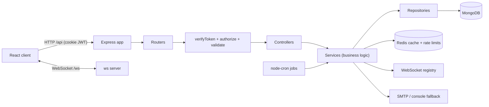

# SPIMS Backend Documentation

Technical documentation for the server-side implementation of **SPIMS — Smart Pharmacy Inventory Management System**.

This documentation describes what the code in `server/` actually does. It is based on a direct reading of the source, not on the repository's marketing README or the Swagger stubs. Where a feature is missing, partial, or could not be verified without a live environment, it is labelled accordingly.

## Purpose

SPIMS is a single-pharmacy inventory and point-of-sale backend. Its responsibilities are:

- Medicine catalog management (medicines, brands, categories, generic names, units).
- Supplier management.
- Batch-level inventory, expiry tracking, and FEFO (First Expire First Out) sales allocation.
- Purchase order lifecycle from creation to goods receipt.
- Sales invoicing with 13% VAT and stock deduction.
- Sales returns with an approval lifecycle, stock restoration/write-off, and VAT-inclusive refunds.
- Stock movement audit trail.
- Dashboard analytics and smart reorder recommendations.
- In-app, email, and SMS (generic HTTP webhook) notifications.
- JWT cookie authentication and role checks.

## Technology stack

| Layer | Technology | Notes |
|---|---|---|
| Runtime | Node.js 22 (CI matrix) | ESM (`"type": "module"`) |
| HTTP | Express 5 | `express.json()`, `cookie-parser`, `cors` |
| Language | TypeScript | NodeNext, strict, `.ts` import specifiers |
| Database | MongoDB + Mongoose 9 | 26 models, ordered migrations + ledger |
| Validation | Zod 4 | Body middleware + `parseOrThrow` for params/query |
| Auth | `jsonwebtoken`, `bcrypt` | 15m access JWT + rotating 7d refresh sessions, httpOnly cookies |
| Cache | `ioredis` | Cache and auth rate limiting; `@upstash/redis` is installed but unused |
| Jobs | `node-cron` | In-process; daily 01:00/02:00 plus notification retry every minute |
| Realtime | `ws` | `/ws`, cookie-authenticated, server push only |
| Email | `nodemailer` | Lazy SMTP transport; console fallback when unconfigured |
| SMS | `fetch` | Generic HTTP webhook; 5s timeout, bearer key optional |
| Security | `helmet`, CSRF, Redis lockout | Origin allow-list, audit log, token-version revocation |
| API docs | `swagger-ui-express` | Typed OpenAPI 3.0 at `/api-docs` |
| Tests | Vitest | 80 unit test files, 544 tests + 15 integration cases (10 HTTP + 5 migration/seeder) |
| Build | `tsc` | Output in `dist/` |

## Architecture at a glance

The backend uses a **modular layered architecture** with manual dependency injection. `src/app/container.ts` constructs every repository, service, and controller once, and routers import controllers from that container.

## Documentation map

| Document | What it covers |
|---|---|
| [architecture/system-overview.md](architecture/system-overview.md) | Runtime topology, layers, startup, design decisions |
| [architecture/project-structure.md](architecture/project-structure.md) | Actual folder layout and module anatomy |
| [architecture/data-flow.md](architecture/data-flow.md) | Request lifecycle and cross-module flows |
| [database/database-overview.md](database/database-overview.md) | MongoDB usage, indexes, constraints, lifecycle |
| [database/schema-and-relationships.md](database/schema-and-relationships.md) | Every model, field, and relationship |
| [database/inventory-data-model.md](database/inventory-data-model.md) | Inventory, batch, movement, and adjustment data |
| [api/api-overview.md](api/api-overview.md) | Base URL, conventions, auth, response envelopes |
| [api/authentication.md](api/authentication.md) | Login, register, logout, cookie and JWT behavior |
| [api/endpoints.md](api/endpoints.md) | Complete endpoint reference |
| [api/error-handling.md](api/error-handling.md) | `AppError`, validation failures, status codes |
| [modules/authentication.md](modules/authentication.md) | Auth module internals |
| [modules/users-and-roles.md](modules/users-and-roles.md) | User management and the actual role matrix |
| [modules/products.md](modules/products.md) | Medicine catalog and lookup data |
| [modules/suppliers.md](modules/suppliers.md) | Supplier module |
| [modules/inventory.md](modules/inventory.md) | Aggregate inventory operations |
| [modules/batches.md](modules/batches.md) | Batches, expiry, disposal, FEFO deduction |
| [modules/purchases.md](modules/purchases.md) | Purchase orders and receiving |
| [modules/sales.md](modules/sales.md) | Sales creation, pricing, deletion |
| [modules/returns.md](modules/returns.md) | Sales returns |
| [modules/notifications.md](modules/notifications.md) | Notification creation, dispatch, retries, preferences, inbox, pagination |
| [modules/smart-reorder.md](modules/smart-reorder.md) | Reorder algorithm and recommendation lifecycle |
| [modules/reporting.md](modules/reporting.md) | Dashboard and analytics endpoints |
| [business-logic/inventory-management.md](business-logic/inventory-management.md) | Stock rules, reconciliation, edge cases |
| [business-logic/stock-movements.md](business-logic/stock-movements.md) | Movement types and audit semantics |
| [business-logic/fefo-fifo.md](business-logic/fefo-fifo.md) | Batch selection algorithm |
| [business-logic/vat-and-pricing.md](business-logic/vat-and-pricing.md) | VAT, discounts, rounding, refunds |
| [business-logic/business-workflows.md](business-logic/business-workflows.md) | End-to-end workflows |
| [infrastructure/redis-and-caching.md](infrastructure/redis-and-caching.md) | Redis config, keys, TTLs |
| [infrastructure/background-jobs.md](infrastructure/background-jobs.md) | Cron schedules and job tracking |
| [infrastructure/realtime-communication.md](infrastructure/realtime-communication.md) | WebSocket handshake and push |
| [infrastructure/external-integrations.md](infrastructure/external-integrations.md) | SMTP, Upstash, third-party status |
| [infrastructure/logging-and-monitoring.md](infrastructure/logging-and-monitoring.md) | Logging and health signals |
| [development/setup-and-installation.md](development/setup-and-installation.md) | Local setup and run commands |
| [development/environment-variables.md](development/environment-variables.md) | Every environment variable used |
| [development/development-workflow.md](development/development-workflow.md) | Scripts, build, CI, conventions |
| [development/migrations-and-seeding.md](development/migrations-and-seeding.md) | Ordered migrations, ledger, and baseline seeding |
| [development/testing.md](development/testing.md) | Test setup and coverage |
| [project-status.md](project-status.md) | Implemented / partial / missing matrix |

## Implementation status summary

| Area | Status |
|---|---|
| Authentication (login, JWT cookie, logout, current user) | Implemented — lockout, immediate access-token revocation, admin reset, audit |
| Role-based authorization | Partially Implemented — user writes are owner-only; other modules remain broadly shared |
| User administration | Implemented — owner-only writes, admin reset, force logout, audit trail |
| Medicine catalog | Implemented |
| Supplier management | Implemented |
| Batch inventory and FEFO | Implemented — FEFO, transactional writes, movement history |
| Aggregate inventory | Implemented — single write path, reconciliation guards, version CAS |
| Purchase orders and receiving | Implemented — VAT/discount totals, guarded delete, partial and multi-batch receiving, invoice upload/download, supplier performance |
| Sales and VAT | Implemented — VAT snapshot/config, customers, payment ledger, invoice payload |
| Sales returns | Implemented — approval workflow, VAT refunds, restocking fees, refund ledger, reversal |
| Purchase returns | Implemented — lifecycle, batch stock deduction, supplier credit |
| Stock adjustments | Implemented — batch adjustments/disposal, inventory movements/reconciliation, stocktake lifecycle |
| Smart reorder | Implemented — WADS/SS/ROP/ROQ, approval/rejection audit, optional draft PO behind `SMART_REORDER_AUTO_PO=true`, status filtering |
| Dashboard analytics | Implemented |
| Notifications | Implemented — InApp/email/SMS, retries, preferences, read state, pagination, admin filters, templates wired into creation |
| Redis caching | Implemented — dashboard/reorder cache with invalidation |
| Background jobs | Implemented — distributed locks |
| WebSocket push | Implemented — origin-checked upgrade |
| Swagger/OpenAPI | Implemented — typed OpenAPI 3.0 spec at `/api-docs/openapi.json`, Swagger UI at `/api-docs`; production requires `ENABLE_API_DOCS=true` and an owner session |
| Pagination | Implemented — cursor pagination on the main lists |
| Security headers / audit | Implemented — Helmet, CSRF, lockout, audit log; MFA and OAuth deferred |
| Automated tests | 80 unit files / 544 tests + 15 integration cases (10 HTTP + 5 migration/seeder); 30 client files / 122 tests |

## Conventions used in this documentation

- **Status labels:** `Implemented`, `Partially Implemented`, `Not Implemented`, `Unverified`.
- **Limitation-table labels:** `Already fixed` (previously documented defect now corrected, with regression coverage), `Still open` (defect or gap remains; the Phase column points to the planned phase), `Needs decision` (choice not yet made), `Accepted limitation` (deliberate behaviour; no change planned), `Implemented` (capability exists and no defect is known).
- **Source references** use paths relative to the repository root, for example `server/src/modules/sales/services/sales.service.ts`.
- All API paths are relative to the `/api` mount point.
- Unless stated otherwise, every non-auth endpoint requires a valid `token` cookie and accepts the roles `owner`, `inventory_manager`, and `pharmacist`.
- Response shapes are quoted from controllers. The API does **not** use one consistent envelope; this is documented per endpoint.
- No secrets are reproduced. Environment variables are documented by name and purpose only.

## Important caveat

Several behaviors are still incomplete or deliberately deferred. Historical financial rows are not fully backfilled. Live SMTP/SMS/Upstash behavior remains unverified. MFA/OAuth/geo-IP, partial receiving, invoice upload, seasonality, multi-branch, and most client UI remain deferred; Docker/NGINX deployment is declined. Payments, customers, purchase returns, migrations/seeders, and Swagger/OpenAPI are implemented. These are documented as **current behavior**, with the corresponding risk called out in the module and business-logic documents.
