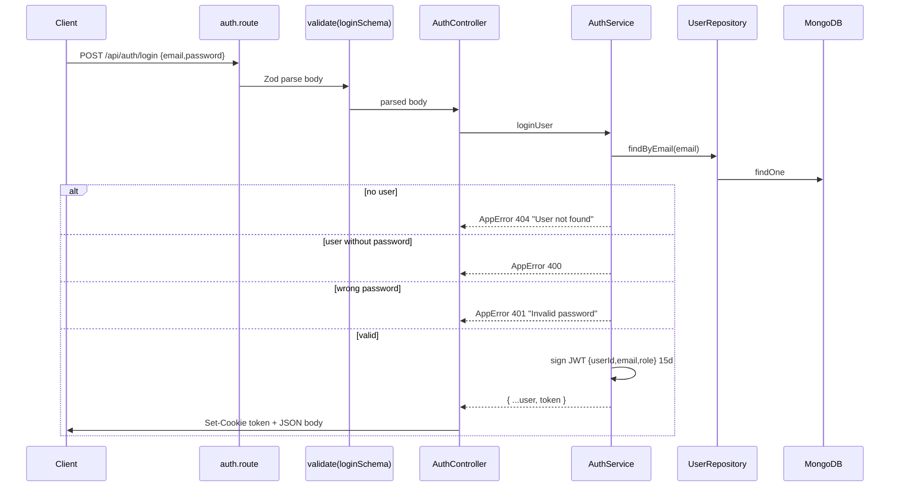

# Authentication API

## 1. Summary

| Endpoint | Method | Auth | Handler |
|---|---|---|---|
| `/api/auth/register` | POST | Public | `AuthController.registerUser` |
| `/api/auth/login` | POST | Public | `AuthController.loginUser` |
| `/api/auth/logout` | POST | Cookie JWT | `AuthController.logoutUser` |
| `/api/auth/me` | GET | Cookie JWT | `AuthController.getCurrentUser` |

Source: `server/src/modules/auth/routes/auth.route.ts`

## 2. Login flow



## 3. `POST /api/auth/register`

### Request

```json
{
  "name": "Asha Sharma",
  "email": "asha@example.com",
  "password": "example-password-123",
  "role": "pharmacist"
}
```

### Validation (`registerSchema`)

| Field | Rules |
|---|---|
| `name` | string, 2–100 chars |
| `email` | valid email |
| `password` | min 6 chars |
| `role` | optional string, defaults to `pharmacist` |

The schema accepts **any string** for `role`; final validation is the Mongoose enum (`owner`, `pharmacist`, `inventory_manager`).

### Behavior

1. Reject with `409` if the email already exists.
2. Hash the password with bcrypt, cost factor 10.
3. Create the user with `provider: "local"` (schema default) and `isActive: true`.
4. Return `201` with the raw user document.

### Response (`201`)

```json
{
  "_id": "665f...",
  "name": "Asha Sharma",
  "email": "asha@example.com",
  "password": "$2b$10$...",
  "provider": "local",
  "role": "pharmacist",
  "isActive": true,
  "lastLogin": null,
  "refreshToken": null,
  "createdAt": "2026-01-01T00:00:00.000Z",
  "updatedAt": "2026-01-01T00:00:00.000Z",
  "__v": 0
}
```

> **Security finding:** the response includes the bcrypt hash. The controller returns the Mongoose document without projection or sanitization. A client registering or logging in receives the hash in the response body.

### Errors

| Status | Condition |
|---|---|
| 400 | Zod validation failure (`errors` object) |
| 409 | Email already registered |
| 500 | Mongoose validation failure (invalid role) |

### Security findings

- The endpoint is public and accepts `role`, so anyone can self-register as `owner`.
- No email verification, invite token, or rate limit.

## 4. `POST /api/auth/login`

### Request

```json
{ "email": "asha@example.com", "password": "example-password-123" }
```

### Validation (`loginSchema`)

| Field | Rules |
|---|---|
| `email` | valid email |
| `password` | min 6 chars |

### Behavior

1. `findByEmail` (lean document).
2. `404` if no user.
3. `400` if the user has no password (for example a Google-provider account).
4. bcrypt compare; `401` with `"Invalid password"` on mismatch.
5. Sign JWT with `{ userId, email, role }`, `expiresIn: "15d"`.
6. Set cookie and return `{ ...user, token }`.

### Response (`200`)

```json
{
  "_id": "665f...",
  "name": "Asha Sharma",
  "email": "asha@example.com",
  "password": "$2b$10$...",
  "role": "pharmacist",
  "isActive": true,
  "token": "<signed JWT>"
}
```

### Cookie attributes

| Attribute | Development | Production (`NODE_ENV=production`) |
|---|---|---|
| `httpOnly` | true | true |
| `secure` | false | true |
| `sameSite` | `strict` | `none` |
| `maxAge` | not set (session cookie) | not set |
| `path` | default `/` | default `/` |

`sameSite: "none"` in production requires HTTPS. There is no CSRF token; the cookie is sent automatically on cross-site requests from allowed origins.

### Errors

| Status | Condition |
|---|---|
| 400 | Validation failure or user has no password |
| 401 | Wrong password |
| 404 | User not found |
| 500 | Unhandled error |

### Security findings

- `isActive` is **not checked**; deactivated users can still log in and use the API.
- `lastLogin` is **not updated**.
- Distinct `404` / `401` messages allow user enumeration.
- The full user, including the password hash, is returned.
- No rate limiting or lockout.

## 5. `POST /api/auth/logout`

- Requires a valid cookie (router-level `verifyToken`).
- Calls `AuthService.logoutUser`, which only verifies that the user exists.
- Clears the `token` cookie with matching attributes.
- Returns `200` `{ "message": "User logged out successfully" }`.

There is no server-side token denylist. The JWT remains valid until expiry if it was captured.

## 6. `GET /api/auth/me`

- Requires a valid cookie.
- Loads the user from the JWT `userId`.
- Returns the raw user document on `200`, again including the password hash.

## 7. Token contract

| Claim | Value |
|---|---|
| `userId` | string ObjectId |
| `email` | user email |
| `role` | `owner` \| `pharmacist` \| `inventory_manager` |
| `iat`, `exp` | standard; 15-day lifetime |
| Algorithm | HS256 (`jsonwebtoken` default) |

`verifyJwt` wraps `jwt.verify(token, JWT_SECRET)` and throws a generic `Unauthorized: Invalid token` on any failure. `verifyToken` converts that to HTTP 401.

## 8. Refresh tokens

`AuthService.refreshToken` exists but:

- Is not exposed by any route.
- Returns the literal string `"newAccessToken"`.
- The `User.refreshToken` field is never written.

Status: **Not Implemented**.

## 9. Google provider

The `User` model supports `provider: "google"`, but there is no OAuth route, strategy, or token exchange. Any non-local account cannot log in because it has no password.

## 10. Client requirements

- Send `credentials: "include"` (or the Axios equivalent) so the cookie is stored and sent.
- The allowed origin must appear in `ALLOWED_ORIGINS`.
- On `401`, redirect to login; there is no refresh flow.

## Related documents

- [API overview](api-overview.md)
- [Error handling](error-handling.md)
- [Authentication module](../modules/authentication.md)
- [Users and roles](../modules/users-and-roles.md)
