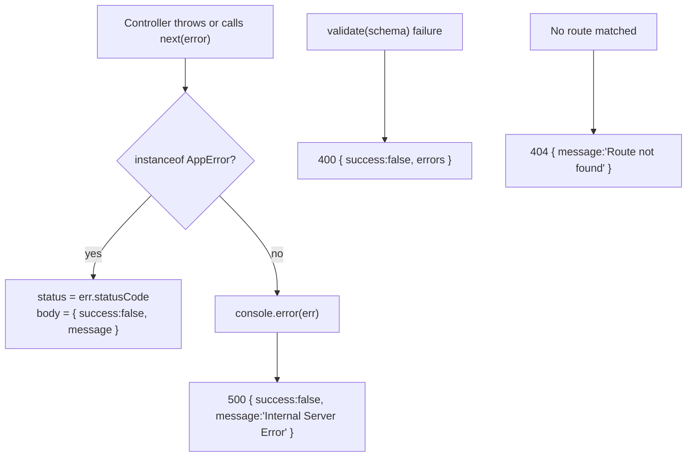

# Error Handling

## 1. Error pipeline



- `AppError` is the only typed application error.
- The global handler is registered last in `server.ts`.
- A non-`AppError` is logged to the console and hidden behind a generic 500.
- Validation middleware responds directly, bypassing the global handler.

Sources: `server/src/shared/error.ts`, `server/src/shared/middleware/globalError.middleware.ts`, `server/src/shared/middleware/validate.middleware.ts`

## 2. `AppError`

```ts
class AppError extends Error {
  statusCode: number;
  isOperational: boolean; // always true
}
```

Static factories:

| Factory | Status | Default message |
|---|---|---|
| `badRequest` | 400 | Bad Request |
| `unauthorized` | 401 | Unauthorized |
| `forbidden` | 403 | Forbidden |
| `notFound` | 404 | Resource not found |
| `methodNotAllowed` | 405 | Method not allowed |
| `conflict` | 409 | Conflict |
| `gone` | 410 | Resource no longer available |
| `unsupportedMediaType` | 415 | Unsupported Media Type |
| `unprocessableEntity` | 422 | Validation failed |
| `tooManyRequests` | 429 | Too many requests |
| `internal` | 500 | Internal Server Error |
| `notImplemented` | 501 | Not Implemented |
| `badGateway` | 502 | Bad Gateway |
| `serviceUnavailable` | 503 | Service Unavailable |
| `gatewayTimeout` | 504 | Gateway Timeout |

Only 400, 401, 404, and 409 are used in practice. 403 comes from `authorize`, not `AppError`.

## 3. Zod validation errors

`validate(schema)`:

1. Calls `schema.parse(req.body)`.
2. On success, replaces `req.body` with the parsed value.
3. On failure, returns:

```json
{
  "success": false,
  "errors": {
    "email": ["Invalid email address"],
    "password": ["Password must be at least 6 characters long"]
  }
}
```

HTTP status is `400`.

Zod v4 error handling is accessed through `error.flatten?.().fieldErrors` with a fallback to `error.errors`. This only covers body validation.

## 4. Common errors by status

### 400 — Bad Request

| Situation | Example source |
|---|---|
| Zod body validation | any validated route |
| Invalid discount | `SalesService.createSale` |
| Cart empty | `SalesService.createSale` |
| Return list empty | `ReturnService.createReturn` |
| Return date before sale date | `ReturnService.createReturn` |
| Return quantity exceeds remaining | `ReturnService.createReturn` |
| Insufficient stock | `InventoryService.decreaseStock` |
| Invalid movement type on manual increase/decrease | `InventoryController` |
| Invalid threshold/quantity/limit query | batch/dashboard controllers |
| Medicine not below reorder point | smart reorder (thrown as 400) |
| No purchase history for reorder | smart reorder (thrown as 400) |
| PO not in required status | `PurchaseOrderService` |
| Batch data mismatch on receipt | `PurchaseOrderService` |

### 401 — Unauthorized

| Situation | Body |
|---|---|
| Missing/invalid/expired token | `{ "message": "Unauthorized: Invalid token" }` |
| `req.user` missing in an action | `{ success: false, message: "Authenticated user required" }` |

The middleware response does **not** include `success: false`; controllers that throw `AppError.unauthorized` do.

### 403 — Forbidden

`{ "message": "Access denied" }` from `authorize` when the role is not in the list.

### 404 — Not Found

| Situation | Body |
|---|---|
| Unknown route | `{ "message": "Route not found" }` |
| Missing entity via `AppError.notFound` | `{ success: false, message: "..." }` |

### 409 — Conflict

Duplicates (email, barcode, brand name, supplier email/phone) and stock conflicts (`Stock changed while processing sale`).

### 500 — Internal Server Error

Any uncaught exception, including:

- Mongoose `CastError` for malformed ObjectIds.
- Mongoose `ValidationError` (enum mismatch, failed validator).
- Missing required fields on unvalidated endpoints.
- MongoDB transaction errors (for example, standalone server without replica set).
- Repository bugs (for example `getTotalStock` misuse does not throw, but undefined lookups can).

The client receives only `Internal Server Error`; details are in the server console.

## 5. Mongoose-specific failure modes

| Cause | Result |
|---|---|
| Invalid ObjectId in path/body | `CastError` → 500 |
| Enum value outside schema | `ValidationError` → 500 (on `save()`) |
| Required field missing on an unvalidated route | `ValidationError` → 500 |
| Duplicate key | `MongoServerError` code 11000 → 500 unless the service pre-checks (most do) |
| `findByIdAndUpdate` with invalid fields | Unknown fields dropped; validators skipped |
| Transaction on standalone MongoDB | `MongoServerError` → 500 |

This is why several endpoints return 500 rather than 400 for bad input: no ObjectId or query validation is applied.

## 6. Error-handling patterns in controllers

| Pattern | Used by |
|---|---|
| `try { ... } catch (e) { next(e) }` | auth, users, medicines, catalog, suppliers, purchases, sales |
| Local `asyncHandler` wrapper | inventory, batches, returns, sale items, notifications, dashboard, smart reorders |
| Manual checks with direct `res.status(...)` | users (404s), notifications (400s), batch controller (400s) |
| No check | several list endpoints; failure becomes 500 |

Express 5 would forward rejected async handlers automatically, but the code does not rely on that because every async controller either catches or is wrapped.

## 7. Silent failures and swallowed errors

| Location | Behavior |
|---|---|
| `NotificationService.createNotification` | `dispatch()` is fire-and-forget; failures are logged and never returned to the caller |
| Notification per-recipient dispatch | Any error marks the recipient `Failed`; the error reason is not stored |
| `AuthService.registerUser` | Mongoose errors propagate |
| Cron jobs | Catch and `console.error`; the `BackgroundJob` record is marked failed via `runJob` |
| Return GOOD path | Expected to fail movement enum validation and abort the transaction (see below) |
| Dashboard repository `getExpiringSoonCount` | Queries a non-existent path, returns 0 silently |

## 8. Expected failure in the return flow

`ReturnService` passes `referenceType: "SALES_RETURN"` into `InventoryService.returnMedicine`. The GOOD branch forwards that value to `InventoryMovement`, whose schema enum only allows `PURCHASE_ORDER`, `SALE`, `RETURN`, `ADJUSTMENT`, `SYSTEM`. Isolated validation with the installed Mongoose version rejects `SALES_RETURN`, so the save throws and the return transaction aborts. Damaged/expired/opened returns use the valid literal `"RETURN"`.

Status: **Confirmed enum mismatch**; the HTTP 500 is the expected runtime outcome.

Source: `server/src/modules/sales/services/return.service.ts`, `server/src/modules/inventory/services/inventory.service.ts`, `server/src/modules/inventory/model/inventoryMovement.model.ts`

## 9. What is missing

- No error codes (only messages).
- No request IDs or correlation IDs.
- No centralized logging of request context.
- No distinction between operational and programmer errors in the response.
- No retry or idempotency semantics.
- No 429 rate limiting, despite the factory existing.
- No 405 responses; unmatched methods fall through to 404.

## Related documents

- [API overview](api-overview.md)
- [Authentication](authentication.md)
- [Logging and monitoring](../infrastructure/logging-and-monitoring.md)
