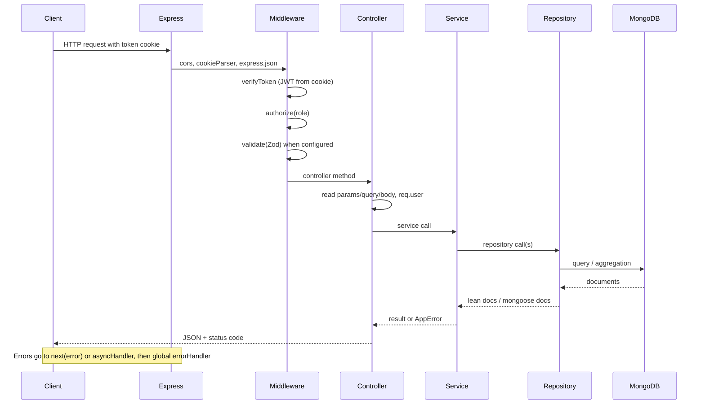
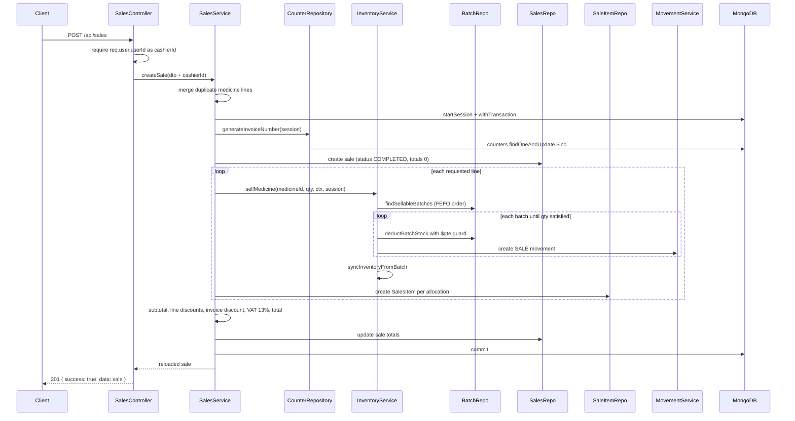
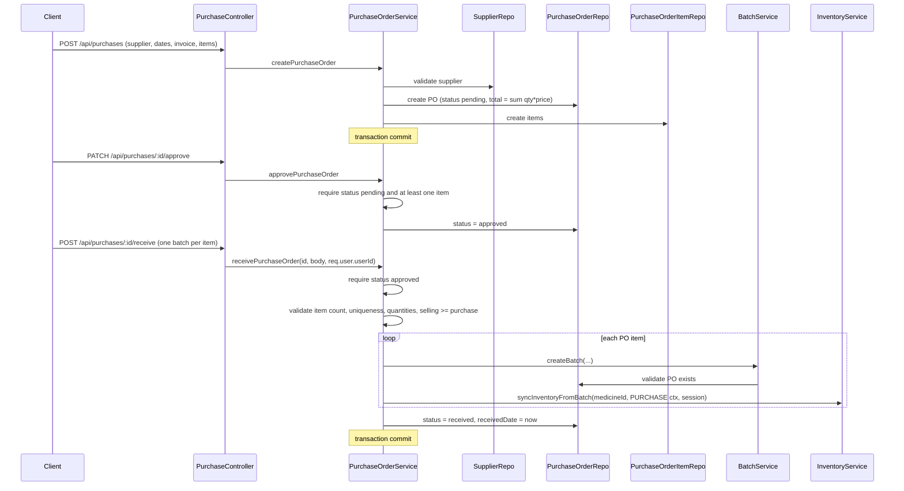
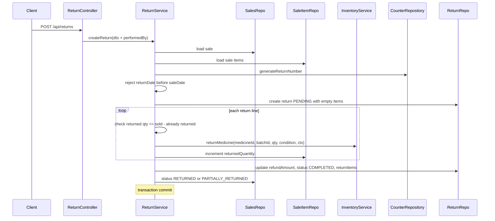
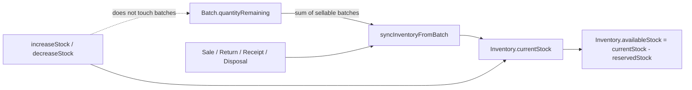
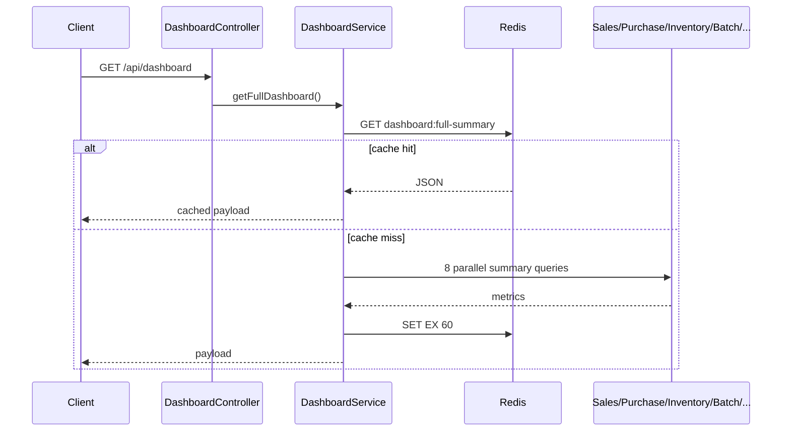
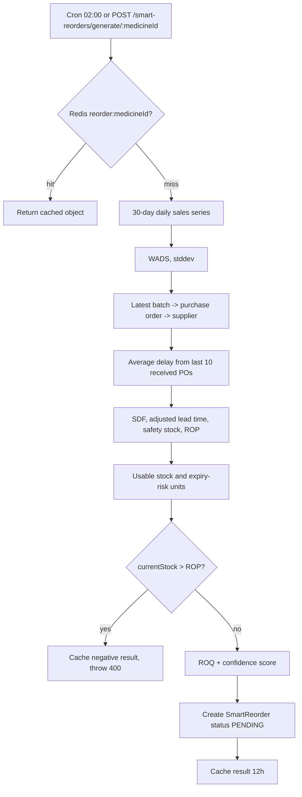
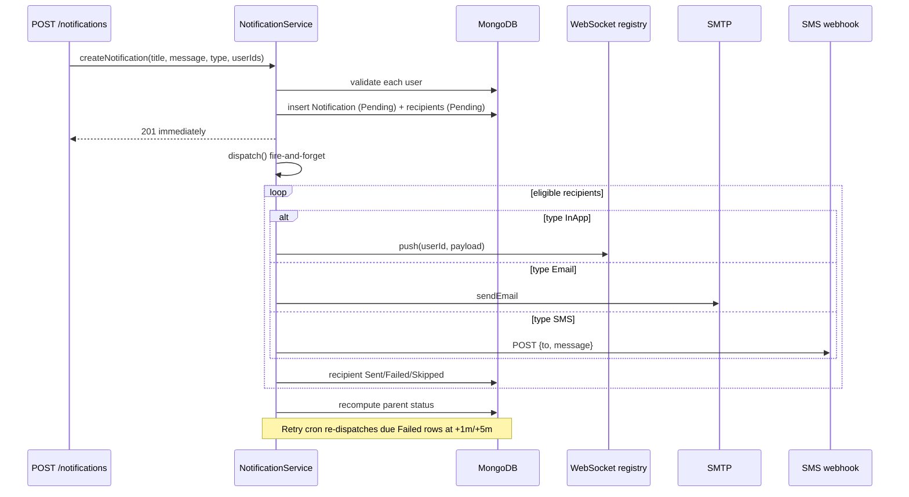

# Data Flow

This document traces data through the backend: HTTP requests, cross-module operations, caching, and realtime delivery.

## 1. HTTP request lifecycle

Characteristics:

- Authentication is cookie-based; there is no `Authorization: Bearer` handling even though the unused Swagger spec declares bearer auth.
- Validation: the shared `validate` middleware applies to request bodies. Notification params/query are parsed in the controller with `parseOrThrow` because Express 5 exposes `req.query` as a read-only getter. Other modules validate params/query ad hoc or not at all.
- Responses use different envelopes per module (`{ success, data }`, raw document, `{ message, data }`).
- Express 5 can forward rejected promises, but most controllers use explicit `try/catch` + `next(error)` or a local `asyncHandler`.

## 2. Sale creation flow

The most complex write path. It is transactional and touches counters, sales, inventory, batches, sale items, and movements.

Important: the sale record is created first with zero totals; items and totals are filled inside the same transaction. `SaleItem.totalPrice` is VAT-exclusive.

Source: `server/src/modules/sales/services/sales.service.ts`, `server/src/modules/inventory/services/inventory.service.ts`

## 3. Purchase order and receiving flow

Receiving does not support partial receipt or quantity tolerance; it requires exact matches.

> **Current blocker:** the batch insert fails the `isActive` validator for positive quantities (confirmed with the installed Mongoose version), so the transaction aborts and the PO remains `approved`. The flow above describes the intended implementation; it cannot complete until the validator is fixed.

Source: `server/src/modules/purchase/services/purchaseOrder.service.ts`

## 4. Return flow

The condition affects stock differently depending on value, and the outcome is inconsistent with the labels. See [Returns](../modules/returns.md).

Source: `server/src/modules/sales/services/return.service.ts`

## 5. Inventory synchronization flow

There are two paths:

1. **Batch-first flows** (sale, receipt, GOOD return, disposal) update batches and then reconcile `Inventory`.
2. **Aggregate-first flows** (`increaseStock`, `decreaseStock`, `reserveStock`, `releaseReservedStock`) update `Inventory` directly and may log a movement without touching a batch.

This split is the root of several drift bugs documented in [Inventory management](../business-logic/inventory-management.md).

## 6. Dashboard read flow

`GET /dashboard/summary`, `/reorder`, `/expiry`, etc. bypass the full-dashboard cache and compute directly. Only the combined endpoint is cached.

Source: `server/src/modules/dashboard/service/dashboard.service.ts`

## 7. Smart reorder flow

Source: `server/src/modules/smartReorder/services/smartReorder.service.ts`

## 8. Notification flow

Delivery is asynchronous relative to the HTTP response. In-app delivery is
always recorded as `Sent` (the inbox is the durable record). Email and SMS
failures store an error and are retried at +1m/+5m when retryable.

## 9. WebSocket flow

1. Client opens `ws://host/ws` with the `token` cookie.
2. Server parses cookies manually during the HTTP upgrade.
3. Invalid/missing token: HTTP 401 and socket destroyed.
4. Valid token: `register(userId, socket)` stores the socket in a per-user set.
5. Notification dispatch calls `push(userId, { title, message })`.
6. `close` removes the socket.

There are no client-to-server messages and no heartbeat.

## 10. Data consistency boundaries

| Operation | Transaction? | Batch update | Aggregate update | Movement log |
|---|---|---|---|---|
| Sale create | Yes | Deduct per allocation | Recalculated | SALE per batch |
| Sale delete | Yes | **No** | `increaseStock` per item | RETURN per item |
| Return GOOD | Yes | **No** | `increaseStock` | RETURN once |
| Return DAMAGED/EXPIRED/OPENED | Yes | Increase | Recalculated | Two RETURN logs |
| Purchase receive | Yes | Create batches | Recalculated per item | PURCHASE (on create or delta) |
| Confirm disposal | No | Set 0 | `decreaseStock` | `SALE` (hardcoded; requested `EXPIRED` lost) |
| Manual increase/decrease | No | No | Direct delta | `PURCHASE` on increase; `SALE` on decrease |
| Reserve/release | No | No | Available only | RESERVE/RELEASE |
| Batch adjust | No | Set value | Recalculated | None |

## Related documents

- [System overview](system-overview.md)
- [Stock movements](../business-logic/stock-movements.md)
- [Inventory management](../business-logic/inventory-management.md)
- [Business workflows](../business-logic/business-workflows.md)
- [Redis and caching](../infrastructure/redis-and-caching.md)
