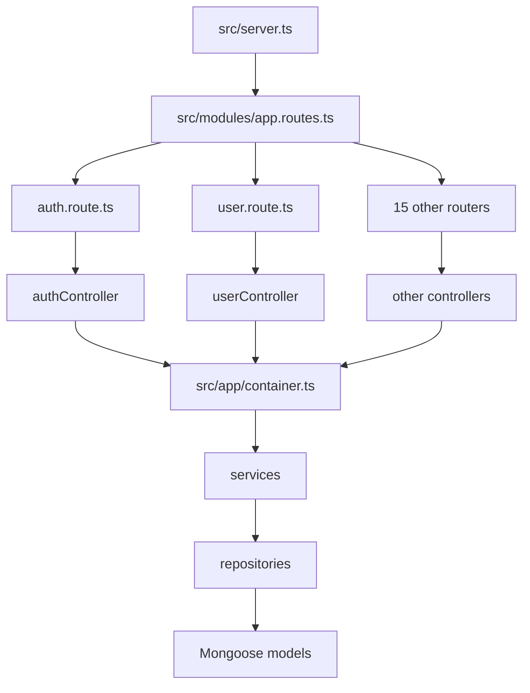

# Project Structure

This document reflects the actual `server/` layout. It intentionally mentions filename inconsistencies because they affect navigation and searches.

## 1. Top level

```text
server/
├── .env                 # local secrets (not documented here, not committed)
├── .env.example         # partial template
├── .gitignore           # node_modules, .env
├── package.json
├── package-lock.json
├── tsconfig.json
├── node_modules/
└── src/
```

There is no `docs/` folder before this documentation set, no test fixtures, and no migration directory. Operational one-off scripts live in `src/scripts/` and are run with `tsx`.

## 2. `src/` tree

```text
src/
├── server.ts                       # entry point
├── app/
│   └── container.ts                # composition root (repos, services, controllers)
├── config/
│   ├── db.config.ts                # mongoose.connect
│   └── redis.config.ts             # ioredis client
├── docs/                           # incomplete Swagger sources, not mounted
│   ├── auth.swagger.ts
│   ├── dashboard.swagger.ts
│   ├── inventory.swagger.ts        # empty
│   ├── medicine.swagger.ts         # empty
│   ├── purchase.swagger.ts         # empty
│   ├── sales.swagger.ts            # empty
│   ├── supplier.swagger.ts         # empty
│   ├── index.ts                    # swagger-jsdoc spec builder
│   └── schemas/                    # empty files
├── modules/
│   ├── app.routes.ts               # mounts all module routers under /api
│   ├── auth/
│   ├── user/
│   ├── medicine/
│   ├── supplier/
│   ├── purchase/
│   ├── inventory/
│   ├── batch/
│   ├── sales/
│   ├── smartReorder/
│   ├── notification/
│   ├── dashboard/
│   ├── backgroundJobs/
│   └── worker/
├── scripts/
│   ├── dedupeInventories.ts        # one-off duplicate aggregate cleanup
│   ├── dedupeNotificationRecipients.ts
│   └── backfillNotificationRecipientTimestamps.ts
├── shared/
│   ├── error.ts                    # AppError + static factories
│   ├── middleware/
│   │   ├── authorize.ts
│   │   ├── verifyJwt.ts
│   │   ├── verifyToken.ts
│   │   ├── validate.middleware.ts
│   │   └── globalError.middleware.ts
│   ├── provider/
│   │   ├── redis.provider.ts
│   │   ├── websocker.provider.ts   # note spelling
│   │   ├── email.provider.ts
│   │   └── sms.provider.ts
│   └── utils/
│       ├── generateJwtToken.ts
│       └── parseOrThrow.ts          # Zod for params/query
└── types/
    └── global.ts                   # Express Request.user augmentation
```

## 3. Standard module anatomy

Most modules follow this shape:

```text
modules/<module>/
├── model/ or models/       # Mongoose schema + interface
├── repo/                   # persistence
├── service/ or services/   # business logic
├── controller/ or controllers/
├── routes/                 # Express router
├── schema/                 # Zod validation (where implemented)
└── types/                  # local DTO/type helpers (some modules)
```

Modules that deviate:

| Module | Deviation |
|---|---|
| `auth` | No model/repo of its own; reuses `user` repository. Has `controller`, `routes`, `schema`, `services`, and a test. |
| `user` | No Zod validation middleware wired to routes, despite `schema/user.schema.ts` existing. |
| `inventory` | Has `model/` (singular folder) with three schemas, `services/` with `InventoryService`, `StockMutationService`, and `InventoryMovementService`, plus `types/stockMovement.type.ts`. `StockAdjustmentService` is never wired. |
| `batch` | Model folder is `model/`; service folder is `service/`; controller is `controller/`. |
| `sales` | Contains four models (`Sales`, `SalesItem`, `Return`, `Counter`), three services, three controllers, and three routers. |
| `backgroundJobs` | No controller/routes. Contains model, repo, service, and three jobs. Filename typo: `backgroud.model.ts`. |
| `worker` | One unused cron file, `smartReorder.cron.ts`; never imported by `server.ts`. |
| `dashboard` | Read-only; no model, repo, or schema. Aggregates other modules. |
| `smartReorder` | Utility folder is misspelled `utils/smartReorder.Calculatro.ts`. |
| `medicine` | Main service file is misspelled `services/medicine.sercive.ts`. |
| `shared/provider` | `websocker.provider.ts` (misspelled). |

These spellings are repeated in imports, so renaming files would require import updates.

## 4. Models by collection

| Model | File | Collection (Mongoose default) |
|---|---|---|
| `User` | `modules/user/model/user.model.ts` | `users` |
| `Medicine` | `modules/medicine/models/medicine.model.ts` | `medicines` |
| `Brand` | `modules/medicine/models/brand.model.ts` | `brands` |
| `Category` | `modules/medicine/models/category.model.ts` | `categories` |
| `GenericName` | `modules/medicine/models/genericName.model.ts` | `genericnames` |
| `Unit` | `modules/medicine/models/unit.model.ts` | `units` |
| `Supplier` | `modules/supplier/model/supplier.model.ts` | `suppliers` |
| `Batch` | `modules/batch/model/medicineBatch.model.ts` | `batches` |
| `Inventory` | `modules/inventory/model/inventory.model.ts` | `inventories` |
| `InventoryMovement` | `modules/inventory/model/inventoryMovement.model.ts` | `inventorymovements` |
| `StockAdjustment` | `modules/inventory/model/stockAdjustment.model.ts` | `stockadjustments` |
| `PurchaseOrder` | `modules/purchase/model/purchaseOrder.model.ts` | `purchaseorders` |
| `PurchaseOrderItem` | `modules/purchase/model/purchaseOrderItem.model.ts` | `purchaseorderitems` |
| `Sales` | `modules/sales/model/sales.model.ts` | `sales` |
| `SalesItem` | `modules/sales/model/salesItem.model.ts` | `salesitems` |
| `Return` | `modules/sales/model/return.model.ts` | `returns` |
| `Counter` | `modules/sales/model/counter.model.ts` | `counters` |
| `Notification` | `modules/notification/model/notification.model.ts` | `notifications` |
| `NotificationRecipient` | `modules/notification/model/notificationRecipient.model.ts` | `notificationrecipients` |
| `SmartReorder` | `modules/smartReorder/model/smartReorder.model.ts` | `smartreorders` |
| `BackgroundJob` | `modules/backgroundJobs/model/backgroud.model.ts` | `backgroundjobs` |

Collection names matter for aggregation `$lookup.from` values. Existing pipelines already use the names above (`medicines`, `inventories`, `batches`, `sales`).

## 5. Routers and mount points

| Mount | Router file | Mount-level roles |
|---|---|---|
| `/api/auth` | `modules/auth/routes/auth.route.ts` | Public (individual routes use `verifyToken`) |
| `/api/users` | `modules/user/routes/user.route.ts` | `owner`, `pharmacist` |
| `/api/medicines` | `modules/medicine/routes/medicine.route.ts` | all three |
| `/api/units` | `modules/medicine/routes/unit.route.ts` | all three |
| `/api/categories` | `modules/medicine/routes/category.route.ts` | all three |
| `/api/brands` | `modules/medicine/routes/brand.route.ts` | all three |
| `/api/generic-names` | `modules/medicine/routes/genericName.route.ts` | all three |
| `/api/suppliers` | `modules/supplier/routes/supplier.route.ts` | all three |
| `/api/purchases` | `modules/purchase/routes/purchase.route.ts` | all three |
| `/api/inventory` | `modules/inventory/routes/inventory.routes.ts` | all three |
| `/api/sales` | `modules/sales/routes/sales.routes.ts` | all three |
| `/api/sale-items` | `modules/sales/routes/saleItem.routes.ts` | all three |
| `/api/returns` | `modules/sales/routes/return.routes.ts` | all three |
| `/api/batches` | `modules/batch/routes/batch.routes.ts` | all three |
| `/api/smart-reorders` | `modules/smartReorder/routes/smartReorder.routes.ts` | all three; narrower on generate/delete |
| `/api/notifications` | `modules/notification/routes/notification.routes.ts` | all three |
| `/api/dashboard` | `modules/dashboard/routes/dashboard.routes.ts` | all three |

All mounts except auth are wrapped with `verifyToken` + `authorize` in `modules/app.routes.ts`.

## 6. Entry point composition



`OtherR` represents the 15 remaining mounted routers. Routers import controllers directly from `container.ts`; controllers do not receive dependencies from the request context.

## 7. Shared code

| File | Purpose |
|---|---|
| `shared/error.ts` | `AppError` with factories for 400/401/403/404/405/409/410/415/422/429/500/501/502/503/504 |
| `shared/middleware/verifyJwt.ts` | `jwt.verify` wrapper, throws generic error |
| `shared/middleware/verifyToken.ts` | Reads cookie, assigns `req.user`, returns 401 on failure |
| `shared/middleware/authorize.ts` | Role allow-list check, returns 403 |
| `shared/middleware/validate.middleware.ts` | Zod body parse, returns 400 with `errors` |
| `shared/middleware/globalError.middleware.ts` | Central error response |
| `shared/provider/redis.provider.ts` | `getCache`, `setCache`, `deleteCache` |
| `shared/provider/websocker.provider.ts` | Per-user socket registry and `push` |
| `shared/provider/email.provider.ts` | Lazy Nodemailer transport + `sendEmail` |
| `shared/utils/generateJwtToken.ts` | Legacy 15-day JWT helper; auth now uses `modules/auth/utils/authTokens.ts` |
| `shared/utils/requestContext.ts` | Extracts IP, user agent, device, browser, OS, and proxy location |
| `shared/middleware/rateLimit.middleware.ts` | Redis fixed-window rate limiter |
| `shared/middleware/verifyOrigin.middleware.ts` | Origin allow-list check for auth routes |
| `types/global.ts` | Adds `user?: JWTUserPayload` (including `sessionId`) to Express `Request` |

## 8. Documentation and CI files

| Path | State |
|---|---|
| `src/docs/index.ts` | Builds an OpenAPI spec with `swagger-jsdoc`; never imported by the server |
| `src/docs/*.swagger.ts` | Only `auth` and `dashboard` contain content; inventory/medicine/purchase/sales/supplier are empty; `schemas/` files are empty |
| `.github/workflows/main.yml` | Backend and client `npm ci` + `npm run build --if-present` on Node 22 |
| Root `README.md` | Marketing/overview document; several feature claims are ahead of the implementation |
| Root `SECURITY.md` | Policy document; some Docker/NGINX claims are still ahead of the repository |

## 9. Operational scripts

| Script | npm command | Purpose |
|---|---|---|
| `src/scripts/dedupeInventories.ts` | `npm run inventory:dedupe` | Merge duplicate `inventories.medicineId` rows and reconcile them from batch truth before the unique index deploys |
| `src/scripts/dedupeNotificationRecipients.ts` | `npm run notification:dedupe` | Merge duplicate notification recipient rows |
| `src/scripts/backfillNotificationRecipientTimestamps.ts` | `npm run notification:backfill` | Backfill legacy recipient timestamps |

`inventory:dedupe` accepts `--dry-run` and `--sync-indexes`.

## Related documents

- [System overview](system-overview.md)
- [Data flow](data-flow.md)
- [API overview](../api/api-overview.md)
- [Project status](../project-status.md)
