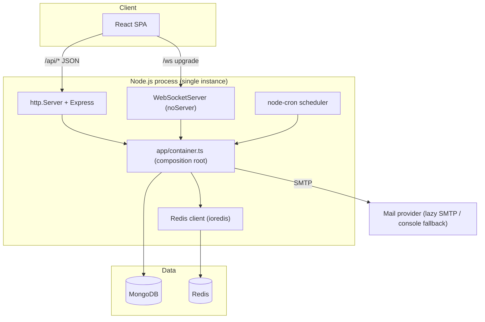
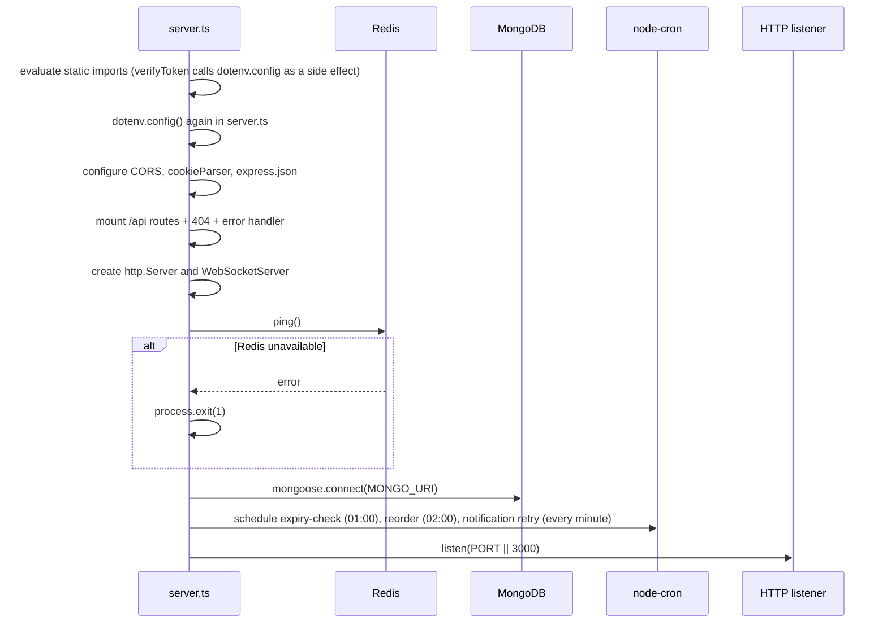
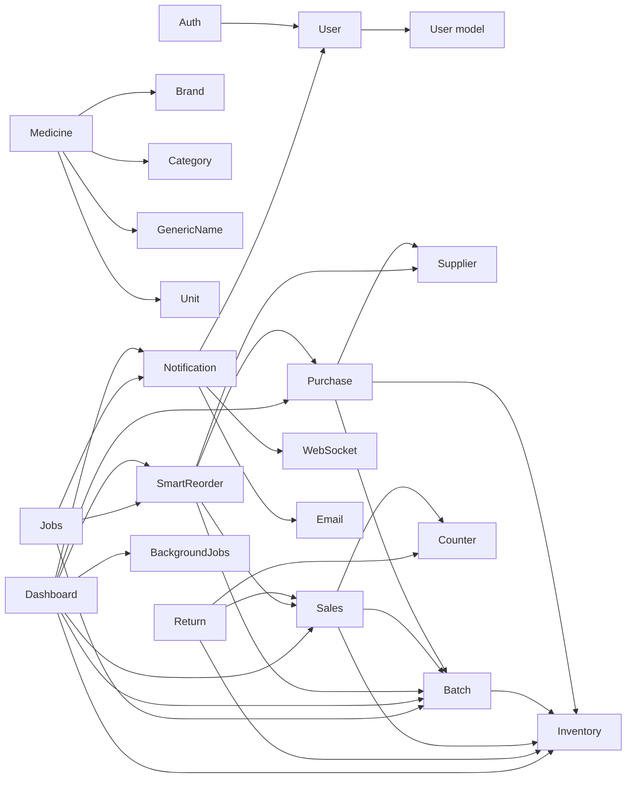

# System Overview

## 1. Scope

The backend is an Express 5 application that exposes a JSON API under `/api`, a health probe at `/health`, and a WebSocket endpoint at `/ws`. It persists data in MongoDB through Mongoose and uses Redis for caching. Two in-process cron jobs run daily and a third runs every minute for notification retries.

There is no separate worker process, message broker, API gateway, or container configuration in this repository. Everything starts from `server/src/server.ts`.

Source: `server/src/server.ts`

## 2. Runtime topology

## 3. Layer responsibilities

| Layer | Location | Responsibility |
|---|---|---|
| Entry point | `src/server.ts` | Load env, configure CORS/cookies/JSON, mount routes, create HTTP + WS servers, start cron, connect Redis and MongoDB |
| Composition root | `src/app/container.ts` | Instantiate models' repositories, services, controllers; inject `AppError` class |
| Routing | `src/modules/app.routes.ts`, `src/modules/*/routes/*` | Map HTTP verbs/paths to controller methods; apply auth/role middleware |
| Middleware | `src/shared/middleware/*` | `verifyToken`, `authorize`, Zod `validate`, global error handler |
| Controllers | `src/modules/*/controller(s)/*` | Parse `req`, invoke services, choose status codes and response envelopes |
| Services | `src/modules/*/service(s)/*` | Business rules, transactions, cross-module orchestration |
| Repositories | `src/modules/*/repo/*` | Mongoose queries, aggregations, optional session propagation |
| Models | `src/modules/*/model(s)/*` | Schema, defaults, enums, validators, indexes |
| Validation schemas | `src/modules/*/schema/*` | Zod request-body contracts |
| Providers | `src/shared/provider/*` | Redis cache helpers, WebSocket registry, email transport, SMS webhook |

### Deviations from a strict layering

- Several controllers contain business checks (for example sale item shape checks) rather than delegating fully to services.
- `BatchService` calls `InventoryService` directly, and `PurchaseOrderService` calls both `BatchService` and inventory services. Cross-module coupling is intentional and concentrated in services.
- Some modules do not validate request bodies at all (batches, inventory, returns, sale updates). See [API overview](../api/api-overview.md).
- `StockAdjustmentService` exists but is not constructed in the container and is not reachable from any route.

## 4. Startup sequence

Notable consequences:

- **Redis is a hard startup dependency**. It backs dashboard/reorder caching and auth rate limiting.
- Cron jobs are scheduled after MongoDB connects but before `listen`.
- The email transport is created lazily on the first email, so importing the notification or auth service performs no network call at startup. See [External integrations](../infrastructure/external-integrations.md).

Source: `server/src/server.ts`, `server/src/shared/provider/email.provider.ts`

## 5. HTTP server configuration

| Concern | Implementation |
|---|---|
| Body parsing | `express.json()` with default limits |
| Cookies | `cookie-parser` |
| CORS | Origin allow-list parsed from `ALLOWED_ORIGINS` JSON; `credentials: true`; non-matching origins receive no CORS approval |
| 404 | JSON `{ message: "Route not found" }` |
| Errors | Central `errorHandler`; `AppError` maps to its status, everything else 500 |
| Health | `GET /health` returns plain text `Server is healthy`; unauthenticated |
| Port | `process.env.PORT` or `3000` |

## 6. Authentication and authorization architecture

- Login issues a short-lived access JWT signed with `JWT_SECRET` (15 minutes by default) and a rotating refresh JWT signed with `JWT_REFRESH_SECRET` (7 days by default).
- Tokens are stored in httpOnly cookies named `token` and `refreshToken`.
- Refresh sessions are stored in the `AuthSession` collection with device, browser, OS, IP, location, and a SHA-256 refresh-token hash.
- `verifyToken` reads `req.cookies.token`, verifies it, and assigns `req.user = { userId, email, role, sessionId }`.
- `authorize(roles)` compares `req.user.role` against an allow-list.
- `app.routes.ts` applies `verifyToken` and `authorize` to whole router groups.
- Some routers repeat `verifyToken` internally; this is redundant but harmless.
- `smart-reorder` applies a second, narrower `authorize` on generation and deletion.

The effective role matrix is almost flat. See [Users and roles](../modules/users-and-roles.md).

## 7. Dependency relationships

Key couplings to be aware of:

- `BatchService` depends on `InventoryService` for reconciliation and disposal.
- `PurchaseOrderService` depends on `BatchService`, `InventoryService`, and `InventoryMovementService`.
- `SalesService` and `ReturnService` depend on `InventoryService` and `CounterRepository`.
- `DashboardService` depends on eleven other services/repositories, which makes it the most coupled service.

## 8. Important design decisions (as implemented)

1. **Manual dependency injection** rather than a DI framework. All wiring lives in one file. There are no interfaces for repositories; concrete classes are injected.
2. **Repository pattern** around Mongoose, but some cross-model work uses aggregation pipelines inside repositories (dashboard, inventory search, top-selling).
3. **Two-level stock model**: a per-medicine aggregate `Inventory` document plus per-batch `quantityRemaining`. Reconciliation is explicit via `syncInventoryFromBatch`, not automatic.
4. **Transaction usage is selective**: sales creation/deletion, returns, purchase creation/receipt, and notification creation use MongoDB sessions. Inventory increase/decrease and most CRUD endpoints do not.
5. **Historical numbering** uses a `Counter` collection (`INV-000001`, `RET-000001`, `PO-000001`, `ADJ-000001`). Only invoice and return numbers are used in practice.
6. **Soft state flags instead of soft deletes**: `isActive` on medicines and lookup data, `status` on suppliers. `DELETE` endpoints generally hard-delete.
7. **Cache-aside** for dashboard and reorder reads, with no invalidation hooks.
8. **Server push WebSocket** rather than rooms, topics, or client commands.

## 9. Deployment assumptions

- Single Node process; cron jobs run in that process. Running multiple instances would duplicate jobs.
- MongoDB must support transactions (replica set) for sales, returns, and purchasing flows.
- Redis must be reachable before startup completes.
- Docker, docker-compose, NGINX, and process-manager deployment are **declined** for this project; deploy the Node process and static client build directly.
- Swagger UI is served at `/api-docs` (open outside production; `ENABLE_API_DOCS=true` plus an owner session in production).
- CI (`.github/workflows/ci.yml`) runs lint, typecheck, unit/coverage tests, the HTTP integration suite, and the build for both packages; `security.yml` adds dependency audits, Gitleaks, and CodeQL.

## 10. What this architecture does not include

- No message queue, event bus, or outbox pattern.
- Cron jobs are persisted in `BackgroundJob` and guarded by Redis locks; there is no leader election.
- Structured JSON logging, request IDs, and `/ready` exist; metrics and distributed tracing do not.
- No API versioning.
- Cursor pagination and common filters exist across the main lists. Range analytics, CSV export, and per-cashier/category breakdowns are implemented; a general list-sorting convention remains open.
- No file storage; the purchase invoice "file" is a string field.
- No payment gateway or payment ledger.

## Related documents

- [Project structure](project-structure.md)
- [Data flow](data-flow.md)
- [Database overview](../database/database-overview.md)
- [API overview](../api/api-overview.md)
- [Project status](../project-status.md)
