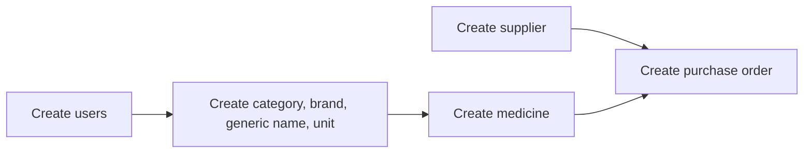
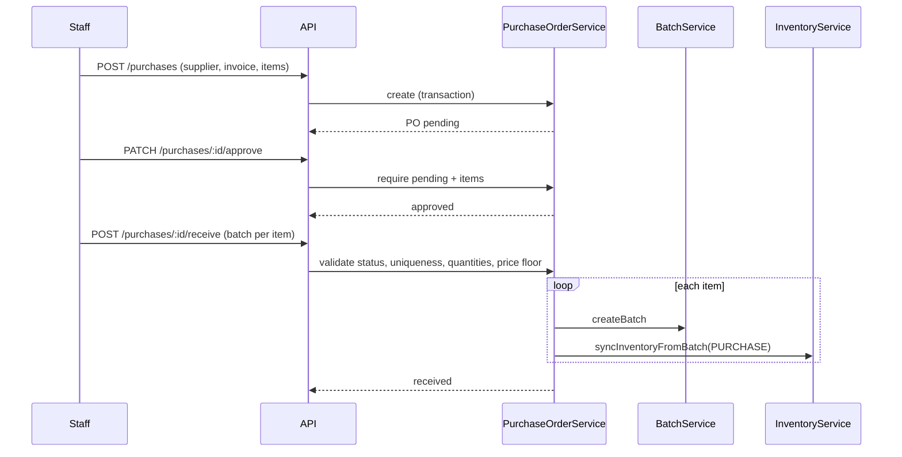
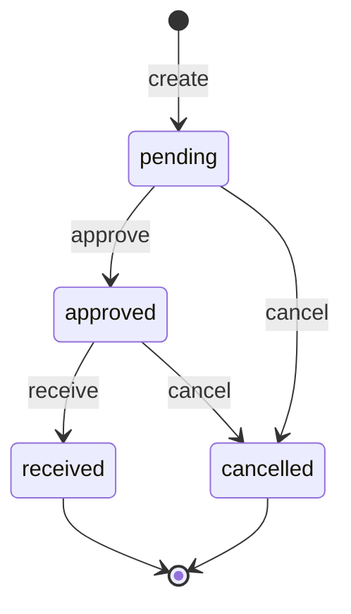
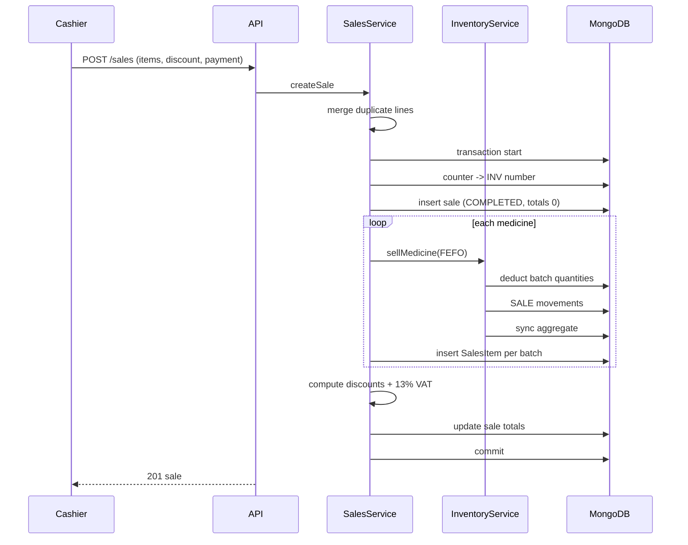
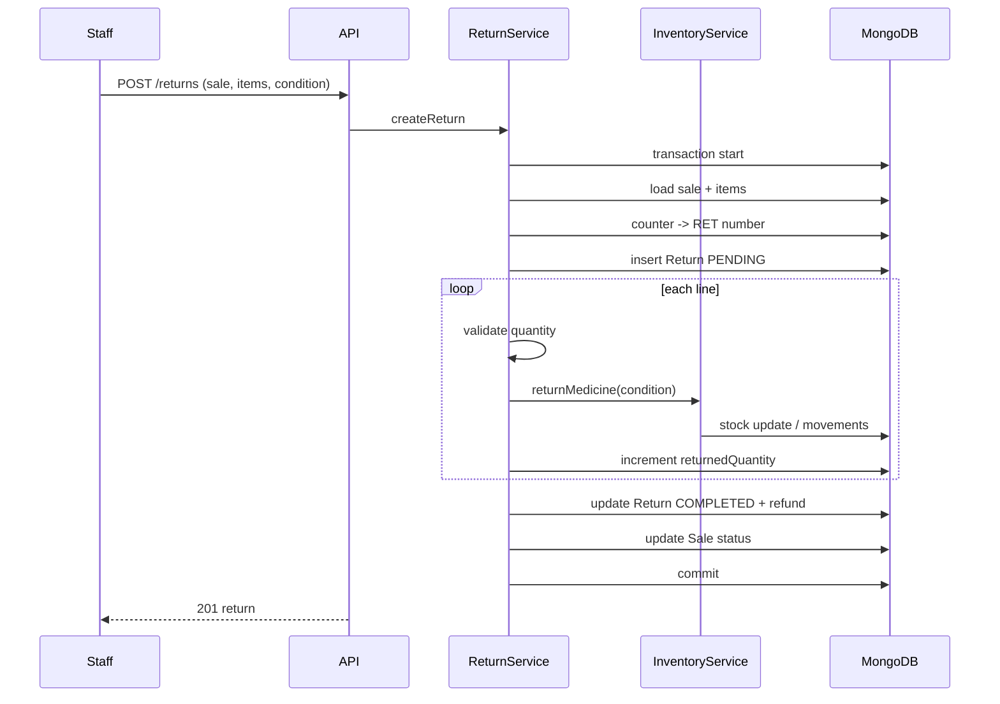
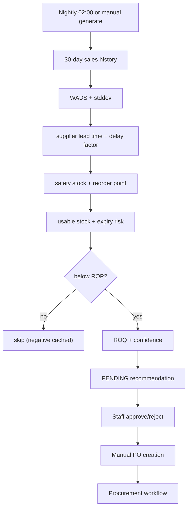
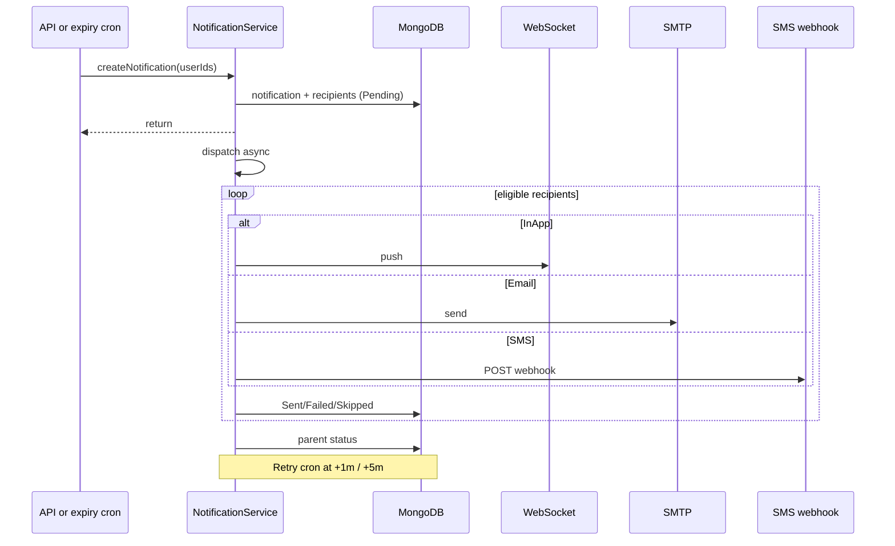

# Business Workflows

End-to-end flows as implemented, including transaction boundaries and failure points.

## 1. Master data setup



1. An owner/pharmacist creates users (`POST /users`).
2. Catalog lookups are created (`/categories`, `/brands`, `/generic-names`, `/units`).
3. A medicine is created with references to those lookups (`POST /medicines`).
4. A supplier is created (`POST /suppliers`).

Prerequisites for later flows:

- A medicine must exist before ordering or selling.
- A supplier must exist before creating a PO.
- A unit must exist for the medicine; the service does not validate `unitId`, so an invalid id can fail at the database layer.

## 2. Procurement: order → approve → receive



### State machine



Failure points:

- Invalid supplier → 404, nothing created.
- Receive validation failure → transaction abort; no batches, PO stays `approved`.
- Batch schema validation failure (e.g. expiry before manufacturing, or deactivating with stock) → transaction abort, PO stays `approved`.
- Duplicate batch number for the same medicine → 500, transaction abort.

Post-conditions on success:

- One batch per PO line.
- Batch `quantityReceived = quantityRemaining`.
- Aggregate inventory includes the new stock.
- `PURCHASE` movements recorded.
- PO `received` with `receivedDate`.

## 3. Sale



Pre-conditions:

- Authenticated user.
- Valid payment method and sale date.
- Sellable stock for every medicine.
- No expired/flagged batches selected.

Post-conditions:

- Batch quantities reduced.
- Aggregate stock synced.
- One sale, N sale items.
- `SALE` movements per batch.
- Invoice number reserved.

Failure points:

- Out of stock or insufficient total → 400 before any write.
- Concurrent batch depletion → 409, transaction aborts.
- Discount > subtotal → 400, transaction aborts.
- Counter failure → 500, nothing written.

## 4. Return



Behavior by condition:

| Condition | Behavior |
|---|---|
| GOOD | Restores the original batch and syncs the aggregate |
| DAMAGED | Writes off; no stock restored |
| EXPIRED | Writes off; no stock restored |
| OPENED | Writes off; no stock restored |

Each line writes exactly one `RETURN` movement. The remaining Phase 4 work is VAT refunds, persisted `returnItems.VAT`, and the approval/status flow. See [Returns](../modules/returns.md).

## 5. Expiry and disposal

```mermaid
sequenceDiagram
  participant Cron as 01:00 cron
  participant B as BatchService
  participant N as NotificationService
  participant Staff
  participant API

  Cron->>B: markExpiredBatches()
  B->>B: set isExpired for date < now and qty > 0
  Cron->>N: notify pharmacists (InApp)
  Staff->>API: GET /batches/expired/awaiting-disposal
  Staff->>API: POST /batches/:id/confirm-disposal
  API->>B: require isExpired + qty > 0
  B->>B: batch quantity = 0
  B->>B: sync aggregate from batches
  Note over B: movement is logged as EXPIRED; all writes are in one transaction
```

Timing:

- Expiry is evaluated nightly, not continuously.
- A batch can be past its date but not flagged until the next run.
- Sales exclude it anyway because of the date filter.
- Disposal requires the flag, so staff cannot dispose before the cron or manual `mark-expired` call.

## 6. Smart reorder cycle



The approval is advisory. No code converts an approved recommendation into a PO or reserves stock.

## 7. Notification cycle



## 8. Daily operational timeline

| Time | Event |
|---|---|
| 01:00 | Expiry check: flag batches, notify pharmacists |
| 02:00 | Reorder calculation for all medicines |
| On demand | Sales, receipts, returns, adjustments, notifications |
| Dashboard | Cached 60 s; everything else live |

Cron uses server-local time. There is no timezone configuration.

## 9. Failure and recovery matrix

| Failure | State left behind | Recovery |
|---|---|---|
| Sale transaction abort | No changes | Retry |
| Receipt validation failure | PO still approved, no batches | Fix payload, retry |
| Receipt DB failure | Transaction abort | Retry |
| Disposal aggregate failure | Batch zeroed, aggregate not reduced | Manual reconciliation |
| Return condition/VAT defects | Return saved with current (incorrect) semantics | Phase 4 remediation |
| SMTP failure | Recipient `Failed`, error stored | Automatic retry at +1m/+5m or forced dispatch |
| Permanent SMTP 5xx | Recipient `Failed`, error stored | No retry |
| SMS webhook failure | Recipient `Failed`, error stored | Automatic retry at +1m/+5m or forced dispatch |
| Notification opted out | Recipient `Skipped` | No retry; preference change required |
| Process dies after notification create before dispatch | Recipient remains `Pending` | Retry sweep picks up never-attempted rows on the next tick; abandoned claims after 15 minutes |
| WS user offline | Recipient marked `Sent` (push result ignored) | No retry; inbox is durable |
| Redis down at startup | Process exits | Restore Redis |
| Redis down at runtime | Cache calls throw; dashboard may 500 | Redis client reconnects |
| Cron crash | Job marked `FAILED` if `runJob` recorded it | Manual re-run/generate |
| Duplicate cron instances | Multiple runs/recommendations | Single-instance deployment |

## 10. Multi-step operations that are not atomic

| Operation | Why |
|---|---|
| Expiry disposal | Fixed: batch + aggregate + movement in one transaction |
| Batch adjust | Fixed: update + sync + movement in one transaction |
| Manual inventory increase/decrease | Fixed: batch + aggregate + movement in one transaction |
| Notification dispatch | Per-recipient updates, no transaction |
| Batch deduct/increase | Fixed: routed through `StockMutationService` with a movement |
| Sale item price correction | No parent-total recomputation |

## Related documents

- [Inventory management](inventory-management.md)
- [Stock movements](stock-movements.md)
- [VAT and pricing](vat-and-pricing.md)
- [Purchases](../modules/purchases.md)
- [Sales](../modules/sales.md)
- [Returns](../modules/returns.md)
- [Background jobs](../infrastructure/background-jobs.md)
