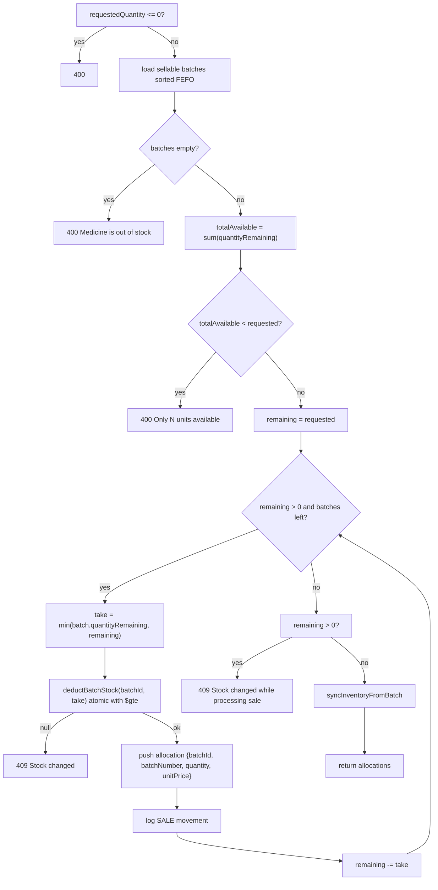

# FEFO and FIFO

## 1. Verdict

| Strategy | Status |
|---|---|
| FEFO (First Expire First Out) | **Implemented** for sales allocation |
| FIFO (First In First Out) | **Not Implemented** as a selection strategy |
| Manual batch selection at checkout | **Not Implemented** |

FEFO is implemented in the batch repository and used by the sales path. FIFO influences only tie-breaking, not primary order.

## 2. Where FEFO is enforced

| Location | Purpose |
|---|---|
| `MedicineBatchRepo.findSellableBatches` | Query and sort for sales |
| `InventoryService.sellMedicine` | Allocate across the sorted batches |
| `InventoryRepo.searchMedicines` | Return the earliest-expiring batch as `nextBatch` for the POS UI |
| `BatchService.allocateStock` | Applies similar filters but **no sort**; broken (see below) |

Source: `server/src/modules/batch/repo/medicineBatch.repo.ts`

## 3. Sellable-batch query

```ts
this.batchModel
  .find({
    medicineId,
    quantityRemaining: { $gt: 0 },
    expiryDate: { $gt: new Date() },
    isExpired: false,
  })
  .sort({
    expiryDate: 1,
    manufacturingDate: 1,
    createdAt: 1,
  })
```

Interpretation:

1. **Nearest expiry first** (`expiryDate` ascending).
2. If two batches expire on the same date, the **older manufacturing date** is taken first.
3. If both dates match, the **earlier-created batch** is taken first.

This is FEFO with FIFO-like tie-breakers. It is not FIFO, because a later-received batch with an earlier expiry will be sold first.

Filters exclude:

- zero or negative remaining quantity,
- already-expired dates,
- batches explicitly flagged `isExpired`.

Note: `getAvailableBatches` (the `/batches/medicine/:id/available` endpoint) uses the same quantity/date filters but **not** `isExpired: false`. This only matters if a batch was manually flagged while its date is still in the future.

## 4. Allocation algorithm

`InventoryService.sellMedicine(medicineId, requestedQuantity, movementCtx, session)`:



Properties:

- The allocation is **server-side**; a client cannot choose a batch even though `batchId` is required by the request schema.
- Unit price comes from each batch's `sellingPrice`, so a single medicine line can produce multiple sale items with different prices.
- One `SALE` movement is written per batch.
- The aggregate is synced once after allocation.
- `deductBatchStock` uses `{ _id, quantityRemaining: { $gte: quantity } }` with `$inc`, making each deduction atomic.
- The whole flow runs inside the sale transaction; a failure aborts all deductions.

## 5. Worked example

Batches for medicine M:

| Batch | Expiry | Manufacturing | Created | Remaining | Selling price |
|---|---|---|---|---|---|
| A | 2026-06-30 | 2025-01-10 | 2025-02-01 | 4 | 10 |
| B | 2026-06-30 | 2025-03-15 | 2025-04-01 | 5 | 12 |
| C | 2026-05-31 | 2025-05-01 | 2025-06-01 | 10 | 9 |
| D | 2025-12-31 | 2024-01-01 | 2024-02-01 | 8 | 9 |
| E | 2026-07-31 | 2025-01-01 | 2025-01-15 | 0 | 11 |

Sorted sellable order: **C, A, B**.

- D is excluded (expired).
- E is excluded (zero).
- C expires first despite being created last.

Request 12 units:

| Step | Batch | Take | Remaining after |
|---|---|---|---|
| 1 | C | 10 | 2 |
| 2 | A | 2 | 0 |

Result: two `SalesItem` rows (C: 10 × 9, A: 2 × 10), two `SALE` movements, aggregate synced.

## 6. Search/POS preview

`InventoryRepo.searchMedicines` returns medicines with `availableStock > 0` and a `nextBatch` sub-document:

```js
$sort: { expiryDate: 1 }
$limit: 1
```

It filters `quantityRemaining > 0` and `isExpired: false`, but **not** `expiryDate > now`. A POS search can therefore preview a batch whose date has passed but which has not been flagged. The actual sale would exclude it and allocate a different batch.

## 7. FIFO status

There is:

- no received-date ordering field on batches (only `createdAt`, used as a tie-breaker),
- no stock-layer/FIFO cost accounting,
- no configuration to switch strategy,
- no per-sale strategy selection.

`createdAt` is not a reliable receipt order when batches are backfilled or created manually.

## 8. Edge cases and consistency rules

| Edge case | Behavior |
|---|---|
| Requested quantity ≤ 0 | 400 before any query |
| No sellable batches | 400 `Medicine is out of stock` |
| Total sellable < requested | 400 with available count |
| Batch depleted concurrently | `deductBatchStock` returns null → 409, transaction aborts |
| Batch expires between read and update | Still deducted (update does not re-check date) |
| Batch flagged between read and update | Still deducted (update does not re-check flag) |
| Partial allocation then conflict | Transaction aborts, all deductions roll back |
| Duplicate medicine lines in cart | Merged before allocation; quantities summed, max discount kept |
| Same medicine twice in separate cart entries | Treated as one line |
| Client-provided `batchId` | Ignored |
| Negative price | Not possible via batch schema (`min: 0`) |

## 9. Expiry-risk interaction

Smart reorder computes `expiryRiskUnits` for batches expiring within `adjustedLeadTime + 30 days` and adds them to the recommended order quantity. That does **not** change FEFO; it only increases purchasing.

## 10. Comparison summary

| Criterion | FEFO | FIFO |
|---|---|---|
| Primary sort | expiry date | receipt time |
| Implemented | yes | no |
| Tie-breaker | manufacturing date, created date | — |
| Batch selection by client | no | no |
| Applies to sales | yes | — |
| Applies to returns | no (returns target the original batch) | — |
| Applies to purchasing | no (batches are created explicitly) | — |

## 11. What to verify

- `deductBatchStock` concurrency behavior under two simultaneous sales for the same medicine.
- Whether `isExpired` is ever set while `expiryDate` is in the future.
- Whether any client depends on the `nextBatch` preview matching the actual allocation (it may not when the earliest batch is already expired by date but not flagged).
- Whether `quantityRemaining` can exceed `quantityReceived` after `increaseQuantity` or `adjustStock` (validators are skipped on update).

## Related documents

- [Inventory management](inventory-management.md)
- [Batches](../modules/batches.md)
- [Sales](../modules/sales.md)
- [Inventory data model](../database/inventory-data-model.md)
