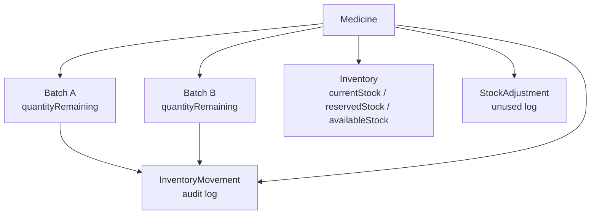

# Inventory Data Model

SPIMS stores stock in **two places**: a per-batch quantity and a per-medicine aggregate. Movement records provide an audit trail but are not used to derive stock. This document explains the model and its consistency rules as implemented.

## 1. The three inventory records



| Record | Granularity | Role | Source of truth? |
|---|---|---|---|
| `Batch` | One row per medicine + batch number | Physical stock, expiry, cost and selling price | **Yes** for batch-first flows |
| `Inventory` | One row per medicine (intended) | Fast aggregate availability for listings and reservations | Derived, but also directly mutated |
| `InventoryMovement` | Append-only event | Audit trail for sales, purchases, returns, adjustments, expiry | No — never replayed |
| `StockAdjustment` | Append-only event | Intended manual adjustment history | No — not wired |

## 2. Batch model

| Concept | Implementation |
|---|---|
| Quantity received | `quantityReceived` (immutable after creation in practice) |
| Quantity on hand | `quantityRemaining` |
| Expiry | `expiryDate` plus `isExpired` flag |
| Sellable | `quantityRemaining > 0 && expiryDate > now && isExpired === false` |
| Price | `purchasePrice`, `sellingPrice` per batch |
| Origin | `purchaseOrderId` |
| Identity | `{ medicineId, batchNumber }` unique |

Batch status virtual:

```text
quantityRemaining === 0  -> "sold-out"
isExpired === true       -> "expired"
isActive === true        -> "active"
otherwise                -> "inactive"
```

The order means a zero-quantity expired batch reports `sold-out`, not `expired`.

Source: `server/src/modules/batch/model/medicineBatch.model.ts`

## 3. Aggregate inventory model

```text
currentStock   = total units physically on hand (intended)
reservedStock  = units held for pending orders (intended)
availableStock = currentStock - reservedStock (intended)
```

Schema validator on save:

```text
0 <= availableStock <= currentStock - reservedStock
```

Actual behavior:

- `syncInventoryFromBatch` sets `currentStock = sum(sellable batches)` and `availableStock = currentStock - reservedStock`.
- `increaseStock` adds to both `currentStock` and `availableStock`.
- `decreaseStock` subtracts from both.
- `reserveStock` subtracts from `availableStock` only.
- `releaseReservedStock` adds to `availableStock` only.

Consequences:

- `reservedStock` is **never changed** by any endpoint, so reservation is really "temporarily reduce available stock".
- `increaseStock` / `decreaseStock` do not change batch quantities, so `currentStock` can diverge from the batch sum.
- A later `syncInventoryFromBatch` overwrites `currentStock` with the batch sum, discarding aggregate-only changes.

Source: `server/src/modules/inventory/services/inventory.service.ts`, `server/src/modules/inventory/model/inventory.model.ts`

## 4. Invariants the code tries to maintain

| Invariant | Enforced where | Reliable? |
|---|---|---|
| Cannot sell more than a batch holds | `deductBatchStock` filter `quantityRemaining >= qty` | Yes, atomic per batch |
| Cannot sell expired stock | `findSellableBatches` filters date and flag | Yes at query time |
| Sale allocation follows FEFO | `findSellableBatches` sort | Yes |
| `currentStock` equals sum of batches | `syncInventoryFromBatch` after sales/receipts | Only on batch-first flows |
| `availableStock = currentStock - reservedStock` | `syncInventoryFromBatch` | Yes on sync; not on direct updates |
| Movement always belongs to the right medicine | `InventoryMovementService` checks batch.medicineId | Yes |
| Every stock change has a movement | Not enforced | No: batch adjust, reserve/release edge cases, sale deletion batch side |
| Quantities never negative | Batch min 0; stock checks | Mostly, but updates bypass validators |

## 5. Flow-by-flow effects

### 5.1 Purchase receipt (batch-first)

For each purchase item:

1. Create a batch with `quantityReceived = quantityRemaining = received quantity`.
2. Call `syncInventoryFromBatch(medicineId, purchaseContext, session)`.
3. If inventory does not exist, create it with `currentStock = totalStock` and log a `PURCHASE` movement for `totalStock`.
4. If it exists, update `currentStock` and log a movement for the delta (`updateInventory` computes `after - before`).

Effect: batch sum and aggregate agree after each item.

Caveat: if a purchase order contains the same medicine twice (blocked by service) or a batch is created through `POST /batches` directly, no sync occurs.

### 5.2 Sale (batch-first)

For each requested medicine:

1. Load sellable batches sorted FEFO.
2. For each batch, atomically decrement `quantityRemaining` if enough remains.
3. Log one `SALE` movement per batch.
4. After all allocations, sync aggregate stock.
5. Create one `SalesItem` per allocation.

Effect: batches and aggregate agree. If the transaction aborts, all writes roll back.

### 5.3 GOOD return (aggregate-only)

`returnMedicine` immediately calls `increaseStock` and returns. It does **not** restore `batch.quantityRemaining` and does **not** sync.

Effect: aggregate stock increases, batch stock does not. The next batch-first sync (another sale/receipt) will overwrite the increase.

### 5.4 DAMAGED / EXPIRED / OPENED return (batch-first)

The service logs a `RETURN` movement, then increments the batch, logs a second `RETURN` movement, then syncs the aggregate.

Effect: stock is restored even for damaged/expired/opened items, and two movement records exist for one return line.

### 5.5 Sale deletion (aggregate-only)

For each sale item: `increaseStock` (aggregate + movement), delete the sale item, delete the sale.

Effect: aggregate stock is restored, batch stock is not. A subsequent sync can erase the restoration.

### 5.6 Expiry disposal (batch + aggregate)

`confirmDisposal`:

1. Requires `isExpired === true` and `quantityRemaining > 0`.
2. Sets batch `quantityRemaining = 0` directly.
3. Calls `decreaseStock` for the disposed quantity. `decreaseStock` receives `movementType: EXPIRED` in its context but **hardcodes `movementType: "SALE"` when creating the movement**, so disposal is recorded as a SALE.

Effect: both layers drop by the same amount, so they stay aligned unless they were already drifted. No transaction wraps the two writes.

### 5.7 Manual batch adjustment

`POST /batches/:id/adjust` sets `quantityRemaining` to an absolute value and syncs the aggregate. It writes no movement and does not validate that the new value is below the amount already sold.

### 5.8 Direct inventory endpoints

`POST /inventory/:medicineId/increase|decrease|reserve|release` modify only the aggregate row and write a movement. These are intended as administrative escape hatches but can desynchronize the model.

### 5.9 `POST /inventory/:medicineId/sync`

Recomputes the aggregate from batches. **Bug:** when called without a session, `getTotalStock` still filters by medicine but includes expired, flagged, and zero-quantity batches, so a sync request can inflate `currentStock` with unsellable stock. The session branch applies the correct sellable filters.

Source: `server/src/modules/batch/repo/medicineBatch.repo.ts` (`getTotalStock`), called by `server/src/modules/inventory/services/inventory.service.ts` (`syncInventoryFromBatch`).

## 6. Availability calculations

| Use case | Calculation | Source |
|---|---|---|
| Sales search result | `Inventory.availableStock > 0`, joins the earliest non-expired batch | `inventory.repo.ts` `searchMedicines` |
| Low stock (dashboard) | `availableStock > 0` and `availableStock <= medicine.reorderLevel` | `inventory.repo.ts` `getLowStockCount` |
| Out of stock | `availableStock <= 0` | `inventory.repo.ts` `getOutOfStockCount` |
| Batch availability | `quantityRemaining > 0 && expiryDate > now` | `batch.service.ts` `getAvailableBatches` |
| Sellable for a sale | quantity > 0, expiry > now, `isExpired: false` | `medicineBatch.repo.ts` `findSellableBatches` |
| Low-stock batches | per-batch `quantityRemaining <= query threshold` and `> 0` | `batch.service.ts` `getLowStockBatches` |
| Smart reorder usable stock | sum of `quantityRemaining` for batches with `expiryDate > now + adjustedLeadTime + 30 days` | `medicineBatch.repo.ts` `getUsableStock` |

The dashboard's `expiringSoonCount` from `InventoryRepo` queries `"batches.expiryDate"`, a path that does not exist on the `Inventory` collection, so it always returns 0. The batch repository has a working `getExpiringSoonCount`, which dashboard summary and expiry summary use.

## 7. Reservations

The reserve/release endpoints exist but are not integrated with any order flow.

- Reserve: rejects if `availableStock < quantity`, then `availableStock -= quantity`.
- Release: `availableStock += quantity`.
- Neither touches `reservedStock`.
- No reference integrity check (any `referenceId` is accepted).
- No guard against releasing more than was reserved.

Treat reservations as **Partially Implemented**.

## 8. Movement semantics

| Movement type | Written by | Notes |
|---|---|---|
| `PURCHASE` | Receipt sync, manual increase | Quantity is the increase |
| `SALE` | Sale allocation, manual decrease | Quantity is units removed |
| `RETURN` | Return, sale deletion | Positive quantity; direction inferred by type |
| `ADJUSTMENT` | Inventory update/delete with context | Absolute delta |
| `EXPIRED` | Intended for disposal, but disposal writes `SALE` because `decreaseStock` hardcodes it. Can be written via `PATCH /inventory/:id` with an explicit context. | Disposed quantity |
| `RESERVE` | Reserve endpoint | Quantity removed from available |
| `RELEASE` | Release endpoint | Quantity returned to available |

`referenceType` is validated against a 5-value enum; `RETURN` is used for sales returns even though `SALES_RETURN` is passed as a string in `ReturnService`. Mongoose rejects values outside the enum on `save()`, so `referenceType: "SALES_RETURN"` would fail validation if it reaches the movement model. This is a **latent bug** in the return path and should be verified when returns are exercised.

## 9. Data repair guidance

If aggregate and batch stock disagree, the only supported repair is:

1. Recompute from batches manually (`GET /batches/medicine/:medicineId`).
2. Update via `PATCH /inventory/:id` or the sync endpoint.

Do not use `POST /inventory/:medicineId/sync` until the `getTotalStock` filtering bug is fixed, unless the medicine is the only one with stock.

## Related documents

- [Inventory management](../business-logic/inventory-management.md)
- [Stock movements](../business-logic/stock-movements.md)
- [FEFO/FIFO](../business-logic/fefo-fifo.md)
- [Inventory module](../modules/inventory.md)
- [Batches module](../modules/batches.md)
