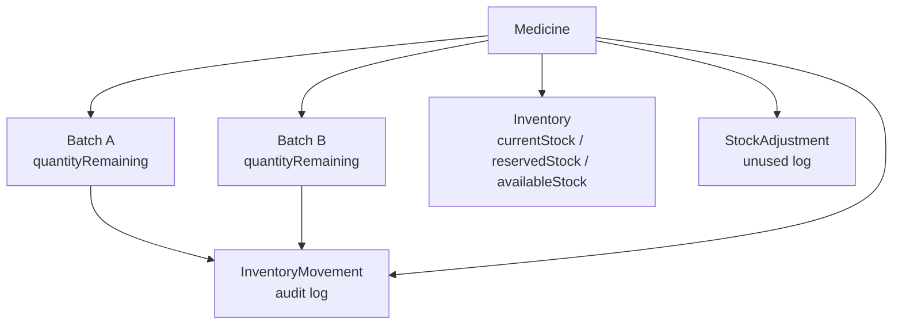

# Inventory Data Model

SPIMS stores stock in **two places**: a per-batch quantity and a per-medicine aggregate. The batch is the source of truth; the aggregate is a derived cache. Movement records provide an audit trail but are not used to derive stock.

## 1. The inventory records



| Record | Granularity | Role | Source of truth? |
|---|---|---|---|
| `Batch` | One row per medicine + batch number | Physical stock, expiry, cost and selling price | **Yes** |
| `Inventory` | One row per medicine | Fast aggregate availability for listings and reservations | Derived |
| `InventoryMovement` | Append-only event | Audit trail for sales, purchases, returns, adjustments, expiry | No — never replayed |
| `StockAdjustment` | Append-only event | Intended manual adjustment history | No — not wired |

## 2. Batch model

| Concept | Implementation |
|---|---|
| Quantity received | `quantityReceived` (immutable after creation) |
| Quantity on hand | `quantityRemaining` |
| Expiry | `expiryDate` plus `isExpired` flag |
| Sellable | `quantityRemaining > 0 && expiryDate > now && isExpired === false` |
| Price | `purchasePrice`, `sellingPrice` per batch |
| Origin | `purchaseOrderId` |
| Identity | `{ medicineId, batchNumber }` unique |

Batch status virtual:

```text
quantityRemaining === 0  -> "sold-out"
isExpired === true       -> "expired"
isActive === true        -> "active"
otherwise                -> "inactive"
```

The order means a zero-quantity expired batch reports `sold-out`, not `expired`.

Source: `server/src/modules/batch/model/medicineBatch.model.ts`

## 3. Aggregate inventory model

```text
currentStock   = Σ quantityRemaining over sellable batches
reservedStock  = units held by reserve/release
availableStock = currentStock - reservedStock
```

Schema:

```text
reservedStock >= 0
0 <= availableStock <= currentStock - reservedStock
medicineId is unique
```

Because `findByIdAndUpdate` does not run document validators by default, `StockMutationService` computes the three values together and writes them explicitly. The unique index on `medicineId` prevents duplicate aggregate rows; duplicate-key errors are mapped to 409.

Source: `server/src/modules/inventory/services/stockMutation.service.ts`, `server/src/modules/inventory/model/inventory.model.ts`

## 4. Invariants

| Invariant | Enforced where | Reliable? |
|---|---|---|
| Cannot sell more than a batch holds | `deductBatchStock` filter `quantityRemaining >= qty` | Yes, atomic per batch |
| Cannot sell expired stock | `findSellableBatches` filters date and flag | Yes at query time |
| Sale allocation follows FEFO | `findSellableBatches` sort | Yes |
| `currentStock` equals sum of sellable batches | `syncAggregate` after every mutation | Yes, unless `markExpiredBatches` runs without a sync |
| `availableStock = currentStock - reservedStock` | `syncAggregate`, reserve/release | Yes |
| Movement always belongs to the right medicine | `InventoryMovementService` checks batch ownership | Yes |
| Every stock change has one movement | `StockMutationService` | Yes, for all wired stock mutations |
| Quantities never negative | Service guards plus schema `min` | Yes for batch and reserved stock |
| One aggregate row per medicine | Unique index | Yes after deployment dedupe |

## 5. Flow-by-flow effects

### 5.1 Purchase receipt

For each purchase item:

1. Create a batch with `quantityReceived = quantityRemaining = received quantity`.
2. Call `StockMutationService.receiveStock`.
3. Recompute the aggregate from all sellable batches.
4. Write one `PURCHASE` movement for the received quantity.
5. `BatchService.createBatch` owns a transaction when the caller does not supply one.

Effect: batch sum and aggregate agree after each item.

### 5.2 Sale

For each requested medicine:

1. Load sellable batches sorted FEFO.
2. For each batch, atomically decrement `quantityRemaining` if enough remains.
3. Write one `SALE` movement per batch.
4. After all allocations, sync aggregate stock once.
5. Create one `SalesItem` per allocation.

Effect: batches and aggregate agree. If the transaction aborts, all writes roll back.

### 5.3 GOOD return

`returnMedicine` delegates to `increaseBatchStock`:

1. Restore `batch.quantityRemaining`.
2. Sync the aggregate.
3. Write one `RETURN` movement.

### 5.4 DAMAGED / EXPIRED / OPENED return

The service writes one `RETURN` movement and does **not** restore batch or aggregate stock. The item is treated as a write-off.

### 5.5 Sale deletion

For each sale item with `quantity > returnedQuantity`:

1. Restore `quantity - returnedQuantity` to the original batch.
2. Sync the aggregate.
3. Write one `RETURN` movement.
4. Delete the sale item.

Fully returned items are deleted without a stock change.

### 5.6 Expiry disposal

`confirmDisposal`:

1. Requires `isExpired === true` and `quantityRemaining > 0`.
2. Sets batch `quantityRemaining = 0`.
3. Syncs the aggregate.
4. Writes one `EXPIRED` movement.

All three writes run in one transaction.

### 5.7 Manual batch adjustment

`POST /batches/:id/adjust` sets `quantityRemaining` to an absolute value, syncs the aggregate, and writes one movement for the absolute delta. The value must be between 0 and `quantityReceived`.

### 5.8 Direct inventory endpoints

`POST /inventory/:medicineId/increase|decrease` require a `batchId` and mutate the batch plus aggregate. `reserve|release` mutate `reservedStock` and `availableStock`; `batchId` is optional.

### 5.9 `POST /inventory/:medicineId/sync`

Recomputes the aggregate from batches. The sellable filter (`quantityRemaining > 0`, `expiryDate > now`, `isExpired: false`) is applied with or without a session. If the aggregate changes, one `ADJUSTMENT` movement records the delta.

Source: `server/src/modules/batch/repo/medicineBatch.repo.ts` (`getTotalStock`), called by `server/src/modules/inventory/services/stockMutation.service.ts`.

## 6. Availability calculations

| Use case | Calculation | Source |
|---|---|---|
| Sales search result | `Inventory.availableStock > 0`, joins the earliest non-expired batch | `inventory.repo.ts` `searchMedicines` |
| Low stock (dashboard) | `availableStock > 0` and `availableStock <= medicine.reorderLevel` | `inventory.repo.ts` `getLowStockCount` |
| Out of stock | `availableStock <= 0` | `inventory.repo.ts` `getOutOfStockCount` |
| Batch availability | `quantityRemaining > 0 && expiryDate > now && !isExpired` | `batch.service.ts` `getAvailableBatches` |
| Sellable for a sale | quantity > 0, expiry > now, `isExpired: false` | `medicineBatch.repo.ts` `findSellableBatches` |
| Low-stock batches | per-batch `quantityRemaining <= query threshold` and `> 0` | `batch.service.ts` `getLowStockBatches` |
| Smart reorder usable stock | sum of `quantityRemaining` for batches with `expiryDate > now + adjustedLeadTime + 30 days` | `medicineBatch.repo.ts` `getUsableStock` |

## 7. Reservations

The reserve/release endpoints exist but are not integrated with any order flow.

- Reserve: rejects if `availableStock < quantity`, then increments `reservedStock` and decrements `availableStock`.
- Release: rejects if `reservedStock < quantity`, then decrements `reservedStock` and increments `availableStock`.
- Reconciliation clamps `reservedStock` to `totalStock` if batch truth falls below outstanding reservations, so `availableStock` is never negative.
- No reference integrity check (any `referenceId` is accepted).

Treat reservations as **Partially Implemented**.

## 8. Movement semantics

| Movement type | Written by | Notes |
|---|---|---|
| `PURCHASE` | Receipt, direct batch create, manual increase | Quantity is the increase |
| `SALE` | Sale allocation | Quantity is units removed |
| `RETURN` | GOOD return, non-GOOD write-off, sale deletion | Positive quantity; direction inferred by operation |
| `ADJUSTMENT` | Batch adjustment, drift correction, inventory initialization | Absolute delta |
| `EXPIRED` | Disposal | Disposed quantity |
| `RESERVE` | Reserve endpoint | Quantity removed from available |
| `RELEASE` | Release endpoint | Quantity returned to available |

`referenceType` is validated against a 9-value enum: `PURCHASE_ORDER`, `PURCHASE`, `SALE`, `RETURN`, `SALES_RETURN`, `ADJUSTMENT`, `RESERVE`, `RELEASE`, and `SYSTEM`.

## 9. Data repair guidance

If aggregate and batch stock disagree:

1. Recompute from batches manually (`GET /batches/medicine/:medicineId`).
2. Run `POST /inventory/:medicineId/sync`. It applies the sellable filter and writes an `ADJUSTMENT` for the delta.
3. Do not set `currentStock` or `availableStock` through `PATCH /inventory/:id`; those fields are rejected.
4. For duplicate aggregate rows created before the unique index, run `npm --prefix server run inventory:dedupe -- --dry-run`, then `npm --prefix server run inventory:dedupe -- --sync-indexes`. The script keeps the latest/highest-stock row, reconciles it from sellable batches, merges reservations, and deletes the rest.

## Related documents

- [Inventory management](../business-logic/inventory-management.md)
- [Stock movements](../business-logic/stock-movements.md)
- [FEFO/FIFO](../business-logic/fefo-fifo.md)
- [Inventory module](../modules/inventory.md)
- [Batches module](../modules/batches.md)
