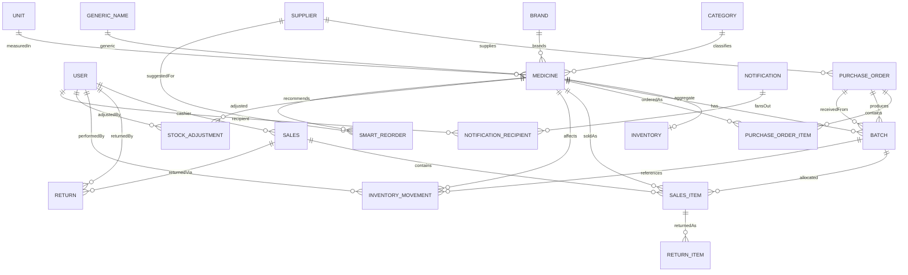

# Schema and Relationships

All schemas are defined with Mongoose. `R` = required, `O` = optional, `D` = default. Types are Mongoose schema types. `ObjectId` columns are references unless noted.

## 1. Entity-relationship overview

`RETURN_ITEM` is an embedded array inside `RETURN`, not a separate collection. `INVENTORY` is intended to be one row per medicine but the unique constraint is not enforced.

## 2. Identity

### 2.1 `users` — `User`

Source: `server/src/modules/user/model/user.model.ts`

| Field | Type | Flags | Notes |
|---|---|---|---|
| `_id` | ObjectId | auto | |
| `name` | String | R, trim | |
| `email` | String | R, unique, lowercase, trim | |
| `password` | String | conditional R | Required only when `provider === "local"`; stores a bcrypt hash when written by auth/user creation |
| `provider` | String | D `local`, enum `local`/`google` | Google flow not implemented |
| `role` | String | D `pharmacist`, enum | `owner`, `pharmacist`, `inventory_manager` |
| `isActive` | Boolean | D `true` | Not checked during login |
| `lastLogin` | Date | D `null` | Never updated by the login flow |
| `refreshToken` | String | D `null` | Unused |
| `createdAt`, `updatedAt` | Date | timestamps | |

### 2.2 `counters` — `Counter`

Source: `server/src/modules/sales/model/counter.model.ts`

| Field | Type | Flags |
|---|---|---|
| `name` | String | R, unique, trim |
| `sequence` | Number | R, min 0, D 0 |
| `createdAt`, `updatedAt` | Date | timestamps |

Counter names in use: `invoice`, `return`, `purchase-order`, `stock-adjustment` (`modules/sales/constants/counter.constants.ts`). Only invoice and return generation are called.

## 3. Catalog

### 3.1 `medicines` — `Medicine`

Source: `server/src/modules/medicine/models/medicine.model.ts`

| Field | Type | Flags | Notes |
|---|---|---|---|
| `medicineName` | String | R, trim, max 200 | Zod limits to 100 |
| `genericNameId` | ObjectId → `GenericName` | R | |
| `categoryId` | ObjectId → `Category` | R | |
| `brandId` | ObjectId → `Brand` | R | |
| `manufacturer` | String | O, trim, max 100 | |
| `barcode` | String | O, unique, trim, max 50 | |
| `unitId` | ObjectId → `Unit` | R | |
| `dosageForm` | String | O, trim, max 100 | |
| `strength` | String | O in schema, trim, max 100 | Zod requires it on create |
| `reorderLevel` | Number | O, min 0 | Used by inventory low-stock aggregation |
| `description` | String | O, trim, max 500 | |
| `isActive` | Boolean | D `true` | Deactivate instead of delete |
| `createdAt`, `updatedAt` | Date | timestamps | |

### 3.2 `brands`, `categories`, `genericnames`, `units`

| Model | Fields | Constraints |
|---|---|---|
| `Brand` | `name` R unique max 100; `description` R max 100; `isActive` D true | timestamps |
| `Category` | `name` R unique max 100; `description` O max 500; `isActive` D true | timestamps |
| `GenericName` | `name` R unique max 100; `description` O max 200; `isActive` D true | timestamps |
| `Unit` | `name` R unique max 100; `description` R unique max 10; `isActive` D true | timestamps |

Sources: `modules/medicine/models/brand.model.ts`, `category.model.ts`, `genericName.model.ts`, `unit.model.ts`

`Unit.description` is intended as a short symbol (max 10) but is required and unique.

## 4. Supply

### 4.1 `suppliers` — `Supplier`

Source: `server/src/modules/supplier/model/supplier.model.ts`

| Field | Type | Flags | Notes |
|---|---|---|---|
| `companyName` | String | R | |
| `contactPerson` | String | R | |
| `email` | String | R, unique, lowercase | |
| `phone` | String | R | Application-level uniqueness only |
| `address` | String | R | |
| `leadTime` | Number | R | Days; used by smart reorder |
| `status` | String | D `active`, enum `active`/`inActive` | |
| `reliabilityScore` | Number | D 0, min 0, max 100 | Never written by any service |
| `createdAt`, `updatedAt` | Date | timestamps | |

### 4.2 `purchaseorders` — `PurchaseOrder`

Source: `server/src/modules/purchase/model/purchaseOrder.model.ts`

| Field | Type | Flags | Notes |
|---|---|---|---|
| `supplierId` | ObjectId → `Supplier` | R | |
| `orderDate` | Date | R | |
| `expectedDeliveryDate` | Date | O | Used for supplier delay; missing value can break reorder math |
| `invoiceNumber` | String | R | Supplier invoice identity |
| `invoiceFile` | String | O | No upload mechanism |
| `totalAmount` | Number | R | Sum of `quantity * purchasePrice`; VAT/discount not applied |
| `receivedDate` | Date | O | Set when received |
| `status` | String | R, D `pending`, enum | |
| `VAT` | Number | D 13 | Stored as a percentage, never used in totals |
| `discount` | Number | D 0 | Stored, never used in totals |
| `createdAt`, `updatedAt` | Date | timestamps | |

There is no PO number field; `CounterRepository.generatePurchaseOrderNumber` is unused.

### 4.3 `purchaseorderitems` — `PurchaseOrderItem`

| Field | Type | Flags |
|---|---|---|
| `purchaseOrderId` | ObjectId → `PurchaseOrder` | R |
| `medicineId` | ObjectId → `Medicine` | R |
| `quantity` | Number | R |
| `purchasePrice` | Number | R |
| `createdAt`, `updatedAt` | Date | timestamps |

No unique constraint on `{ purchaseOrderId, medicineId }`; duplicate prevention is service-level only.

## 5. Inventory

### 5.1 batches (Batch)

Source: `server/src/modules/batch/model/medicineBatch.model.ts`

| Field | Type | Flags | Notes |
|---|---|---|---|
| `medicineId` | ObjectId → `Medicine` | R | |
| `purchaseOrderId` | ObjectId → `PurchaseOrder` | R | |
| `batchNumber` | String | R | Unique per medicine (compound index) |
| `expiryDate` | Date | R | Validator: must be later than `manufacturingDate` |
| `manufacturingDate` | Date | R | |
| `purchasePrice` | Number | R, min 0 | |
| `sellingPrice` | Number | R, min 0 | |
| `quantityReceived` | Number | R, min 1 | |
| `quantityRemaining` | Number | R, min 0 | Validator: must not exceed `quantityReceived` |
| `isExpired` | Boolean | D false | Set by expiry job or manual route |
| `isActive` | Boolean | D true | Validator: only allowed true when `quantityRemaining === 0` (inverted; see risk below) |
| `createdAt`, `updatedAt` | Date | timestamps | |

Virtual `status`: `sold-out` when remaining is 0, else `expired` when `isExpired`, else `active`/`inactive`.

Indexes: `{ expiryDate }`, unique `{ medicineId, batchNumber }`, `{ medicineId, expiryDate }`, `{ isExpired }`, `{ isActive }`.

> **Confirmed defect:** the `isActive` validator requires `quantityRemaining === 0`, but the default is `true`. Using the installed Mongoose version, validating a new batch with `quantityRemaining: 5` fails with `Batch can only be marked as inactive if quantity remaining is zero`. Therefore `POST /batches` and every purchase receipt (which creates batches with positive quantity) fail validation before insertion. An isolated `doc.validate()` probe was used; no database is required to reproduce. See [Batches](../modules/batches.md).

### 5.2 `inventories` — `Inventory`

Source: `server/src/modules/inventory/model/inventory.model.ts`

| Field | Type | Flags | Notes |
|---|---|---|---|
| `medicineId` | ObjectId → `Medicine` | R | **No unique index** |
| `currentStock` | Number | R, D 0 | Intended to equal the sum of sellable batch quantities |
| `reservedStock` | Number | R, D 0 | Never incremented by the reserve endpoint |
| `availableStock` | Number | R, D 0 | Validator: `0 <= value <= currentStock - reservedStock` |
| `lastUpdated` | Date | R, D now | |

No `timestamps`. Validators only run on `save()`, not on `findByIdAndUpdate` without `runValidators`.

### 5.3 `inventorymovements` — `InventoryMovement`

Source: `server/src/modules/inventory/model/inventoryMovement.model.ts`

| Field | Type | Flags |
|---|---|---|
| `medicineId` | ObjectId → `Medicine` | R |
| `batchId` | ObjectId → `Batch` | O in schema, **required by service** |
| `movementType` | String enum (7 values) | R |
| `quantity` | Number | R, signed semantics not enforced |
| `referenceId` | ObjectId | R |
| `referenceType` | String enum (5 values) | R |
| `performedBy` | ObjectId → `User` | R |
| `remarks` | String | D `""` |
| `createdAt`, `updatedAt` | Date | timestamps |

`quantity` is normally passed as a positive magnitude by the services; direction is implied by `movementType`. The schema has no `min` or sign constraint, so caller-supplied negative values are possible on the manual endpoints.

### 5.4 `stockadjustments` — `StockAdjustment`

| Field | Type | Flags |
|---|---|---|
| `medicineId` | ObjectId → `Medicine` | R |
| `quantityBefore` | Number | R |
| `quantityAfter` | Number | R |
| `reason` | String | R |
| `adjustedBy` | ObjectId → `User` | R |
| `adjustedAt` | Date | R, D now |
| `createdAt`, `updatedAt` | Date | timestamps |

Not exposed by any route; `StockAdjustmentService` is not constructed in the container.

## 6. Sales and returns

### 6.1 `sales` — `Sales`

Source: `server/src/modules/sales/model/sales.model.ts`

| Field | Type | Flags | Notes |
|---|---|---|---|
| `invoiceNumber` | String | R, unique | `INV-000001` format |
| `customerName` | String | R | Free text, no customer entity |
| `subTotal` | Number | R | Sum of `unitPrice * quantity` before discounts |
| `VAT` | Number | R | Computed tax amount |
| `discount` | Number | R | Sum of line discounts plus invoice discount |
| `totalAmount` | Number | R | `(subTotal - discount) + VAT` |
| `paymentMethod` | String | R | String, not enum at schema level; Zod restricts create |
| `cashierId` | ObjectId → `User` | R | Taken from JWT |
| `saleDate` | Date | R | Supplied by client |
| `status` | String | D `PENDING`, enum | Creation sets `COMPLETED` |
| `createdAt`, `updatedAt` | Date | timestamps | |

### 6.2 `salesitems` — `SalesItem`

| Field | Type | Flags | Notes |
|---|---|---|---|
| `salesId` | ObjectId → `Sales` | R | No index |
| `batchId` | ObjectId → `Batch` | R | |
| `medicineId` | ObjectId → `Medicine` | R | |
| `quantity` | Number | R | Units taken from this batch |
| `returnedQuantity` | Number | D 0 | Incremented by returns |
| `unitPrice` | Number | R | Batch `sellingPrice` at sale time |
| `discount` | Number | R | Absolute line discount, not a percentage |
| `totalPrice` | Number | R | `unitPrice * quantity - discount` (VAT-exclusive) |
| `createdAt`, `updatedAt` | Date | timestamps | |

One sale line is created **per batch allocation**, so a single requested medicine can produce multiple `SalesItem` rows.

### 6.3 returns (Return)

Source: `server/src/modules/sales/model/return.model.ts`

| Field | Type | Flags | Notes |
|---|---|---|---|
| `salesId` | ObjectId → `Sales` | R | |
| `returnNumber` | String | R | `RET-000001`; not unique in DB |
| `status` | String | D `PENDING`, enum | Service writes `COMPLETED` immediately |
| `returnReason` | String | R | |
| `returnedBy` | ObjectId → `User` | R | |
| `returnDate` | Date | R | Must not precede sale date |
| `refundAmount` | Number | D 0 | Excludes VAT |
| `returnItems` | embedded array | | See below |
| `createdAt`, `updatedAt` | Date | timestamps | |

`returnItems[]`:

| Field | Type | Flags |
|---|---|---|
| `saleItemId` | ObjectId → `SalesItem` | O |
| `quantity` | Number | R |
| `unitPrice` | Number | R |
| `discount` | Number | R |
| `VAT` | Number | **R** (never populated by the service) |
| `medicineId` | ObjectId → `Medicine` | O |
| `batchId` | ObjectId → `Batch` | O |
| `refundAmount` | Number | R |
| `condition` | String enum `GOOD`/`DAMAGED`/`EXPIRED`/`OPENED` | D `GOOD` |
| `remarks` | String | O |

Because returns are written with `findByIdAndUpdate`, the required `VAT` field is not validated.

## 7. Recommendations and operations

### 7.1 `smartreorders` — `SmartReorder`

| Field | Type | Flags |
|---|---|---|
| `medicineId` | ObjectId → `Medicine` | R |
| `suggestedQuantity` | Number | R |
| `confidenceScore` | Number | O |
| `recommendationReason` | String | R |
| `generatedAt` | Date | D now |
| `status` | String | D `PENDING`, enum |
| `WADS` | Number | R |
| `demandStdDev` | Number | R |
| `adjustedLeadTime` | Number | R |
| `safetyStock` | Number | R |
| `reorderPoint` | Number | R |
| `currentStock` | Number | R |
| `expiryRiskUnits` | Number | R |
| `supplierId` | ObjectId → `Supplier` | R |

No timestamps. `createRecommendation` (manual/admin) is defined in the service but not exposed by a route and omits the algorithm fields, which would fail schema validation if called.

### 7.2 `notifications` and `notificationrecipients`

| `Notification` | Type | Flags |
|---|---|---|
| `title` | String | R |
| `message` | String | R |
| `type` | String enum `Email`/`SMS`/`InApp` | R |
| `status` | String enum `Pending`/`Sent`/`Failed` | D `Pending` |
| `createdAt`, `updatedAt` | Date | timestamps |

| `NotificationRecipient` | Type | Flags |
|---|---|---|
| `notificationId` | ObjectId → `Notification` | R |
| `userId` | ObjectId → `User` | R |
| `sentAt` | Date | O |
| `status` | String enum | D `Pending` |

`NotificationRecipient` has no timestamps and no declared indexes.

### 7.3 `backgroundjobs` — `BackgroundJob`

| Field | Type | Flags |
|---|---|---|
| `jobName` | String | R |
| `status` | String enum | R |
| `startedAt` | Date | R |
| `scheduledAt` | Date | O |
| `completedAt` | Date | O |
| `errorMessage` | String | O |

No timestamps.

## 8. Relationship summary

| Parent | Child | Cardinality | Enforced by |
|---|---|---|---|
| User | Sales | 1:N | `cashierId` ref, no DB constraint |
| User | Return | 1:N | `returnedBy` |
| User | InventoryMovement | 1:N | `performedBy` |
| User | NotificationRecipient | 1:N | `userId` |
| Medicine | Inventory | 1:1 intended | No unique index |
| Medicine | Batch | 1:N | `medicineId` |
| Medicine | SalesItem | 1:N | `medicineId` |
| Medicine | SmartReorder | 1:N | `medicineId` |
| Supplier | PurchaseOrder | 1:N | `supplierId` |
| Supplier | SmartReorder | 1:N | `supplierId` |
| PurchaseOrder | PurchaseOrderItem | 1:N | `purchaseOrderId` |
| PurchaseOrder | Batch | 1:N | `purchaseOrderId` |
| Batch | SalesItem | 1:N | `batchId` |
| Sales | SalesItem | 1:N | `salesId` |
| Sales | Return | 1:N | `salesId` |
| Notification | NotificationRecipient | 1:N | `notificationId` |

## 9. Notable schema-level risks

1. `Inventory` lacks a unique index on `medicineId`; concurrent `createInventory` calls can create duplicates.
2. `SalesItem.salesId` and `Return.salesId` are unindexed, making sale detail and return creation collection scans as data grows.
3. `Return.returnNumber` is not unique despite being generated sequentially.
4. `Return.returnItems.VAT` is required but never written; the update path bypasses validators.
5. `Batch.isActive` validator conflicts with its default and blocks creation of any batch with positive quantity (confirmed by isolated validation).
6. `PurchaseOrder.VAT` and `PurchaseOrder.discount` are stored but never applied to `totalAmount`.
7. `InventoryMovement.batchId` is optional in the schema but mandatory in the service, creating a mismatch for any future writer that bypasses the service.
8. `Supplier.reliabilityScore` is never computed; smart reorder computes reliability on the fly instead.
9. `Sales.status` includes `CANCELLED` and `PENDING`, but no code path sets either after creation.
10. `User.lastLogin` and `User.refreshToken` are never maintained.

## Related documents

- [Database overview](database-overview.md)
- [Inventory data model](inventory-data-model.md)
- [Inventory management](../business-logic/inventory-management.md)
- [VAT and pricing](../business-logic/vat-and-pricing.md)
