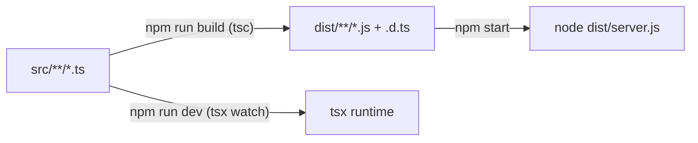

# Development Workflow

## 1. Scripts

| Script | Command | Purpose |
|---|---|---|
| `npm run dev` | `tsx watch src/server.ts` | Watch-mode development server |
| `npm run build` | `tsc` | Compile to `dist/` |
| `npm start` | `node dist/server.js` | Run the compiled server |
| `npm test` | `vitest` | Watch-mode tests |
| `npm run test:ci` | `vitest run` | Single test run for CI |
| `npm run test:coverage` | `vitest run --coverage` | Coverage report |
| `npm run lint` | `eslint .` | Lint (no writes) |
| `npm run lint:fix` | `eslint . --fix` | Lint with autofix |
| `npm run typecheck` | `tsc --noEmit` | Type check without emitting |
| `npm run audit` | `npm audit --omit=dev --audit-level=high` | Production audit |

There is no format, migration, seed, or Docker script. CI runs lint, type
checking, tests, and the build. Root-level wrappers are documented in
[`docs/ci-cd.md`](../../../docs/ci-cd.md).

## 2. TypeScript configuration

Source: `server/tsconfig.json`

| Option | Value | Effect |
|---|---|---|
| `module` | `nodenext` | ESM with Node resolution |
| `target` | `esnext` | Modern syntax |
| `rootDir` / `outDir` | `./src` / `./dist` | Build layout |
| `strict` | true | Strict type checks |
| `noUncheckedIndexedAccess` | true | Indexed access includes `undefined` |
| `exactOptionalPropertyTypes` | true | Exact optional semantics |
| `allowImportingTsExtensions` | true | Imports may end in `.ts` |
| `rewriteRelativeImportExtensions` | true | Emitted JS rewrites `.ts` to `.js` |
| `verbatimModuleSyntax` | true | Type-only imports must use `import type` |
| `declaration`, `sourceMap` | true | Emits `.d.ts` and maps |
| `skipLibCheck` | true | Skips dependency type checks |

### Import style

The codebase mixes two styles:

- `.js` specifiers that map to `.ts` sources (for example `../../shared/error.js`).
- Explicit `.ts` specifiers (for example `../../app/container.ts`).

Both compile because of `allowImportingTsExtensions` + `rewriteRelativeImportExtensions`. New code should follow the surrounding module's style to avoid churn. Do not remove `rewriteRelativeImportExtensions`; `.ts` imports would otherwise break the build output.

### Module system

`package.json` sets `"type": "module"`. There is no CommonJS output. The email provider no longer uses top-level `await`; its transporter is created lazily on first use.

## 3. Repository layout conventions

- One folder per business module under `src/modules/<module>/`.
- Layers in `model`, `repo`, `service`, `controller`, `routes`, `schema`.
- Singular vs plural folder names vary by module; match the module you are editing.
- Shared concerns in `src/shared` and `src/types`.
- All dependency construction in `src/app/container.ts`.
- Routers import controllers from the container, not by constructing them.
- Zod schemas live next to the module and are applied with `validate(schema)`.

## 4. Adding a new endpoint (pattern used by the codebase)

1. **Model** (if needed): add a Mongoose schema in `modules/<name>/model`.
2. **Repository**: add a class wrapping the model, accepting an optional `ClientSession` for transactional calls.
3. **Service**: add business logic and throw `AppError` for expected failures.
4. **Schema**: add a Zod schema if the route is a write.
5. **Controller**: add a method that calls the service and returns the module's response envelope.
6. **Router**: register the route with `validate(...)` where applicable.
7. **Container**: instantiate the repo/service/controller and export the controller.
8. **Mount**: add the router to `modules/app.routes.ts` with `verifyToken` and `authorize`.
9. **Docs**: update `server/docs/api/endpoints.md` and the module document.

Do not add dependencies without updating `package.json`. This documentation set does not change application code.

## 5. Build and run

- `npm run build` must succeed before `npm start`.
- `npm start` does not load `.env` itself; dotenv is called inside the app, with the import-order caveat described in [Environment variables](environment-variables.md).
- `dist/` is generated and not committed.

## 6. Runtime sequence for developers

1. Start MongoDB (replica set) and Redis.
2. Export env or create `.env`.
3. `npm run dev`.
4. Watch for:
   - `[Redis] Connected`
   - `MongoDB Connected: <host>`
   - `Server is running on port <port>`
5. If the process exits, check the auth environment validation, Redis, then MongoDB. The email provider performs no network call at startup.

## 7. Database changes

- Adding a field: update the Mongoose schema; existing documents lack it until read/write. Defaults apply only on new documents.
- Adding an index: declaring it in the schema triggers creation on startup (autoIndex). Large collections may experience startup delay; run `npm run index:check` before deploying unique indexes.
- Renaming a field or backfilling data: add an ordered migration under `server/src/database/migrations/`, register it, run `npm run db:migrate:dry-run`, then `npm run db:migrate`.
- Changing an enum: old documents remain; validators run on save only.

Migrations are explicit, idempotent, and recorded in the `migrations` collection;
they are not executed at boot. Seed the first owner and baseline lookups with
`npm run db:seed` (see [migrations and seeding](migrations-and-seeding.md)).
Never commit real seed credentials.

## 8. CI

`.github/workflows/ci.yml`:

| Job | Steps |
|---|---|
| backend | checkout, Node 22, `npm ci`, lint, typecheck, unit/coverage tests, HTTP integration tests, build |
| client | checkout, Node 22, `npm ci`, lint, typecheck, tests, build |

`security.yml` adds the production dependency audit, Gitleaks, and CodeQL. A failing test, lint, typecheck, build, audit, or secret scan blocks the required checks.

## 9. Code style observations

- Formatting is inconsistent across files (indentation, blank lines, semicolons).
- There is no Prettier/ESLint configuration.
- Filenames contain typos that are part of the import graph: `medicine.sercive.ts`, `websocker.provider.ts`, `backgroud.model.ts`, `smartReorder.Calculatro.ts`.
- Some controllers use `asyncHandler`, some use `try/catch`; follow the module you are editing.
- Response envelopes differ by module; do not "standardize" them in isolation, as the client may depend on the current shape.

## 10. Git hygiene

- `.env` is gitignored; `node_modules` is gitignored.
- `dist/` is not ignored by `server/.gitignore` (only `node_modules` and `.env` are listed). The repository does not currently track `dist/`, but a build will create it. Add it to `.gitignore` if you are changing repository hygiene (outside this documentation task).
- Do not commit generated OpenAPI or docs artifacts unless intended.

## 11. Recommended checks before a PR

1. `npm run build`
2. `npm run test:run`
3. Manual smoke test of the affected endpoints.
4. Verify no secrets or `.env` values are included.
5. Update the relevant docs under `server/docs/`.
6. Check that any new route is mounted with `verifyToken` and appropriate roles.

## Related documents

- [Setup and installation](setup-and-installation.md)
- [Testing](testing.md)
- [Project structure](../architecture/project-structure.md)
- [Environment variables](environment-variables.md)
