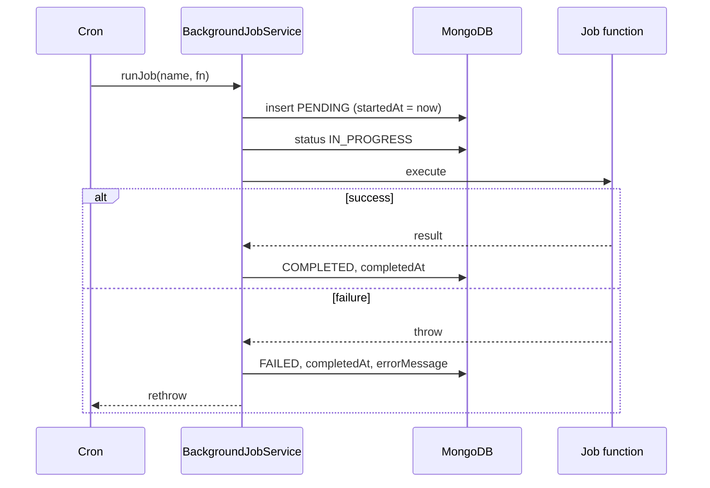

# Background Jobs

## 1. Scheduling mechanism

Jobs use `node-cron` inside the API process. There is no external queue or worker deployment. Each job takes a Redis `SET NX PX` lock, so multiple instances do not run the same schedule concurrently; if Redis is unavailable the job skips rather than running unlocked.

Three jobs are scheduled from `server.ts`:

| Job name | Schedule | Function |
|---|---|---|
| `expiry-check` | `0 1 * * *` (01:00 daily) | Flag expired batches and notify pharmacists |
| `reorder-calculation` | `0 2 * * *` (02:00 daily) | Generate smart reorder recommendations |
| `notification-retry` | `* * * * *` (every minute) | Retry due failed notification recipients |

Cron expressions use server-local time.

The old duplicate scheduler in `modules/worker/smartReorder.cron.ts` has been removed.

Sources: `server/src/modules/backgroundJobs/jobs/expiryCheck.job.ts`, `reorderCalculation.job.ts`, `notificationRetry.job.ts`, `server/src/server.ts`

## 2. Job tracking

Every run is wrapped by `BackgroundJobService.runJob` **except the
notification-retry sweep**, which runs every minute and intentionally writes no
`backgroundjobs` record (1,440 rows/day would add noise without useful signal).



`BackgroundJob` fields:

| Field | Meaning |
|---|---|
| `jobName` | `expiry-check`, `reorder-calculation` |
| `status` | `PENDING`, `IN_PROGRESS`, `COMPLETED`, `FAILED` |
| `startedAt` | Set at scheduling time, then updated at start |
| `scheduledAt` | Optional |
| `completedAt` | Set on completion/failure |
| `errorMessage` | Failure reason |

No timestamps are enabled on the model, so there is no `createdAt`/`updatedAt` audit beyond these fields.

## 3. Expiry check job

```text
01:00 daily
1. markExpiredBatches():
   - load all batches
   - if quantityRemaining > 0 AND expiryDate < now AND isExpired == false
     -> set isExpired = true
2. If any newly expired:
   - find all users with role "pharmacist"
   - createNotification({ type: "InApp", title, message, userIds, critical: true })
```

Behavior:

- Only flags batches; does not zero stock or write movements.
- No notification if nothing newly expired.
- If there are no pharmacists, notification creation throws `400` (`At least one recipient is required`), the job fails, and is marked `FAILED`.
- The notification is dispatched asynchronously; the job does not wait for delivery.
- The job scans every batch in memory (`findAll`), not just candidates.

## 4. Reorder calculation job

```text
02:00 daily
1. generateForAllMedicines()
2. For every medicine:
   - return cached recommendation if present
   - skip if stock is above reorder point
   - skip if no purchase history
   - otherwise create a PENDING recommendation
3. Log created/skipped counts
```

Notes:

- Each medicine runs sequentially; there is no batching or concurrency.
- A single medicine failure is caught inside `generateForAllMedicines` and reported as `skipped` (with the error message as `reason`); the job still completes.
- Redis availability is required for every medicine (cache read/write). A Redis outage is caught per medicine, so every medicine is reported as `skipped` and the job still completes successfully.
- Recommendations persist indefinitely; nothing archives old ones.

## 5. Notification retry job

```text
every minute
1. notificationService.retryScheduled()
2. Find distinct notificationId values where:
   status = "Failed" AND attempts < 3 AND nextAttemptAt != null AND nextAttemptAt <= now
   OR status = "Pending" AND attempts < 3
      AND (lastAttemptAt = null OR lastAttemptAt <= now - 15 minutes)
3. dispatch() each notification; catch and log per-notification errors
4. Return { attempted }
```

Behavior:

- Retries happen at +1 minute and +5 minutes after the first and second
  failures, then become terminal.
- Recipients marked `Skipped` are never retried.
- Non-retryable failures (missing `SMS_WEBHOOK_URL`, missing phone, permanent
  SMTP 5xx) never get a `nextAttemptAt` and are not swept.
- `Pending` rows that were never attempted are swept immediately. A row that was
  claimed but never finished (crash mid-send) is recovered only after the
  15-minute `STALE_IN_FLIGHT_MS` window, so a slow provider call is not resent.
- Each send goes through `claimForDispatch` (`_id` + `status` + `attempts` +
  `lastAttemptAt` compare-and-swap), so the sweep and the request path cannot
  both send the same row. Delivery is at-least-once.
- The sweep is not wrapped in `runJob`; recipient rows are the audit trail.
- One failing notification does not stop the rest of the sweep.
- An in-process `running` flag skips a tick if the previous sweep is still
  active. This does not coordinate across processes.

Source: `server/src/modules/backgroundJobs/jobs/notificationRetry.job.ts`

## 6. Stale-job detection

`BackgroundJobService.getStaleJobs(60)` returns `IN_PROGRESS` jobs started more than 60 minutes ago. It is surfaced by `GET /dashboard/system-health`.

This only detects jobs that crashed hard enough to skip `markCompleted`/`markFailed` (for example a process kill). It does not detect missed schedules.

## 7. Repository behavior

`BackgroundJobRepo.create` saves once: with the supplied transaction session when present, otherwise without one. This closes the previous double-save defect.

## 8. Multi-instance behavior

Every instance schedules the cron, but `runWithLock` gates each run with a Redis lock:

- `lock:expiry-check` for 30 minutes.
- `lock:reorder-calculation` for 2 hours.
- `lock:notification-retry` for 55 seconds.

The in-process overlap guard remains as a secondary check for the retry sweep. If Redis is unreachable, the job logs and skips; it does not run unlocked. Deployment guidance is still to run a dedicated worker if cron load grows.

## 9. Time zones and daylight saving

`node-cron` uses the host time zone. The schedules are wall-clock times, so they shift with DST if the host does. No `timezone` option is configured.

## 10. Failure handling

| Failure | Result |
|---|---|
| Batch scan exception | Job `FAILED`, cron catches and logs |
| Notification creation failure | Job `FAILED` after batches were already flagged |
| Redis unavailable during reorder | Job `FAILED` |
| SMTP failure during dispatch | Recipient `Failed`; retried at +1m/+5m when transient |
| Permanent SMTP 5xx | Recipient `Failed` with no retry |
| SMS webhook failure during dispatch | Recipient `Failed`; retried when the failure is retryable |
| Notification retry sweep failure | Cron catches and logs; other notifications still attempted |
| Retry sweep overlap (single instance) | Next tick is skipped while the current sweep runs |
| Process restart mid-job | Record stuck `IN_PROGRESS` until manually cleaned; appears in system health |
| Missed run while process down | No catch-up; next scheduled time only |
| Missed retry sweep while down | The next sweep picks up rows whose `nextAttemptAt` has passed |

## 11. Manual triggers

| Action | Endpoint |
|---|---|
| Mark expired now | `POST /api/batches/mark-expired` |
| Generate all recommendations | `POST /api/smart-reorders/generate` |
| Generate one recommendation | `POST /api/smart-reorders/generate/:medicineId` |

Manual triggers call the services directly and do not create `BackgroundJob` records. The 02:00 cron run does create one through `runJob`.

## 12. Limitations

| Issue | Status |
|---|---|
| External queue/worker | Not Implemented |
| Distributed lock | Implemented with Redis `SET NX PX` + compare-and-delete release |
| Retry with backoff | Not Implemented |
| Job history API | Not Implemented (only dashboard stale count) |
| Archive/cleanup of job records | Not Implemented |
| Catch-up for missed runs | Not Implemented |
| Timezone configuration | Not Implemented |
| Duplicate scheduler file | Removed |
| Notification failure isolation | Implemented (per-recipient, with scheduled retries) |
| Notification retry audit record | Intentionally not recorded; recipient rows are the audit trail |
| Retry overlap across instances | Redis lock plus in-process guard; stale-claim window still bounds duplicate sends |
| Atomic dispatch claim | Implemented (`_id` + `status` + `attempts` + `lastAttemptAt` compare-and-swap); delivery is at-least-once |
| Pagination of jobs | Not Implemented |

## Related documents

- [Realtime communication](realtime-communication.md)
- [Redis and caching](redis-and-caching.md)
- [Logging and monitoring](logging-and-monitoring.md)
- [Smart reorder](../modules/smart-reorder.md)
- [Batches](../modules/batches.md)
