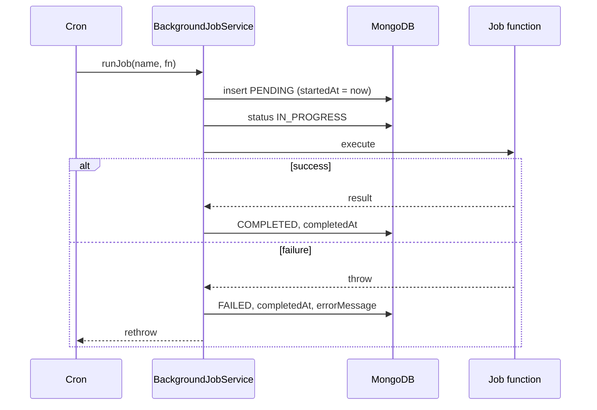

# Background Jobs

## 1. Scheduling mechanism

Jobs use `node-cron` inside the API process. There is no external queue, worker deployment, or distributed lock.

Two jobs are scheduled from `server.ts`:

| Job name | Schedule | Function |
|---|---|---|
| `expiry-check` | `0 1 * * *` (01:00 daily) | Flag expired batches and notify pharmacists |
| `reorder-calculation` | `0 2 * * *` (02:00 daily) | Generate smart reorder recommendations |

Cron expressions use server-local time.

A third scheduler exists in `modules/worker/smartReorder.cron.ts` with the same 02:00 schedule, but it is **never imported** and never runs. It is duplicate dead code.

Sources: `server/src/modules/backgroundJobs/jobs/expiryCheck.job.ts`, `reorderCalculation.job.ts`, `server/src/modules/worker/smartReorder.cron.ts`, `server/src/server.ts`

## 2. Job tracking

Every run is wrapped by `BackgroundJobService.runJob`:



`BackgroundJob` fields:

| Field | Meaning |
|---|---|
| `jobName` | `expiry-check`, `reorder-calculation` |
| `status` | `PENDING`, `IN_PROGRESS`, `COMPLETED`, `FAILED` |
| `startedAt` | Set at scheduling time, then updated at start |
| `scheduledAt` | Optional |
| `completedAt` | Set on completion/failure |
| `errorMessage` | Failure reason |

No timestamps are enabled on the model, so there is no `createdAt`/`updatedAt` audit beyond these fields.

## 3. Expiry check job

```text
01:00 daily
1. markExpiredBatches():
   - load all batches
   - if quantityRemaining > 0 AND expiryDate < now AND isExpired == false
     -> set isExpired = true
2. If any newly expired:
   - find all users with role "pharmacist"
   - createNotification({ type: "InApp", title, message, userIds })
```

Behavior:

- Only flags batches; does not zero stock or write movements.
- No notification if nothing newly expired.
- If there are no pharmacists, notification creation throws `400` (`At least one recipient is required`), the job fails, and is marked `FAILED`.
- The notification is dispatched asynchronously; the job does not wait for delivery.
- The job scans every batch in memory (`findAll`), not just candidates.

## 4. Reorder calculation job

```text
02:00 daily
1. generateForAllMedicines()
2. For every medicine:
   - return cached recommendation if present
   - skip if stock is above reorder point
   - skip if no purchase history
   - otherwise create a PENDING recommendation
3. Log created/skipped counts
```

Notes:

- Each medicine runs sequentially; there is no batching or concurrency.
- A single medicine failure is caught inside `generateForAllMedicines` and reported as `skipped` (with the error message as `reason`); the job still completes.
- Redis availability is required for every medicine (cache read/write). A Redis outage is caught per medicine, so every medicine is reported as `skipped` and the job still completes successfully.
- Recommendations persist indefinitely; nothing archives old ones.

## 5. Stale-job detection

`BackgroundJobService.getStaleJobs(60)` returns `IN_PROGRESS` jobs started more than 60 minutes ago. It is surfaced by `GET /dashboard/system-health`.

This only detects jobs that crashed hard enough to skip `markCompleted`/`markFailed` (for example a process kill). It does not detect missed schedules.

## 6. Repository defect

`BackgroundJobRepo.create`:

```ts
if (session) {
  await job.save({ session });
}
return await job.save();
```

With a session, the document is saved twice. The second `save()` runs outside the supplied session. No current job passes a session, so this is latent, but any future transactional use should fix it.

## 7. Multi-instance behavior

There is no leader election or lock. If the API runs on multiple instances:

- Each instance schedules its own cron and runs the same jobs.
- Expiry flagging is mostly idempotent (checks `!isExpired`), but races can produce duplicate notifications.
- Reorder generation can create duplicate recommendations (no unique constraint).

Deployment guidance: run a single API instance, or move cron to a dedicated process.

## 8. Time zones and daylight saving

`node-cron` uses the host time zone. The schedules are wall-clock times, so they shift with DST if the host does. No `timezone` option is configured.

## 9. Failure handling

| Failure | Result |
|---|---|
| Batch scan exception | Job `FAILED`, cron catches and logs |
| Notification creation failure | Job `FAILED` after batches were already flagged |
| Redis unavailable during reorder | Job `FAILED` |
| SMTP failure during dispatch | Recipient `Failed`; job itself already returned |
| Process restart mid-job | Record stuck `IN_PROGRESS` until manually cleaned; appears in system health |
| Missed run while process down | No catch-up; next scheduled time only |

## 10. Manual triggers

| Action | Endpoint |
|---|---|
| Mark expired now | `POST /api/batches/mark-expired` |
| Generate all recommendations | `POST /api/smart-reorders/generate` |
| Generate one recommendation | `POST /api/smart-reorders/generate/:medicineId` |

Manual triggers call the services directly and do not create `BackgroundJob` records. The 02:00 cron run does create one through `runJob`.

## 11. Limitations

| Issue | Status |
|---|---|
| External queue/worker | Not Implemented |
| Distributed lock | Not Implemented |
| Retry with backoff | Not Implemented |
| Job history API | Not Implemented (only dashboard stale count) |
| Archive/cleanup of job records | Not Implemented |
| Catch-up for missed runs | Not Implemented |
| Timezone configuration | Not Implemented |
| Duplicate scheduler file | Dead code |
| Notification failure isolation | Partial (per-recipient) |
| Pagination of jobs | Not Implemented |

## Related documents

- [Realtime communication](realtime-communication.md)
- [Redis and caching](redis-and-caching.md)
- [Logging and monitoring](logging-and-monitoring.md)
- [Smart reorder](../modules/smart-reorder.md)
- [Batches](../modules/batches.md)
