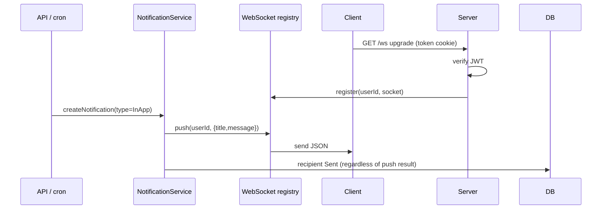

# Realtime Communication

## 1. Purpose

Push in-app notifications to connected users over WebSocket. There are no other realtime features, and clients cannot send messages.

## 2. Server setup

`server.ts`:

```ts
const server = http.createServer(app);
const wss = new WebSocketServer({ noServer: true });

server.on("upgrade", (request, socket, head) => {
  const url = new URL(request.url ?? "", `http://${request.headers.host}`);
  if (url.pathname !== "/ws") {
    socket.destroy();
    return;
  }
  const token = parseCookies(request.headers.cookie ?? "")["token"];
  if (!token) { /* 401 + destroy */ }
  const payload = verifyJwt(token); // throws on invalid
  wss.handleUpgrade(request, socket, head, (ws) => {
    wss.emit("connection", ws, request, payload.userId);
  });
});

wss.on("connection", (ws, _request, userId) => register(userId, ws));
```

Properties:

- Path: `/ws`.
- Authentication: `token` cookie, same JWT as HTTP.
- No query-string token support and no `Authorization` header support.
- Cookies are parsed manually (not via `cookie-parser`).
- Invalid token: HTTP 401 written to the socket and destroyed.
- Any other upgrade path is destroyed.
- No origin check on the upgrade.
- No TLS termination of its own; use a reverse proxy for `wss://`.

Source: `server/src/server.ts`

## 3. Connection registry

`shared/provider/websocker.provider.ts`:

```ts
const connections = new Map<string, Set<WebSocket>>();

register(userId, socket)   // add, remove on close
push(userId, payload)      // send JSON to all sockets, return boolean
```

- Keyed by user id.
- Multiple sockets per user are supported (multiple tabs/devices).
- The set is cleaned on `close` only. There is no `error` handler, so sockets that error without closing may remain.
- `push` returns `false` if no socket exists, but callers ignore the result.
- No ping/pong heartbeat, so dead connections can linger until TCP timeout.
- No message handling (`socket.on("message")` is absent).
- No broadcast/rooms/topics.
- State is in-process; multiple API instances do not share connections.

## 4. Message format

`push` sends only:

```json
{
  "title": "Expired batches require disposal confirmation",
  "message": "3 batch(es) expired overnight..."
}
```

There is no event type, id, timestamp, or channel. A client cannot distinguish an expiry alert from any other notification except by reading the text. The database notification id is not included.

## 5. Delivery flow



If the user is offline, the recipient is still marked `Sent` because `push`'s boolean is ignored. The notification remains queryable via `GET /notifications/me`, so the inbox is the durable record.

## 6. Authentication and authorization

- Any authenticated role can connect.
- A socket is bound to the user id in the JWT at connect time.
- Role changes or account deactivation do not close existing sockets or invalidate the token.
- A JWT expiring after connection is not re-checked; the socket stays open until closed.
- There is no per-user rate limit or message size limit.

## 7. Lifecycle

| Event | Behavior |
|---|---|
| Connect | Register socket |
| Close | Remove socket from set |
| Error | No handler |
| Server restart | All sockets drop; clients must reconnect |
| Token expired | Not re-verified |
| User logs out | Cookie cleared; existing socket remains registered |
| Notification deleted | Already-delivered message stays on the client |

## 8. Client integration notes

- Connect to `/ws` with credentials so the cookie is sent.
- Reconnect with backoff; the server sends no heartbeat or resume marker.
- Expect only server-initiated JSON payloads with `title` and `message`.
- Use `GET /api/notifications/me` to fetch history; WebSocket payloads are not persisted with ids.

## 9. Limitations

| Feature | Status |
|---|---|
| Server push | Implemented |
| Client-to-server messages | Not Implemented |
| Rooms/topics | Not Implemented |
| Presence/online status | Not Implemented |
| Heartbeat/reconnect protocol | Not Implemented |
| Delivery acknowledgement | Not Implemented |
| Multi-instance fan-out | Not Implemented |
| Payload ids/types | Not Implemented |
| Origin validation | Not Implemented |
| Socket cleanup on error | Not Implemented |

## 10. Security observations

- The upgrade does not check `Origin`, unlike the HTTP CORS policy.
- Token verification uses the same long-lived JWT; there is no re-authentication.
- Any allowed role can open a socket, but messages are only sent to the socket's own user id.
- A stolen token allows both HTTP and WebSocket access.

## Related documents

- [Notifications module](../modules/notifications.md)
- [Authentication](../api/authentication.md)
- [System overview](../architecture/system-overview.md)
