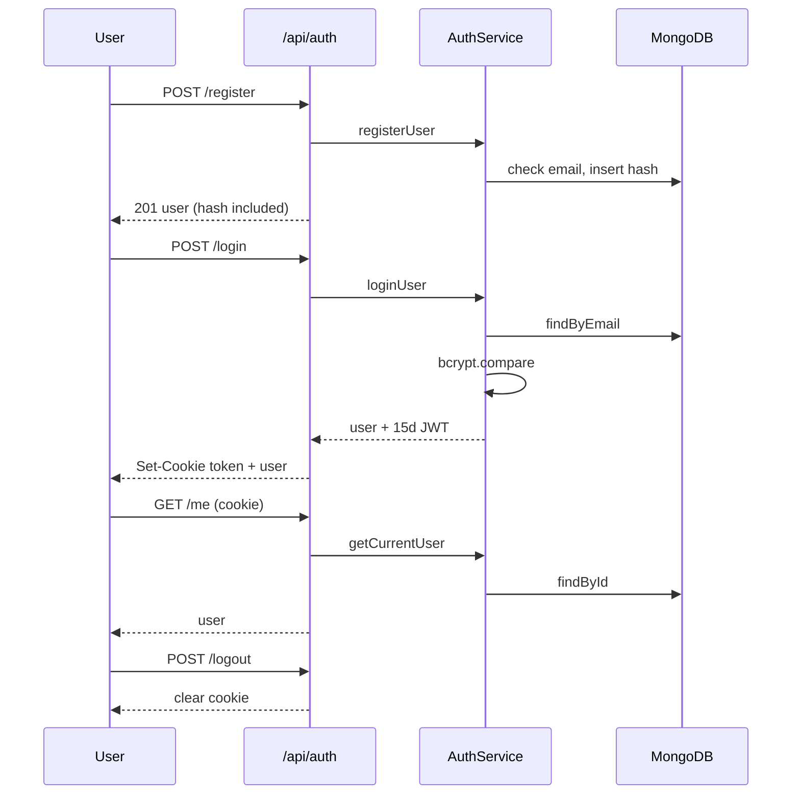

# Authentication Module

## 1. Purpose

Issue and verify the JWT cookie used by every protected route, and expose register/login/logout/current-user endpoints.

## 2. Responsibilities

- Validate credentials against the `users` collection.
- Hash passwords on registration.
- Sign JWTs and set/clear the `token` cookie.
- Verify tokens on protected routes (via shared middleware).
- Provide the current user profile.

It does **not** implement refresh tokens, password reset, email verification, OAuth, MFA, or account lockout.

## 3. Structure

```text
modules/auth/
├── controller/
│   └── auth.controller.ts
├── routes/
│   └── auth.route.ts
├── schema/
│   ├── login.schema.ts
│   └── register.schema.ts
└── services/
    ├── auth.service.ts
    └── auth.service.test.ts
```

The module has no model or repository; it reuses `modules/user/repo/user.repo.ts`.

## 4. Routes

| Method | Path | Middleware | Controller |
|---|---|---|---|
| POST | `/api/auth/register` | `validate(registerSchema)` | `registerUser` |
| POST | `/api/auth/login` | `validate(loginSchema)` | `loginUser` |
| POST | `/api/auth/logout` | `verifyToken` | `logoutUser` |
| GET | `/api/auth/me` | `verifyToken` | `getCurrentUser` |

Full contracts: [API authentication](../api/authentication.md).

## 5. Controller behavior

`AuthController` (`modules/auth/controller/auth.controller.ts`) is thin:

- Delegates to `AuthService`.
- On login, sets the cookie with `httpOnly`, `secure` and `sameSite` conditional on `NODE_ENV`, then returns the service result as JSON.
- On logout, clears the cookie with the same attributes.
- Forwards all errors with `next(error)`.

No response sanitization is performed. The password hash is serialized into responses from register, login, and `/me`.

## 6. Service behavior

`AuthService` (`modules/auth/services/auth.service.ts`):

| Method | Behavior | Notes |
|---|---|---|
| `registerUser` | Check email uniqueness → bcrypt hash (cost 10) → create user | Accepts a caller-supplied role |
| `loginUser` | Find by email → reject absent password → bcrypt compare → sign JWT | Does not check `isActive`; does not update `lastLogin` |
| `logoutUser` | Verify user exists | No token revocation |
| `refreshToken` | Placeholder returning `"newAccessToken"` | Not exposed |
| `getCurrentUser` | Find by id | Returns the document incl. hash |

## 7. Models

Uses `User` (`modules/user/model/user.model.ts`). Relevant fields: `email`, `password`, `role`, `isActive`, `provider`, `lastLogin`, `refreshToken`.

## 8. Validation

- `registerSchema`: `name` 2–100, valid email, password ≥ 6, optional `role` string defaulting to `pharmacist`.
- `loginSchema`: valid email, password ≥ 6.
- Role is not restricted in Zod; the Mongoose enum rejects unknown values with a 500.

## 9. Middleware

| Middleware | Role |
|---|---|
| `validate` | Body parsing/validation |
| `verifyToken` | Reads `req.cookies.token`, calls `verifyJwt`, assigns `req.user` |
| `verifyJwt` | `jwt.verify` with `JWT_SECRET`; throws generic error |
| `authorize` | Used at router mounts, not in this module |

## 10. Business rules

1. Email is unique and lowercased.
2. Passwords are bcrypt-hashed on registration and user creation.
3. JWT lifetime is 15 days; there is no renewal.
4. Logout only clears the cookie.
5. Role comes from the JWT and is trusted until expiry; changing a user's role does not invalidate existing tokens.
6. Deactivating a user does not prevent login or API use.

## 11. Dependencies

- `UserRepository`
- `AppError`
- `bcrypt`
- `jsonwebtoken`
- `generateJwtToken`

## 12. Workflows



## 13. Security findings

| Finding | Impact |
|---|---|
| Public registration accepts `role` | Privilege escalation to `owner` |
| Password hash returned in JSON | Credential material exposure |
| `isActive` ignored at login | Deactivated accounts remain usable |
| No refresh-token implementation | Long-lived bearer cookie cannot be revoked |
| Distinct login errors | User enumeration |
| No rate limiting/lockout | Brute force |
| No CSRF protection | Cross-site request risk in production (`SameSite=None`) |
| `bcrypt` in `devDependencies` | Production install with `--omit=dev` breaks auth |

## 14. Limitations and status

| Capability | Status |
|---|---|
| Local register/login/logout/me | Implemented |
| JWT cookie auth | Implemented |
| Refresh tokens | Not Implemented |
| Password reset / change flow | Not Implemented |
| Google OAuth | Not Implemented |
| Email verification | Not Implemented |
| Account lockout / rate limiting | Not Implemented |
| Token revocation | Not Implemented |

## Related documents

- [API authentication](../api/authentication.md)
- [Users and roles](users-and-roles.md)
- [Error handling](../api/error-handling.md)
