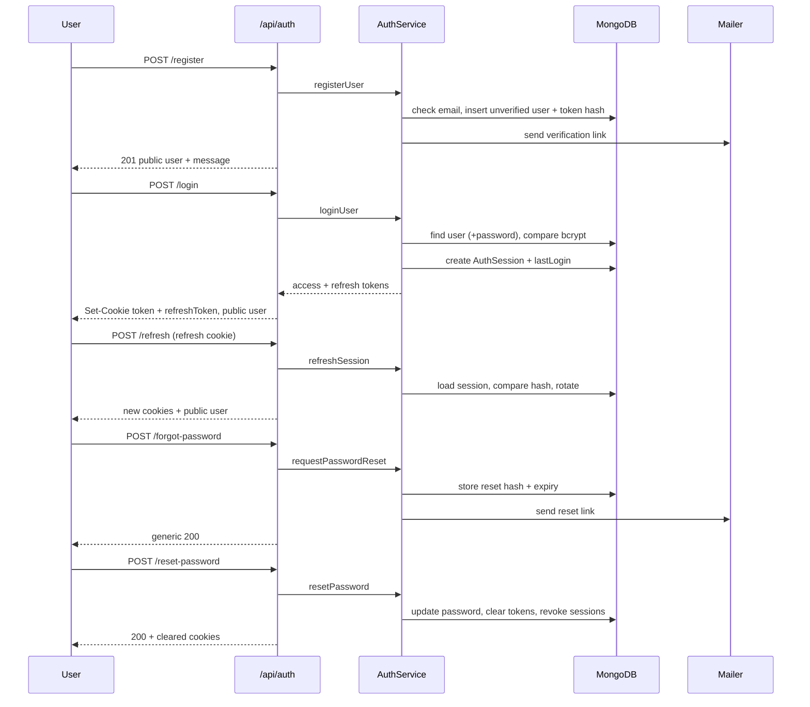

# Authentication Module

## 1. Purpose

Issue and verify short-lived access JWTs, maintain revocable multi-device
refresh sessions, verify email addresses, reset passwords, and expose the
current-user and session-management endpoints used by every protected route.

## 2. Responsibilities

- Validate credentials against the `users` collection.
- Hash passwords with bcrypt on registration and password reset.
- Sign short-lived access JWTs and rotating refresh JWTs.
- Store only SHA-256 hashes of refresh tokens, never the raw token.
- Track each device/session with browser, OS, device label, IP, and
  proxy-provided location.
- Send verification and password-reset emails.
- Rate-limit sensitive auth endpoints with Redis.
- Provide the current user profile and active-session list.

It does **not** implement Google OAuth, MFA, account lockout, or admin
impersonation.

## 3. Structure

```text
modules/auth/
├── controller/
│   └── auth.controller.ts
├── model/
│   └── authSession.model.ts
├── repo/
│   └── authSession.repo.ts
├── routes/
│   └── auth.route.ts
├── schema/
│   ├── email.schema.ts
│   ├── login.schema.ts
│   ├── register.schema.ts
│   ├── resetPassword.schema.ts
│   └── verifyEmail.schema.ts
├── services/
│   ├── auth.mailer.ts
│   ├── auth.service.ts
│   └── auth.service.test.ts
└── utils/
    ├── authConfig.ts
    ├── authCookies.ts
    ├── authTokens.ts
    └── authTokens.test.ts
```

The module reuses `modules/user/repo/user.repo.ts` and
`modules/user/utils/publicUser.ts`.

Rate limiting and Origin checks live in `shared/middleware/`. Request
IP/user-agent/location extraction lives in `shared/utils/requestContext.ts`.

## 4. Routes

| Method | Path | Middleware | Controller |
|---|---|---|---|
| POST | `/api/auth/register` | `verifyOrigin`, rate limit, `validate(registerSchema)` | `registerUser` |
| POST | `/api/auth/login` | `verifyOrigin`, rate limit, `validate(loginSchema)` | `loginUser` |
| POST | `/api/auth/refresh` | `verifyOrigin`, rate limit | `refreshToken` |
| POST | `/api/auth/logout` | `verifyOrigin` | `logoutUser` |
| POST | `/api/auth/logout-all` | `verifyOrigin`, `verifyToken` | `logoutAllSessions` |
| POST | `/api/auth/verify-email` | `verifyOrigin`, rate limit, `validate(verifyEmailSchema)` | `verifyEmail` |
| POST | `/api/auth/resend-verification` | `verifyOrigin`, rate limit, `validate(emailSchema)` | `resendVerification` |
| POST | `/api/auth/forgot-password` | `verifyOrigin`, rate limit, `validate(emailSchema)` | `requestPasswordReset` |
| POST | `/api/auth/reset-password` | `verifyOrigin`, rate limit, `validate(resetPasswordSchema)` | `resetPassword` |
| GET | `/api/auth/me` | `verifyOrigin`, `verifyToken` | `getCurrentUser` |
| GET | `/api/auth/sessions` | `verifyOrigin`, `verifyToken` | `listSessions` |
| DELETE | `/api/auth/sessions/:id` | `verifyOrigin`, `verifyToken` | `revokeSession` |

Full contracts: [API authentication](../api/authentication.md).

## 5. Controller behavior

`AuthController` is thin:

- Delegates to `AuthService`.
- Sets/clears the `token` (access) and `refreshToken` cookies through the
  shared cookie helper.
- Returns the public user shape for login, refresh, and `/me`.
- Clears both cookies whenever refresh fails.
- Revoking the current session also clears cookies.
- Forwards all errors with `next(error)`.

No password hash, reset hash, verification hash, or refresh token is ever
serialized in a response.

## 6. Service behavior

| Method | Behavior | Notes |
|---|---|---|
| `registerUser` | Check email uniqueness → bcrypt hash → create unverified pharmacist → send verification email | Public registration can no longer choose `owner` |
| `verifyEmail` | Hash token → find unexpired user → set `emailVerified` → clear token | Single use |
| `resendVerification` | Generic response; only sends for a local, active, unverified account | Prevents email enumeration |
| `loginUser` | Find with password → bcrypt compare → reject inactive/unverified → update `lastLogin` → create session | Generic `401` for bad credentials |
| `refreshSession` | Verify refresh JWT → load session → compare stored hash → rotate token pair → update device/IP | Hash mismatch revokes the session |
| `logoutSession` | Revoke the session referenced by the refresh cookie | Always clears cookies |
| `logoutAllSessions` | Revoke every active session for the user | Requires an access token |
| `listSessions` | Return active sessions with `isCurrent` | Uses `sessionId` from the access JWT |
| `revokeSession` | Verify ownership → revoke | Current session clears cookies |
| `requestPasswordReset` | Generic response; store hashed token + expiry; send link | No email for unknown/inactive accounts |
| `resetPassword` | Hash new password → mark email verified → clear reset fields → revoke all sessions | Single use |
| `getCurrentUser` | Find by id and return public user | No secrets |

## 7. Models

### `User`

Relevant fields: `name`, `email`, `password` (select false), `role`, optional
`phone` (SMS destination), `notificationPreferences` (`{ email, sms }`),
`isActive`, `emailVerified`, `lastLogin`, `provider`, plus select-false
verification/reset fields:

- `emailVerificationTokenHash`
- `emailVerificationExpiresAt`
- `passwordResetTokenHash`
- `passwordResetExpiresAt`
- legacy `refreshToken` / `refreshTokenExpiresAt` (unused by the new flow)

### `AuthSession`

- `userId`
- `refreshTokenHash` (SHA-256)
- `device`, `browser`, `os`, `ip`, `location`, `userAgent`
- `expiresAt` (TTL index removes the document automatically)
- `lastUsedAt`, `revokedAt`
- timestamps

## 8. Validation

- `registerSchema`: `name` 2–100, valid email (trimmed/lowercased),
  password ≥ 6. No `role` field.
- `loginSchema`: valid email, password ≥ 6.
- `emailSchema`: valid email.
- `verifyEmailSchema` / `resetPasswordSchema`: token length 32–256,
  password ≥ 6.
- Unknown body keys are stripped by the Zod object schemas.

## 9. Middleware

| Middleware | Role |
|---|---|
| `verifyOrigin` | Rejects browser requests whose `Origin` is not in `ALLOWED_ORIGINS`; requests without `Origin` are allowed |
| `rateLimit` | Redis fixed-window limiter; fails open with a logged error if Redis is down |
| `validate` | Body parsing/validation |
| `verifyToken` | Reads `req.cookies.token` and calls `verifyJwt` |
| `verifyJwt` | Verifies an access token, including the `type` claim and required claims |

## 10. Business rules

1. Email is unique and lowercased.
2. Passwords are bcrypt-hashed (cost 10) on registration and reset.
3. Access tokens live 15 minutes by default; refresh tokens live 7 days.
4. Refresh tokens rotate on every successful refresh.
5. A refresh token is accepted only if its SHA-256 hash matches the current
   session hash, or the immediately previous hash inside the 60-second grace
   window.
6. Logout revokes only the current refresh session; `logout-all` revokes all.
7. Password reset revokes every refresh session.
8. Public registration always creates a `pharmacist`.
9. Existing users without an `emailVerified` field are treated as verified;
   new local registrations must verify.
10. Deactivated users cannot log in or refresh.
11. At most `MAX_SESSIONS_PER_USER` active sessions are kept; the oldest are
    revoked after a new login.
12. Access tokens already issued remain valid until they expire, even after a
    reset or logout. The maximum exposure is the access-token lifetime.

## 11. Dependencies

- `UserRepository`, `AuthSessionRepo`
- `AppError`
- `bcrypt`, `jsonwebtoken`, `nodemailer`
- `ioredis` (rate limiting)
- `ua-parser-js` (device/browser/OS labels)

## 12. Workflows



## 13. Security controls

| Control | Status |
|---|---|
| Password/reset/verification hashes in responses | Removed |
| Public role escalation on registration | Fixed (always pharmacist) |
| Refresh-token storage | SHA-256 hash only |
| Refresh rotation + reuse detection | Implemented |
| Inactive-account checks | Login and refresh |
| Email enumeration on login | Generic `401`; status checks after password compare |
| Email enumeration on reset | Generic `200` |
| Rate limiting | Redis fixed window on register/login/refresh/reset/verification |
| CSRF/Origin hardening | Global double-submit CSRF middleware plus `verifyOrigin` on auth routes |
| Token revocation | Refresh sessions revocable; access tokens expire in 15m |
| Email verification | Implemented |

## 14. Limitations and status

| Capability | Status | Phase |
|---|---|---|
| Local register/login/logout/me | Implemented | — |
| JWT access cookie auth | Implemented | — |
| Refresh tokens + rotation | Implemented | — |
| Multi-device session list/revoke | Implemented | — |
| Password reset | Implemented | — |
| Email verification | Implemented | — |
| Rate limiting | Implemented (IP-based, Redis) | — |
| Google OAuth | Still open | Phase 6 |
| MFA | Still open | Phase 6 |
| Account lockout | Still open | Phase 6 |
| Immediate access-token revocation | Still open | Phase 6 |
| Geo-IP location database | Needs decision | Phase 6 |

## Related documents

- [API authentication](../api/authentication.md)
- [Users and roles](users-and-roles.md)
- [Environment variables](../development/environment-variables.md)
- [Error handling](../api/error-handling.md)
