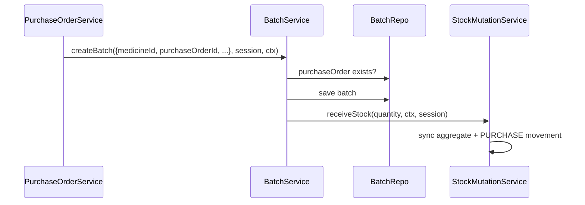
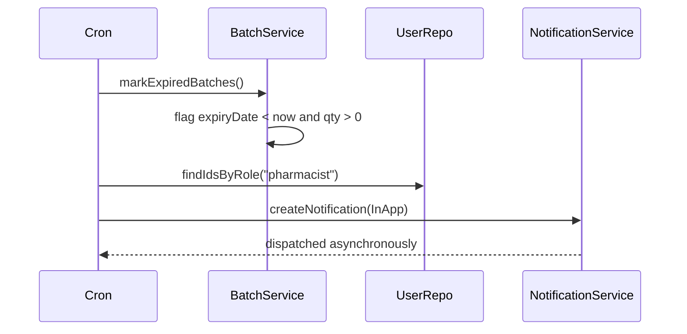

# Batches and Expiry

## 1. Purpose

Track inventory at batch level: quantity, cost, selling price, manufacturing/expiry dates, and expiry state. Batches are the physical stock unit used by FEFO sales and purchase receiving.

## 2. Responsibilities

- Batch CRUD and lookup by medicine.
- Identify sellable batches.
- Deduct/increase/adjust batch quantity.
- Flag expired batches.
- Confirm disposal of expired stock.
- Provide batch data to sales, purchasing, dashboard, and smart reorder.

## 3. Structure

```text
modules/batch/
├── controller/batch.controller.ts
├── model/medicineBatch.model.ts
├── repo/medicineBatch.repo.ts
├── routes/batch.routes.ts
├── schema/batch.schema.ts        # present but unused
├── service/batch.service.ts
└── types/batchAllocation.type.ts
```

## 4. Routes

Base: `/api/batches`, roles: all three. No Zod middleware.

| Method | Path | Purpose |
|---|---|---|
| GET | `/` | List batches |
| GET | `/:id` | Get batch |
| POST | `/` | Create batch |
| PATCH | `/:id` | Update batch |
| DELETE | `/:id` | Delete a zero-stock batch |
| GET | `/medicine/:medicineId` | First batch for medicine |
| GET | `/medicine/:medicineId/available` | Sellable batches |
| GET | `/expired` | Batches past expiry date |
| GET | `/expired/awaiting-disposal` | Expired with stock |
| GET | `/low-stock?threshold=` | Per-batch low stock |
| POST | `/mark-expired` | Flag expired |
| POST | `/:id/deduct` | Deduct quantity |
| POST | `/:id/increase` | Increase quantity |
| POST | `/:id/adjust` | Set absolute quantity |
| GET | `/:id/history` | Batch metadata |
| POST | `/:id/confirm-disposal` | Dispose expired stock |

Full contracts: [endpoints.md](../api/endpoints.md#batches).

## 5. Controller

`BatchController` wraps handlers with `asyncHandler`.

- Numeric query/body checks are manual (`threshold`, `quantity`).
- Create, update, deduct, increase, adjust, and disposal require an authenticated user for movement attribution.
- Movement metadata (`referenceId`, `referenceType`, `movementType`, `remarks`) is separated from the update body.

## 6. Service

`BatchService` (`modules/batch/service/batch.service.ts`):

| Method | Behavior |
|---|---|
| `createBatch` | Requires the purchase order and a movement context; creates the batch with `quantityRemaining = quantityReceived`, then syncs the aggregate and writes one `PURCHASE` movement |
| `getBatchById` / `getAllBatches` | Reads. Missing batch throws `AppError.notFound` → 404 |
| `getAvailableBatches` | `quantityRemaining > 0`, `expiryDate > now`, and `!isExpired` |
| `updateBatch` | Field whitelist; validates dates and quantity; quantity changes go through `setBatchStock`; expiry edits resync the aggregate |
| `deleteBatch` | Rejects batches with `quantityRemaining > 0` |
| `deductQuantity` | Delegates to `StockMutationService.decreaseBatchStock` |
| `increaseQuantity` | Delegates to `StockMutationService.increaseBatchStock`; rejects above `quantityReceived` |
| `adjustStock` | Delegates to `StockMutationService.setBatchStock`; absolute set within `quantityReceived` |
| `markExpiredBatches` | Sets `isExpired: true` for batches with stock whose `expiryDate < now`; returns affected ids |
| `getExpiredBatches` | Filters by `expiryDate < now` only |
| `confirmDisposal` | Requires `isExpired` and stock > 0; writes batch to 0, syncs aggregate, and records one `EXPIRED` movement in one transaction |
| `getExpiredAwaitingDisposal` | `isExpired && quantityRemaining > 0` |
| `getLowStockBatches` | Per-batch threshold filter |
| `getBatchByMedicineId` | `findOne`, not a list |
| `getBatchHistory` | Returns batch metadata only, not movements |

## 7. Model

`Batch` (`modules/batch/model/medicineBatch.model.ts`). Fields, indexes, and validators: [Schema and relationships](../database/schema-and-relationships.md#51-batches-batch).

Important validators:

```text
expiryDate > manufacturingDate
quantityRemaining <= quantityReceived
isActive === false requires quantityRemaining === 0
```

The HTTP update path enforces the same rules explicitly because `findByIdAndUpdate` skips document validators.

## 8. Validation

`modules/batch/schema/batch.schema.ts` exists but is not imported by the router. Request checks cover:

- positive `quantity` on deduct/increase;
- non-negative `quantity` on adjust;
- non-negative `threshold`;
- authenticated user on create/update/deduct/increase/adjust/disposal;
- immutable fields rejected on update;
- date ordering and quantity bounds.

## 9. Middleware

`verifyToken` + `authorize` at `/api/batches`. No module-specific middleware.

## 10. Business rules

### Sellable definition

A batch is sellable when:

```text
quantityRemaining > 0
AND expiryDate > now
AND isExpired === false
```

This is enforced in both `findSellableBatches` (sales) and `getAvailableBatches` (available-batches endpoint).

### Expiry

- Expired means `expiryDate < now`, regardless of `isExpired`.
- `isExpired` is set by `POST /batches/mark-expired` and by the nightly cron.
- Sales exclude both expired dates and flagged batches.
- Expired batches are not removed from inventory until disposal is confirmed.
- The expiry cron sends an in-app notification to all pharmacists but does not zero stock.

### Disposal

1. Batch must be flagged `isExpired`.
2. Batch must have remaining quantity.
3. Set `quantityRemaining = 0`.
4. Recompute aggregate stock from batch truth.
5. Write one movement with movement type `EXPIRED`.

All steps run in one transaction; a failure rolls back the batch, aggregate, and movement.

### Adjustment

- `POST /:id/adjust` is an absolute set, not a delta.
- The value must be between 0 and `quantityReceived`.
- One movement records the absolute delta.
- Aggregate is synced in the same transaction.

### Allocation endpoint

`GET /batches/medicine/:medicineId/allocate` was removed. It mutated stock, wrote no movements, and always returned `[]`. Sales allocate through `InventoryService.sellMedicine`, which applies FEFO inside the sale transaction.

## 11. Dependencies

- `PurchaseOrderRepo` (batch creation validation)
- `StockMutationService` (batch mutation, aggregate sync, movements)
- Used by `InventoryService.sellMedicine`, `DashboardService`, `SmartReorderService`, `PurchaseOrderService`

## 12. Workflows

### Receiving creates batches



### Nightly expiry check



## 13. Limitations and risks

| Issue | Status | Phase |
|---|---|---|
| `isActive` validator blocked positive-quantity creation | Already fixed (active batches may hold stock) | — |
| No movement on deduct/increase/adjust | Fixed (all route through `StockMutationService`) | — |
| `allocateStock` returned an empty array and mutated on GET | Already fixed (endpoint and client stub removed) | — |
| Update paths skip validators | Fixed via explicit service guards | — |
| `getBatchByMedicineId` returns one batch | Still open | Phase 5 |
| `getBatchHistory` lacks movement history | Still open | Phase 5 |
| Available endpoint ignores `isExpired` | Fixed | — |
| No partial receiving/batch split | Needs decision | Phase 6 |
| No batch merge/transfer | Needs decision | Phase 6 |
| No transaction around disposal | Fixed | — |
| No request validation | Still open | Phase 3 |
| Deletion allowed with stock | Fixed (409 when stock remains) | — |
| Zero-stock batch can be deleted while sale items/movements reference it | Still open | Phase 5/6 |
| `markExpiredBatches` does not sync aggregates | Known limitation; next mutation/sync corrects it | Phase 5 |

## Related documents

- [FEFO/FIFO](../business-logic/fefo-fifo.md)
- [Inventory data model](../database/inventory-data-model.md)
- [Inventory management](../business-logic/inventory-management.md)
- [Purchases](purchases.md)
