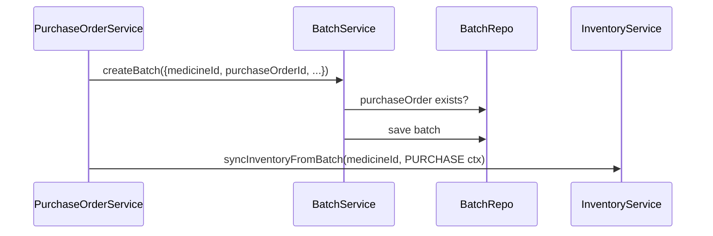
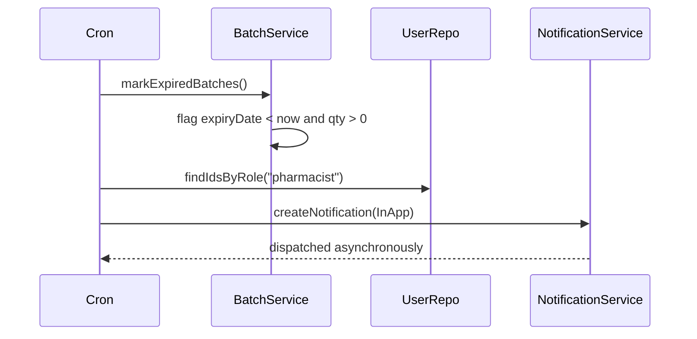

  # Batches and Expiry

## 1. Purpose

Track inventory at batch level: quantity, cost, selling price, manufacturing/expiry dates, and expiry state. Batches are the physical stock unit used by FEFO sales and purchase receiving.

## 2. Responsibilities

- Batch CRUD and lookup by medicine.
- Identify sellable batches.
- Deduct/increase/adjust batch quantity.
- Flag expired batches.
- Confirm disposal of expired stock.
- Provide batch data to sales, purchasing, dashboard, and smart reorder.

## 3. Structure

```text
modules/batch/
├── controller/batch.controller.ts
├── model/medicineBatch.model.ts
├── repo/medicineBatch.repo.ts
├── routes/batch.routes.ts
├── schema/batch.schema.ts        # present but unused
├── service/batch.service.ts
└── types/batchAllocation.type.ts
```

## 4. Routes

Base: `/api/batches`, roles: all three. No Zod middleware.

| Method | Path | Purpose |
|---|---|---|
| GET | `/` | List batches |
| GET | `/:id` | Get batch |
| POST | `/` | Create batch |
| PATCH | `/:id` | Update batch |
| DELETE | `/:id` | Hard delete |
| GET | `/medicine/:medicineId` | First batch for medicine |
| GET | `/medicine/:medicineId/available` | Sellable batches |
| GET | `/expired` | Batches past expiry date |
| GET | `/expired/awaiting-disposal` | Expired with stock |
| GET | `/low-stock?threshold=` | Per-batch low stock |
| POST | `/mark-expired` | Flag expired |
| POST | `/:id/deduct` | Deduct quantity |
| POST | `/:id/increase` | Increase quantity |
| POST | `/:id/adjust` | Set absolute quantity |
| GET | `/:id/history` | Batch metadata |
| POST | `/:id/confirm-disposal` | Dispose expired stock |

Full contracts: [endpoints.md](../api/endpoints.md#batches).

## 5. Controller

`BatchController` wraps handlers with `asyncHandler`.

- Numeric query/body checks are manual (`threshold`, `quantity`).
- `confirmDisposal` requires an authenticated user for movement attribution.
- All other actions do not pass a user id to the service.

## 6. Service

`BatchService` (`modules/batch/service/batch.service.ts`):

| Method | Behavior |
|---|---|
| `createBatch` | Requires the purchase order to exist, then creates the batch. No inventory sync. |
| `getBatchById` / `getAllBatches` | Reads. Missing batch throws plain `Error` → 500. |
| `getAvailableBatches` | All batches for medicine with `quantityRemaining > 0` and `expiryDate > now` (does not check `isExpired`). |
| `updateBatch` / `deleteBatch` | Generic update/delete; no sync or movement. |
| `deductQuantity` | Checks remaining, subtracts, updates. No movement. |
| `increaseQuantity` | Adds, updates. No movement and no upper bound check. |
| `adjustStock` | Sets absolute `quantityRemaining`, then syncs aggregate. No movement. |
| `markExpiredBatches` | Sets `isExpired: true` for batches with stock whose `expiryDate < now`; returns affected ids. |
| `getExpiredBatches` | Filters by `expiryDate < now` only. |
| `confirmDisposal` | Requires `isExpired` and stock > 0; sets batch to 0; calls `InventoryService.decreaseStock`, which records the requested `EXPIRED` movement type. |
| `getExpiredAwaitingDisposal` | `isExpired && quantityRemaining > 0`. |
| `getLowStockBatches` | Per-batch threshold filter. |
| `getBatchByMedicineId` | `findOne`, not a list. |
| `getBatchHistory` | Returns batch metadata only, not movements. |

## 7. Model

`Batch` (`modules/batch/model/medicineBatch.model.ts`). Fields, indexes, and validators: [Schema and relationships](../database/schema-and-relationships.md#51-batches-batch).

Important validators:

```text
expiryDate > manufacturingDate
quantityRemaining <= quantityReceived
isActive === false requires quantityRemaining === 0
```

Active batches may hold stock; only a deactivated batch must be at zero. The invariant is enforced on document `save()`; `findByIdAndUpdate` paths skip validators, so the HTTP update path still needs an explicit guard.

## 8. Validation

`modules/batch/schema/batch.schema.ts` exists but is not imported by the router. The only request checks are:

- positive `quantity` on deduct/increase;
- non-negative `quantity` on adjust;
- non-negative `threshold`;
- authenticated user on disposal.

No date, price, or quantity relationship checks at the HTTP layer; only Mongoose validators on `save()`.

## 9. Middleware

`verifyToken` + `authorize` at `/api/batches`. No module-specific middleware.

## 10. Business rules

### Sellable definition

A batch is sellable when:

```text
quantityRemaining > 0
AND expiryDate > now
AND isExpired === false
```

This is enforced in `findSellableBatches` (used by sales) but **not** in `getAvailableBatches` (used by the available-batches endpoint), which omits the `isExpired` check.

### Expiry

- Expired means `expiryDate < now`, regardless of `isExpired`.
- `isExpired` is set by `POST /batches/mark-expired` and by the nightly cron.
- Sales exclude both expired dates and flagged batches.
- Expired batches are not removed from inventory until disposal is confirmed.
- The expiry cron sends an in-app notification to all pharmacists but does not zero stock.

### Disposal

1. Batch must be flagged `isExpired`.
2. Batch must have remaining quantity.
3. Set `quantityRemaining = 0`.
4. Decrease aggregate stock by the disposed quantity.
5. Write a movement with the requested `EXPIRED` movement type (the context type is no longer overwritten).

No transaction; a failure between steps leaves partial state.

### Adjustment

- `POST /:id/adjust` is an absolute set, not a delta.
- No check against `quantityReceived` (validators are skipped by `findByIdAndUpdate`).
- No movement record.
- Aggregate is synced after the update.

### Allocation endpoint

`GET /batches/medicine/:medicineId/allocate` was removed. It mutated stock, wrote no movements, and always returned `[]`. Sales allocate through `InventoryService.sellMedicine`, which applies FEFO inside the sale transaction.

## 11. Dependencies

- `PurchaseOrderRepo` (batch creation validation)
- `InventoryService` (sync and disposal)
- Used by `InventoryService.sellMedicine`, `DashboardService`, `SmartReorderService`, `PurchaseOrderService`

## 12. Workflows

### Receiving creates batches



### Nightly expiry check



## 13. Limitations and risks

| Issue | Status | Phase |
|---|---|---|
| `isActive` validator blocked positive-quantity creation | Already fixed (active batches may hold stock) | — |
| No movement on deduct/increase/adjust | Still open | Phase 2 |
| `allocateStock` returned an empty array and mutated on GET | Already fixed (endpoint and client stub removed) | — |
| Update paths skip validators, so `isActive`/quantity invariants are unenforced after create | Still open | Phase 2 |
| `getBatchByMedicineId` returns one batch | Still open | Phase 5 |
| `getBatchHistory` lacks movement history | Still open | Phase 5 |
| Available endpoint ignores `isExpired` | Still open | Phase 2 |
| No partial receiving/batch split | Needs decision | Phase 6 |
| No batch merge/transfer | Needs decision | Phase 6 |
| No transaction around disposal | Still open | Phase 2 |
| No request validation | Still open | Phase 3 |
| Deletion allowed with stock | Still open | Phase 2 |

## Related documents

- [FEFO/FIFO](../business-logic/fefo-fifo.md)
- [Inventory data model](../database/inventory-data-model.md)
- [Inventory management](../business-logic/inventory-management.md)
- [Purchases](purchases.md)
