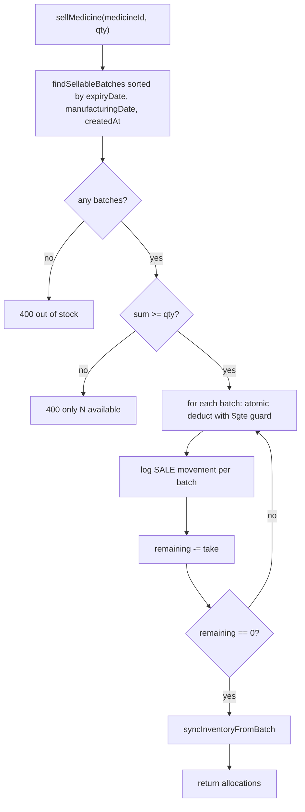

# Inventory Module

## 1. Purpose

Maintain the per-medicine aggregate stock record (`Inventory`), expose manual stock operations, and provide the shared `InventoryService` used by sales, purchasing, returns, and batch disposal.

## 2. Responsibilities

- Create/read/update/delete aggregate inventory rows.
- Increase, decrease, reserve, and release stock.
- Reconcile aggregate stock from batch quantities.
- Search medicines that have available stock.
- Write `InventoryMovement` audit records.
- Provide internal helpers to other modules (`sellMedicine`, `returnMedicine`, `syncInventoryFromBatch`).

## 3. Structure

```text
modules/inventory/
├── controllers/inventory.controller.ts
├── model/
│   ├── inventory.model.ts
│   ├── inventoryMovement.model.ts
│   └── stockAdjustment.model.ts
├── repo/
│   ├── inventory.repo.ts
│   ├── inventoryMovement.repo.ts
│   └── stockAdjustment.repo.ts
├── routes/inventory.routes.ts
├── schema/
│   ├── inventory.schema.ts
│   └── inventoryMovement.schema.ts
└── services/
    ├── inventory.service.ts
    ├── inventoryMovement.service.ts
    └── stockAdjust.service.ts     # not wired
```

## 4. Routes

Base: `/api/inventory`, roles: all three. No Zod middleware.

| Method | Path | Purpose |
|---|---|---|
| POST | `/` | Create aggregate row |
| GET | `/` | List all |
| GET | `/:id` | Get by inventory id |
| GET | `/medicine/:medicineId` | Get by medicine |
| GET | `/medicines/search?query=` | Sellable medicine search |
| POST | `/:medicineId/increase` | Increase aggregate |
| POST | `/:medicineId/decrease` | Decrease aggregate |
| POST | `/:medicineId/reserve` | Reduce available |
| POST | `/:medicineId/release` | Restore available |
| POST | `/:medicineId/sync` | Recompute from batches |
| PATCH | `/:id` | Update fields |
| DELETE | `/:id` | Delete row |

Full contracts: [endpoints.md](../api/endpoints.md#inventory).

## 5. Controller

`InventoryController` uses a local `asyncHandler` and returns `{ success: true, data }` (or a message on delete).

Behavior worth noting:

- `createInventory` accepts a movement context only when both `referenceId` and `referenceType` are present.
- `increaseStock` rejects movement types other than `PURCHASE`/`RETURN`.
- `decreaseStock` rejects movement types other than `SALE`/`EXPIRED`/`ADJUSTMENT`.
- `updateInventory` separates movement-context fields from update fields.
- `deleteInventory` reads an optional body even though it is a DELETE.

## 6. Services

### InventoryService

| Method | Behavior |
|---|---|
| `createInventory` | Creates a row; optionally logs a movement for `currentStock` |
| `increaseStock` | `currentStock += qty`, `availableStock += qty`, logs movement |
| `decreaseStock` | Requires `availableStock >= qty`, subtracts, logs the requested `SALE`/`EXPIRED`/`ADJUSTMENT` movement type |
| `reserveStock` | Requires enough available, subtracts from `availableStock` only |
| `releaseReservedStock` | Adds to `availableStock` only |
| `syncInventoryFromBatch` | Recomputes `currentStock` from batches and `availableStock = current - reserved` |
| `updateInventory` | Generic update; logs a movement for the `currentStock` delta when context is supplied |
| `sellMedicine` | FEFO allocation, per-batch deduction, movement per batch, aggregate sync |
| `returnMedicine` | Condition-dependent restoration |
| `deleteInventory` | Deletes; logs an adjustment when context and stock are present |

### InventoryMovementService

Validates that the medicine exists, the batch exists, the batch belongs to the medicine, and the user exists. It then inserts a movement. `batchId` is mandatory even though the schema marks it optional.

Read helpers (`getMovementsByMedicineId`, `getMovementsByBatch`, `getMovementsByReference`, `getRecentMovements`) exist but are not exposed through inventory routes; only the dashboard uses `getRecentMovements`.

### StockAdjustmentService

Implements `adjustStock`, `getAdjustments`, and `reverseAdjustment`, but:

- It is not constructed in `app/container.ts`.
- No route calls it.
- `adjustStock` only writes a log; it does not change stock.

Status: **Not Implemented / dead code**.

## 7. Models

- `Inventory`: aggregate row, intended one per medicine, no unique index.
- `InventoryMovement`: append-only audit log.
- `StockAdjustment`: unused adjustment log.

See [Inventory data model](../database/inventory-data-model.md).

## 8. Validation

- `createInventorySchema` and `createInventoryMovementSchema` exist but are **not wired**.
- Controller checks are limited to movement type, `performedBy`, and numeric query parameters.
- No ObjectId validation.
- No quantity validation on `POST /inventory` (negative values can reach Mongoose; only `availableStock` has a validator).

## 9. Middleware

`verifyToken` + `authorize` at the mount. Nothing else.

## 10. Business rules

1. `decreaseStock` and `reserveStock` require sufficient `availableStock`.
2. `increaseStock` does not verify batch existence before adjusting the aggregate, but the movement service does (so it fails after the aggregate update when no session is used).
3. Increase/decrease do not update batches.
4. Sync overwrites `currentStock` from sellable batches (positive, unexpired, not flagged), with or without a session.
5. Movement type is constrained by the controller, not by the service.
6. `reservedStock` is never updated by reserve/release.
7. Duplicate inventory rows for one medicine are possible and are not detected.
8. Deleting an inventory row is allowed even with stock and movements; a movement is logged only when context is supplied.

## 11. Dependencies

Used by:

- `SalesService` (`sellMedicine`)
- `ReturnService` (`returnMedicine`)
- `PurchaseOrderService` (`syncInventoryFromBatch`)
- `BatchService` (`syncInventoryFromBatch`, `decreaseStock` for disposal)
- `DashboardService` (through `InventoryRepo` and `InventoryMovementService`)

Depends on:

- `InventoryRepo`, `InventoryMovementRepo`, `MedicineBatchRepo`
- `InventoryMovementService`

## 12. Workflows

### FEFO sale allocation



### Manual increase

1. Load inventory by medicine.
2. Add quantity to `currentStock` and `availableStock`.
3. Update row.
4. Insert movement (`PURCHASE` or `RETURN`).
5. Return updated row.

No batch change.

## 13. Limitations and risks

| Issue | Status | Phase |
|---|---|---|
| `reservedStock` never changes | Needs decision (keep and maintain, or remove from `availableStock`) | Phase 2 |
| Reserve/release not tied to orders | Needs decision | Phase 2 |
| Sync endpoint included expired/flagged/zero batches without a session | Already fixed (one sellable filter in both branches) | — |
| Reserve/release defaults used invalid movement `referenceType` | Already fixed (enum widened) | — |
| Decrease always logged `SALE` | Already fixed (respects `EXPIRED`/`ADJUSTMENT` context) | — |
| Inventory/batch drift on manual operations | Still open | Phase 2 |
| Duplicate inventory rows possible | Still open | Phase 2 |
| No validation middleware | Still open | Phase 3 |
| `StockAdjustment` unreachable | Needs decision | Phase 6 |
| Movement read endpoints absent | Still open | Phase 5 |
| No stocktake/bulk adjustment workflow | Needs decision | Phase 6 |
| No optimistic concurrency on aggregate updates | Still open | Phase 5 |

## Related documents

- [Inventory data model](../database/inventory-data-model.md)
- [Inventory management](../business-logic/inventory-management.md)
- [Stock movements](../business-logic/stock-movements.md)
- [Batches](batches.md)
