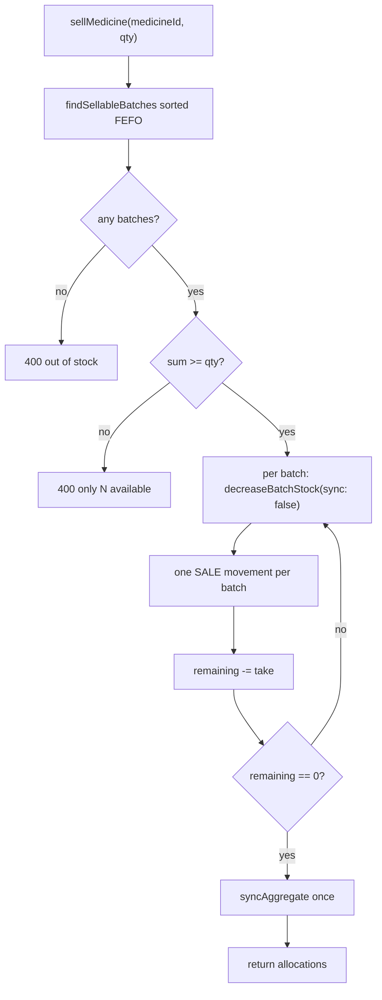

# Inventory Module

## 1. Purpose

Maintain the per-medicine aggregate stock record (`Inventory`), expose manual stock operations, and provide the shared `InventoryService` and `StockMutationService` used by sales, purchasing, returns, batch operations, and disposal.

## 2. Responsibilities

- Create/read/update/delete aggregate inventory rows.
- Increase, decrease, reserve, and release stock.
- Reconcile aggregate stock from batch quantities.
- Search medicines that have available stock.
- Write `InventoryMovement` audit records.
- Provide internal helpers to other modules (`sellMedicine`, `returnMedicine`, `syncInventoryFromBatch`).

## 3. Structure

```text
modules/inventory/
├── controllers/inventory.controller.ts
├── model/
│   ├── inventory.model.ts
│   ├── inventoryMovement.model.ts
│   └── stockAdjustment.model.ts
├── repo/
│   ├── inventory.repo.ts
│   ├── inventoryMovement.repo.ts
│   └── stockAdjustment.repo.ts
├── routes/inventory.routes.ts
├── schema/
│   ├── inventory.schema.ts
│   └── inventoryMovement.schema.ts
├── types/
│   └── stockMovement.type.ts
└── services/
    ├── inventory.service.ts
    ├── inventoryMovement.service.ts
    ├── stockMutation.service.ts
    └── stockAdjust.service.ts     # not wired
```

## 4. Routes

Base: `/api/inventory`, roles: all three. No Zod middleware.

| Method | Path | Purpose |
|---|---|---|
| POST | `/` | Create aggregate row from batch truth |
| GET | `/` | List all |
| GET | `/:id` | Get by inventory id |
| GET | `/medicine/:medicineId` | Get by medicine |
| GET | `/medicines/search?query=` | Sellable medicine search |
| POST | `/:medicineId/increase` | Increase batch + aggregate |
| POST | `/:medicineId/decrease` | Decrease batch + aggregate |
| POST | `/:medicineId/reserve` | Increase reserved, reduce available |
| POST | `/:medicineId/release` | Reduce reserved, restore available |
| POST | `/:medicineId/sync` | Recompute from batches |
| PATCH | `/:id` | Update `reservedStock` only |
| DELETE | `/:id` | Delete a zero-stock row |

Full contracts: [endpoints.md](../api/endpoints.md#inventory).

## 5. Controller

`InventoryController` uses a local `asyncHandler` and returns `{ success: true, data }` (or a message on delete).

Behavior worth noting:

- `createInventory` ignores client `currentStock`/`availableStock`; stock is derived from batches.
- `increaseStock`/`decreaseStock` require `batchId` and a positive quantity.
- `reserveStock`/`releaseReservedStock` accept an optional `batchId`; `referenceId` and `referenceType` are required for the movement.
- `syncInventoryFromBatch` supplies an `ADJUSTMENT` context when authenticated, so drift corrections are audited.
- `updateInventory` rejects `currentStock`/`availableStock`; only `reservedStock` applies.
- `deleteInventory` reads an optional body even though it is a DELETE; the delete guard takes precedence.

## 6. Services

### InventoryService (facade)

| Method | Behavior |
|---|---|
| `createInventory` | Derives `currentStock` from batch truth; validates `reservedStock`; maps duplicate keys to 409 |
| `increaseStock` | Requires `batchId`; delegates to `StockMutationService.increaseBatchStock` |
| `decreaseStock` | Requires `batchId`; delegates to `StockMutationService.decreaseBatchStock` |
| `reserveStock` | Delegates reservation accounting |
| `releaseReservedStock` | Delegates release accounting |
| `syncInventoryFromBatch` | Delegates to `StockMutationService.syncAggregate` |
| `updateInventory` | Accepts only `reservedStock`/`lastUpdated`; recomputes `currentStock` and `availableStock` |
| `sellMedicine` | FEFO allocation; one batch mutation per allocation; one aggregate sync |
| `returnMedicine` | GOOD restores the original batch; DAMAGED/EXPIRED/OPENED writes one write-off movement |
| `deleteInventory` | Blocks deletion while stock or reservations exist |

### StockMutationService

The single transactional write path. It owns batch mutation, aggregate recompute, and movement creation. If a caller supplies a session it joins it; otherwise it starts and ends its own transaction.

### InventoryMovementService

Validates that the medicine exists, the optional batch exists and belongs to the medicine, and the user exists. It then inserts a movement. `batchId` is optional for aggregate-only operations.

Read helpers (`getMovementsByMedicineId`, `getMovementsByBatch`, `getMovementsByReference`, `getRecentMovements`) exist but are not exposed through inventory routes; only the dashboard uses `getRecentMovements`.

### StockAdjustmentService

Implements `adjustStock`, `getAdjustments`, and `reverseAdjustment`, but:

- It is not constructed in `app/container.ts`.
- No route calls it.
- `adjustStock` only writes a log; it does not change stock.

Status: **Not Implemented / dead code**.

## 7. Models

- `Inventory`: aggregate row, unique per medicine.
- `InventoryMovement`: append-only audit log; `batchId` optional.
- `StockAdjustment`: unused adjustment log.

See [Inventory data model](../database/inventory-data-model.md).

## 8. Validation

- `createInventorySchema` and `createInventoryMovementSchema` exist but are **not wired**.
- Controller checks cover movement type, `performedBy`, positive quantities, and required `batchId` on increase/decrease.
- `StockMutationService` validates batch ownership, upper bounds, and session ownership.
- No ObjectId validation.
- No quantity validation on `POST /inventory` for client-supplied `currentStock`/`availableStock`, because those fields are ignored.

## 9. Middleware

`verifyToken` + `authorize` at the mount. Nothing else.

## 10. Business rules

1. `currentStock` is the sum of sellable batches; `availableStock = currentStock - reservedStock`.
2. Every stock mutation updates batch + aggregate + one movement in one transaction.
3. `syncAggregate` is the only aggregate recompute.
4. `POST /inventory/:medicineId/sync` is the only operation that intentionally writes an `ADJUSTMENT` for a drift correction.
5. Reservations maintain `reservedStock`; reconciliation clamps it if batch truth falls below outstanding holds.
6. Duplicate inventory rows are rejected by the unique index.
7. Deleting an inventory row is blocked while stock or reservations exist.

## 11. Dependencies

Used by:

- `SalesService` (`sellMedicine`, `increaseStock` on delete)
- `ReturnService` (`returnMedicine`)
- `PurchaseOrderService` (through `BatchService.createBatch`)
- `BatchService` (through `StockMutationService`)
- `DashboardService` (through `InventoryRepo` and `InventoryMovementService`)

Depends on:

- `InventoryRepo`, `MedicineBatchRepo`
- `StockMutationService`
- `InventoryMovementService`

## 12. Workflows

### FEFO sale allocation



### Manual increase

1. Require a positive quantity and `batchId`.
2. Increase the batch by the quantity.
3. Recompute the aggregate from batch truth.
4. Insert one `PURCHASE`/`RETURN` movement.
5. Return the updated aggregate row.

## 13. Limitations and risks

| Issue | Status | Phase |
|---|---|---|
| `reservedStock` never changed | Fixed (reserve/release maintain it) | — |
| Reserve/release not tied to orders | Still open | Phase 6 |
| Sync endpoint included expired/flagged/zero batches without a session | Already fixed (one sellable filter in both branches) | — |
| Reserve/release defaults used invalid movement `referenceType` | Already fixed (enum widened) | — |
| Decrease always logged `SALE` | Fixed (respects `EXPIRED`/`ADJUSTMENT` context) | — |
| Inventory/batch drift on manual operations | Fixed for wired mutations; expiry flagging still needs a sync | Phase 2 |
| Duplicate inventory rows possible | Fixed (unique index; dedupe before deploy) | — |
| No validation middleware | Still open | Phase 3 |
| `StockAdjustment` unreachable | Needs decision | Phase 6 |
| Movement read endpoints absent | Still open | Phase 5 |
| No stocktake/bulk adjustment workflow | Needs decision | Phase 6 |
| No optimistic concurrency on aggregate updates | Still open | Phase 5 |

## Related documents

- [Inventory data model](../database/inventory-data-model.md)
- [Inventory management](../business-logic/inventory-management.md)
- [Stock movements](../business-logic/stock-movements.md)
- [Batches](batches.md)
