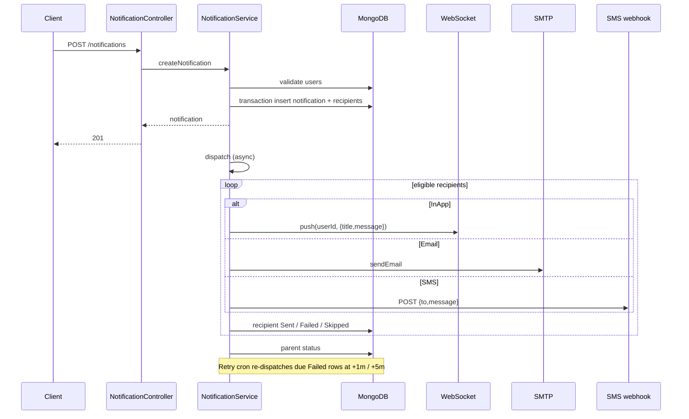

# Notifications

## 1. Purpose

Create notifications, fan them out to selected users, and deliver them in-app
(WebSocket), by email (Nodemailer), or by SMS (HTTP webhook). Track per-recipient
delivery state, retry transient failures, expose a cursor-paginated inbox, and
let users manage read state and channel preferences.

## 2. Responsibilities

- Create a notification and one recipient record per unique user.
- Validate recipients and request payloads.
- Dispatch pending and retryable recipients.
- Track per-recipient delivery status, attempts, and errors.
- Retry transient failures at +1 minute and +5 minutes.
- Push in-app messages over WebSocket.
- Send email through Nodemailer.
- Send SMS through a configured HTTP webhook.
- Provide per-user inboxes with read/unread state.
- Enforce inbox hierarchy and preference authorization.

## 3. Structure

```text
modules/notification/
├── controller/notification.controller.ts
├── model/
│   ├── notification.model.ts
│   └── notificationRecipient.model.ts
├── repo/
│   ├── notification.repo.ts
│   └── notificationRecipient.repo.ts
├── routes/notification.routes.ts
├── schema/notification.schema.ts
├── services/notification.service.ts
├── utils/notification.pagination.ts
└── notification.constants.ts
```

The SMS provider lives in `shared/provider/sms.provider.ts`; the retry cron
lives in `modules/backgroundJobs/jobs/notificationRetry.job.ts`.

## 4. Routes

Base: `/api/notifications`, roles: all three. The mount applies `verifyToken` +
`authorize(["owner", "inventory_manager", "pharmacist"])`.

| Method | Path | Purpose |
|---|---|---|
| GET | `/me` | Current user's inbox (paginated, includes `unreadCount`) |
| GET | `/user/:userId` | Another user's inbox (role hierarchy enforced) |
| POST | `/` | Create + dispatch (Zod-validated body) |
| GET | `/` | List all notifications (paginated) |
| GET | `/:id` | Detail + recipients (owner/pharmacist; owner sees delivery details) |
| POST | `/:id/dispatch` | Dispatch; optional `?force=true` |
| POST | `/:id/retry` | Forced retry of failed recipients |
| PATCH | `/me/:id/read` | Mark one own recipient row read |
| PATCH | `/me/read-all` | Mark all own unread rows read |
| GET | `/preferences/me` | Own channel preferences |
| PATCH | `/preferences/me` | Update own preferences |
| GET | `/preferences/:userId` | Preferences for self or any user when owner |
| PATCH | `/preferences/:userId` | Update another user's preferences (owner only) |
| DELETE | `/:id` | Delete notification + recipient rows |

`/preferences/...` and `/me/...` are registered before `/:id` so literal
segments are not parsed as notification ids.

`POST /:id/dispatch`, `POST /:id/retry`, and `GET /:id` additionally require
`owner` or `pharmacist`. The other routes are available to all three mounted
roles.

Full contracts: [endpoints.md](../api/endpoints.md#notifications).

## 5. Controller

`NotificationController`:

- Uses the shared `validate` middleware for the POST body and both preference
  PATCH bodies.
- Uses `parseOrThrow` for route params and query strings, because Express 5
  exposes `req.query` as a read-only getter.
- Extracts the authenticated viewer with `requireViewer`, which rejects a
  missing user id or an unknown role with `401`.
- Does not contain authorization decisions beyond viewer extraction.

## 6. Service

`NotificationService` (`modules/notification/services/notification.service.ts`):

| Method | Behavior |
|---|---|
| `createNotification` | Normalize and dedupe `userIds`, enforce the 500-unique-recipient cap, validate every user in one query, transaction inserts notification + recipient rows (`Pending`), then triggers `dispatch()` without awaiting; returns a sanitized view |
| `dispatch` | Selects eligible recipients, sends by type, updates recipient state, recomputes parent status; returns a sanitized view |
| `dispatchToRecipient` | In-app push, email, or SMS; applies preferences and the phone check |
| `retryScheduled` | Finds due failed rows and abandoned in-flight rows, then dispatches each notification |
| `getById` | Notification + recipients; owner sees error/attempt/retry fields |
| `getAll` | Cursor-paginated notification list |
| `getForUser` | Recipient rows → notifications plus `recipientStatus`, `sentAt`, `readAt`, `unreadCount` |
| `markRead` / `markAllRead` | Per-recipient read state; repeated marks preserve the original `readAt` |
| `getPreferences` / `updatePreferences` | Channel preferences with self/owner authorization |
| `delete` | Transaction deletes recipient rows in one query, then the notification |

### Delivery status

Parent `Notification.status` is `Pending | Sent | Failed`.

Per-recipient `NotificationRecipient.status` is
`Pending | Sent | Failed | Skipped`.

Parent status recomputation:

```text
any recipient Sent                                   -> Sent
else every recipient is terminal non-success         -> Failed
  (Skipped, or Failed with nextAttemptAt == null)
else                                                 -> Pending
```

### Retries

- Three sends total: the initial attempt, +1 minute, and +5 minutes.
- A retryable failure sets `nextAttemptAt` based on the attempt number.
- The third failure is terminal (`nextAttemptAt: null`).
- `POST /:id/dispatch?force=true` and `POST /:id/retry` bypass the schedule but
  never bypass opt-out. Both require `owner` or `pharmacist`.
- `Skipped` rows are never retried.
- Non-retryable failures do not schedule a retry: missing `SMS_WEBHOOK_URL`,
  missing recipient phone, a missing user at dispatch time, or a permanent
  SMTP 5xx response.
- The one-minute sweep also picks up `Pending` rows that were never attempted
  (`lastAttemptAt: null`) or whose claim is older than 15 minutes
  (`STALE_IN_FLIGHT_MS`), covering a process crash between the create
  transaction and the fire-and-forget dispatch.
- The retry cron uses an in-process overlap guard so a slow sweep is not started
  again on the next tick. Multi-instance duplication is bounded by the claim
  below but still relies on the sweep's stale window; a distributed lock remains
  a documented limitation.

### Delivery guarantees

- Delivery is **at-least-once**, not exactly-once. A crash after a provider call
  but before the recipient row is updated can cause a resend once the claim goes
  stale.
- Each recipient send is preceded by an atomic claim
  (`claimForDispatch`) matching `_id`, `status`, `attempts`, and
  `lastAttemptAt` while setting `lastAttemptAt`. Concurrent dispatchers (request path and sweep) therefore
  cannot both send the same row; the loser skips it.
- The claim window is 15 minutes (`STALE_IN_FLIGHT_MS`, see
  `notification.constants.ts`). SMTP connects/greeting time out after 10s and the
  socket after 20s, so a hung provider cannot keep a row in flight past the
  window.
- Failed rows are swept only while `attempts < MAX_SEND_ATTEMPTS` (3), so the
  sweep cannot exceed the retry budget.

### Preferences

- Per-channel booleans `{ email, sms }` on `User`, default `true`.
- Legacy users without the subdocument are treated as opted in.
- In-app delivery is always on; the inbox row is the durable record.
- Critical notifications (`isCritical: true`) bypass opt-out. The flag is
  internal and is not accepted from the public HTTP create body.
- Opted-out recipients are still recorded as `Skipped` with
  `error: "Recipient opted out"`.

### Authorization

Role rank: `owner(3) > pharmacist(2) > inventory_manager(1)`.

- A user may always read their own inbox.
- A viewer may read another inbox when their rank is **greater than or equal
  to** the target's rank. Peers may therefore read each other's inboxes.
- Unknown roles are denied.
- `GET /:id` requires `owner` or `pharmacist`; recipient `error`, `attempts`,
  `lastAttemptAt`, and `nextAttemptAt` are shown to the `owner` role only.
  Pharmacists see `_id`, `userId`, `status`, `sentAt`, and `readAt`.
- Preference routes: self for `me`; self or owner for `GET /preferences/:userId`;
  owner only for `PATCH /preferences/:userId`.
- `POST /:id/dispatch` and `POST /:id/retry` require `owner` or `pharmacist`.

### Pagination cursors

- Base64url cursor over `createdAt` plus `_id`.
- Newest first; default `limit=20`, maximum `100`.
- Response shape: `{ items, nextCursor }`; inbox responses add `unreadCount`.
- Inbox endpoints paginate recipient rows and use the last **recipient** row for
  `nextCursor`, even if its parent notification was deleted. Deleted parents are
  filtered out of `items` while preserving recipient order.
- If a legacy row has no `createdAt`, the cursor falls back to the ObjectId
  timestamp instead of throwing.
- Invalid cursors return `400`.

## 7. Models

`Notification`:

| Field | Type | Notes |
|---|---|---|
| `title` | String | Required |
| `message` | String | Required |
| `type` | String enum | `Email`, `SMS`, `InApp` |
| `status` | String enum | `Pending`, `Sent`, `Failed` |
| `isCritical` | Boolean | Internal; bypasses opt-out |
| `createdAt`, `updatedAt` | Date | timestamps |

Index: `{ createdAt: -1, _id: -1 }`.

`NotificationRecipient`:

| Field | Type | Notes |
|---|---|---|
| `notificationId` | ObjectId → `Notification` | Required |
| `userId` | ObjectId → `User` | Required |
| `sentAt` | Date \| null | Null until a successful send |
| `status` | String enum | `Pending`, `Sent`, `Failed`, `Skipped` |
| `error` | String \| null | Truncated provider error |
| `attempts` | Number | Delivery attempts |
| `lastAttemptAt` | Date \| null | Last attempt timestamp |
| `nextAttemptAt` | Date \| null | Scheduled retry, null when terminal |
| `readAt` | Date \| null | Per-recipient read state |
| `createdAt`, `updatedAt` | Date | timestamps |

Indexes: unique `{ notificationId: 1, userId: 1 }`,
`{ userId: 1, createdAt: -1, _id: -1 }`, `{ status: 1, nextAttemptAt: 1 }`.

The unique recipient index assumes no duplicate `(notificationId, userId)`
rows exist, and pagination/sweeps assume `createdAt` is present. Both are
deployment steps because there is no migration framework:

```bash
# 1. Give legacy recipient rows a timestamp derived from their ObjectId.
npm --prefix server run notification:backfill -- --dry-run
npm --prefix server run notification:backfill

# 2. Keep one row per (notificationId, userId), merging read/delivery state.
npm --prefix server run notification:dedupe -- --dry-run
npm --prefix server run notification:dedupe

# 3. Create the unique index (Mongoose autoIndex may also do this at boot).
npm --prefix server run notification:dedupe -- --sync-indexes
```

Dedupe prefers a row with the highest delivery status, preserves the earliest
`readAt`, and keeps the largest attempt count. Run both scripts before deploying
a build that relies on the unique index.

See [Schema and relationships](../database/schema-and-relationships.md#72-notifications-and-notificationrecipients).

## 8. Validation

`modules/notification/schema/notification.schema.ts` defines:

- `createNotificationSchema`: title 1–200, message 1–5000, type enum, one or
  more 24-hex ObjectIds. Unknown keys (including `critical`) are stripped. The
  unique-recipient cap is enforced by the service after normalization, so the
  schema does not reject repeated or case-variant ids.
- `notificationIdParamSchema`, `userIdParamSchema`: 24-hex ObjectIds → `400`
  for malformed ids instead of a Mongoose cast error (`500`).
- `paginationQuerySchema`: optional cursor, coerced limit 1–100 (default 20).
- `forceRetryQuerySchema`: explicit `"true" | "false" | "1" | "0"` transform;
  `?force=false` and `?force=0` do not force. `z.coerce.boolean()` is not used
  because it parses `"false"` as `true`.
- `preferencesSchema`: optional booleans, at least one key for PATCH.

Body validation (POST `/` and both preference PATCH routes) uses the shared
`validate` middleware. Query and params use `shared/utils/parseOrThrow.ts`,
which throws `AppError.badRequest` with the first Zod issue. The shared
middleware was not modified.

## 9. Middleware

`verifyToken` + `authorize` at `/api/notifications`.

The WebSocket endpoint is separate and authenticated during the HTTP upgrade
(see [Realtime communication](../infrastructure/realtime-communication.md)).

## 10. Business rules

1. A notification must have at least one recipient.
2. `userIds` are normalized to canonical ObjectId strings and deduplicated
   before fan-out, so case variants map to one recipient row.
3. A notification may fan out to at most 500 unique recipients; larger requests
   return `400` from the service guard after dedupe.
4. Every recipient user must exist before any rows are created.
5. Creation is transactional; dispatch is not.
6. In-app delivery succeeds even when the user has no open socket; the inbox is
   the durable record.
7. Email failures are retried when transient (including network and SMTP 4xx)
   and are terminal on permanent SMTP 5xx responses; the truncated error is
   stored.
8. SMS requires `SMS_WEBHOOK_URL` and a recipient phone; otherwise the row fails
   with a clear error and no retry.
9. Opted-out recipients are `Skipped` and are never retried.
10. Deleting a notification removes all recipient rows in one query first.
11. Inbox `unreadCount` counts only rows whose parent notification still exists.
12. `POST /` and `DELETE /:id` retain the existing mount-level role check (any
    permitted role can broadcast or delete). Dispatch, retry, and `GET /:id`
    require `owner` or `pharmacist`.
13. Create, dispatch, and retry responses are sanitized views; `isCritical` and
    `__v` are never returned.
14. Delivery is at-least-once: each send is gated by an atomic claim
    (`status` + `attempts` + `lastAttemptAt`), and a claim abandoned by a crash is retried after
    `STALE_IN_FLIGHT_MS` (15 minutes).
15. `dispatch`/`retry` return `404` if the notification is deleted between the
    read and the status write instead of returning `200 { data: null }`.

## 11. Dependencies

- `NotificationRepo`, `NotificationRecipientRepo`, `UserRepository`
- `push` from `shared/provider/websocker.provider.ts`
- `sendEmail` from `shared/provider/email.provider.ts`
- `sendSms` from `shared/provider/sms.provider.ts`
- MongoDB connection for transactions
- Used by the expiry cron and dashboard notification counts

## 12. Workflow



## 13. Limitations and risks

| Issue | Status | Phase |
|---|---|---|
| SMS delivery | Implemented | — |
| Real SMTP configuration | Implemented (production refuses to boot without `SMTP_HOST`) | — |
| Delivery error details | Implemented (per recipient, truncated to 1,000 characters; owner-only) | — |
| Failed-recipient retries | Implemented (+1m/+5m plus forced manual retry) | — |
| User opt-out/preferences | Implemented (`{ email, sms }`; critical notifications bypass) | — |
| Read/unread state | Implemented per recipient | — |
| Pagination | Implemented with a base64url cursor | — |
| Authorization on `/notifications/user/:userId` | Implemented with a role hierarchy | — |
| WebSocket delivery outside HTTP response | Implemented | — |
| Notification templates | CRUD/render implemented at `/notification-templates`; not yet wired into notification creation | Phase 6.8 |
| Atomic dispatch claim | Implemented (compare-and-swap; at-least-once delivery) | — |
| Multi-instance retry cron | Fixed: Redis lock; stale-claim window still bounds duplicates | — |
| Retry sweep overlap (single instance) | Implemented (in-process guard) | — |
| Abandoned in-flight rows | Implemented (15-minute sweep) | — |
| Permanent SMTP failures | Implemented (SMTP 5xx terminal; other errors retry) | — |
| SMTP hangs | Implemented (10s connect/greeting, 20s socket) | — |
| Legacy recipient rows | Implemented (`notification:backfill` / `notification:dedupe`) | — |
| GET /:id visibility | Implemented (`owner`/`pharmacist`; delivery details owner-only) | — |
| Unique recipient index | Declared; run the notification dedupe script before deploying the index | Deployment step |
| Same-role inbox visibility | Accepted limitation (peers may read each other's inboxes) | — |

## Related documents

- [Realtime communication](../infrastructure/realtime-communication.md)
- [External integrations](../infrastructure/external-integrations.md)
- [Background jobs](../infrastructure/background-jobs.md)
