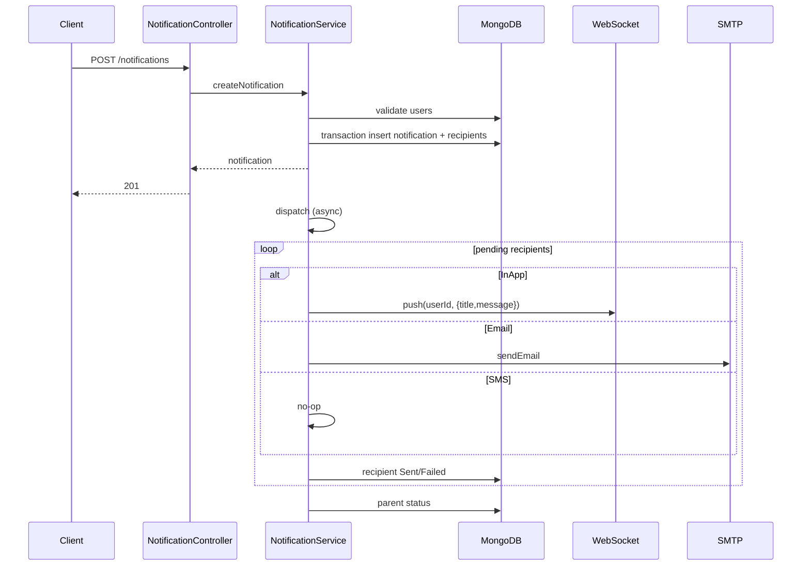

# Notifications

## 1. Purpose

Create notifications, fan them out to selected users, and deliver them in-app (WebSocket) or by email. SMS is accepted but not delivered.

## 2. Responsibilities

- Create a notification and one recipient record per user.
- Validate recipients.
- Dispatch pending recipients.
- Track per-recipient and overall delivery status.
- Provide per-user inboxes.
- Push in-app messages over WebSocket.
- Send email through Nodemailer.

## 3. Structure

```text
modules/notification/
├── controller/notification.controller.ts
├── model/
│   ├── notification.model.ts
│   └── notificationRecipient.model.ts
├── repo/
│   ├── notification.repo.ts
│   └── notificationRecipient.repo.ts
├── routes/notification.routes.ts
└── services/notification.service.ts
```

## 4. Routes

Base: `/api/notifications`, roles: all three.

| Method | Path | Purpose |
|---|---|---|
| GET | `/me` | Current user's inbox |
| GET | `/user/:userId` | Another user's inbox |
| POST | `/` | Create + dispatch |
| GET | `/` | List all |
| GET | `/:id` | Detail + recipients |
| POST | `/:id/dispatch` | Retry pending recipients |
| DELETE | `/:id` | Delete notification + recipients |

Full contracts: [endpoints.md](../api/endpoints.md#notifications).

## 5. Controller

`NotificationController` performs manual input checks for creation:

- `title` and `message` must be truthy.
- `type` must be `Email`, `SMS`, or `InApp`.
- `userIds` must be a non-empty array.

It returns `201` as soon as the notification and recipient rows are created; delivery happens after the response.

## 6. Service

`NotificationService` (`modules/notification/services/notification.service.ts`):

| Method | Behavior |
|---|---|
| `createNotification` | Validate every user → transaction inserts notification + recipient rows (`Pending`) → triggers `dispatch()` without awaiting |
| `dispatch` | Loads pending recipients, sends per recipient, updates recipient status, recomputes parent status |
| `dispatchToRecipient` | In-app push for `InApp`; email for `Email`; nothing for `SMS` |
| `getById` | Notification + recipients |
| `getAll` | All notifications |
| `getForUser` | Recipient rows → notification documents plus `recipientStatus` and `sentAt` |
| `delete` | Transaction deletes recipients then notification |

Status recomputation:

```text
all recipients Failed -> Failed
else any Sent         -> Sent
else                  -> Pending
```

Per-recipient status is the real delivery record.

## 7. Models

- `Notification`: `title`, `message`, `type`, `status`.
- `NotificationRecipient`: `notificationId`, `userId`, `sentAt`, `status`.

See [Schema and relationships](../database/schema-and-relationships.md#72-notifications-and-notificationrecipients).

## 8. Validation

Only the controller checks described above. There is no Zod schema. `userIds` elements are not validated as ObjectIds before `findById`; malformed ids lead to a cast error (500).

## 9. Middleware

`verifyToken` + `authorize` at `/api/notifications`.

The WebSocket endpoint is separate and authenticated during the HTTP upgrade (see [Realtime communication](../infrastructure/realtime-communication.md)).

## 10. Business rules

1. A notification must have at least one recipient.
2. Every recipient user must exist before any rows are created.
3. Creation is transactional; dispatch is not.
4. Only `Pending` recipients are retried on dispatch.
5. Only `Pending` recipients are attempted on dispatch. `Failed` recipients are **not** retried by calling dispatch again; they remain `Failed` unless their status is changed manually.
6. `InApp` delivery succeeds even if the user has no open socket, because `push` returns a boolean that is ignored.
7. `SMS` is treated as delivered with no provider call.
8. Email failures mark the recipient `Failed`; the error detail is discarded.
9. Deleting a notification removes all recipient rows first.

## 11. Dependencies

- `NotificationRepo`, `NotificationRecipientRepo`, `UserRepository`
- `push` from `shared/provider/websocker.provider.ts`
- `sendEmail` from `shared/provider/email.provider.ts`
- MongoDB connection for transactions
- Used by the expiry cron and dashboard notification counts

## 12. Workflow



## 13. Limitations and risks

| Issue | Status |
|---|---|
| SMS delivery | Not Implemented (silently marked Sent) |
| Real SMTP configuration | Partially Implemented (Ethereal fallback) |
| Delivery error details | Not stored |
| No real retry for Failed recipients | Manually re-dispatch only processes Pending rows |
| User opt-out/preferences | Not Implemented |
| Read/unread state | Not Implemented |
| Pagination | Not Implemented |
| Authorization on `/notifications/user/:userId` | Any allowed role can read another user's inbox |
| WebSocket delivery outside HTTP response | Implemented |
| Notification templates | Not Implemented |

## Related documents

- [Realtime communication](../infrastructure/realtime-communication.md)
- [External integrations](../infrastructure/external-integrations.md)
- [Background jobs](../infrastructure/background-jobs.md)
