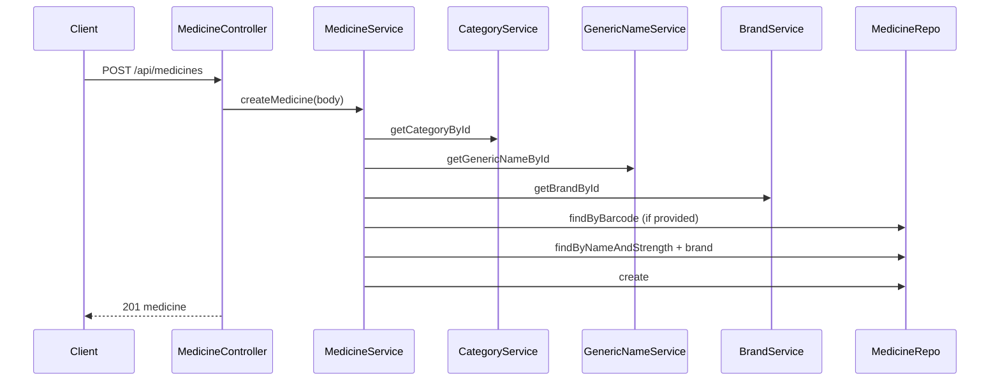

# Products (Medicine Catalog)

## 1. Purpose

Maintain the medicine master data and the lookup tables used to classify it: brands, categories, generic names, and units.

## 2. Responsibilities

- Medicine CRUD with catalog references.
- Duplicate detection by barcode and by name + strength + brand.
- Soft deactivation of medicines.
- CRUD for brands, categories, generic names, and units.
- Provide medicine lists joined with aggregate inventory.

## 3. Structure

```text
modules/medicine/
├── controller/
│   ├── medicine.controller.ts
│   ├── brand.controller.ts
│   ├── category.controller.ts
│   ├── genericName.controller.ts
│   └── unit.controller.ts
├── models/
│   ├── medicine.model.ts
│   ├── brand.model.ts
│   ├── category.model.ts
│   ├── genericName.model.ts
│   └── unit.model.ts
├── repo/
│   ├── medicine.repo.ts
│   ├── brand.repo.ts
│   ├── category.repo.ts
│   ├── genericName.repo.ts
│   └── unit.repo.ts
├── routes/
│   ├── medicine.route.ts
│   ├── brand.route.ts
│   ├── category.route.ts
│   ├── genericName.route.ts
│   └── unit.route.ts
├── schema/
│   ├── medicine.schema.ts
│   ├── brand.schema.ts
│   ├── category.schema.ts
│   ├── genericName.schema.ts
│   └── unit.schema.ts
└── services/
    ├── medicine.sercive.ts      # spelling is intentional (actual filename)
    ├── brand.service.ts
    ├── category.service.ts
    ├── genericName.service.ts
    └── unit.service.ts
```

## 4. Routes

| Prefix | Endpoints | Validation |
|---|---|---|
| `/api/medicines` | 6 | create/update |
| `/api/brands` | 5 | create/update |
| `/api/categories` | 5 | create/update |
| `/api/generic-names` | 5 | create/update |
| `/api/units` | 5 | create/update |

All require the cookie and allow all three roles. Full contracts: [endpoints.md](../api/endpoints.md#medicines).

## 5. Controllers

- `MedicineController` returns raw documents/arrays and a `{ message }` on deactivate.
- The four lookup controllers follow the same pattern: raw document on create/get/update, `{ message }` on delete.
- None of them sanitize responses or validate ObjectIds.

## 6. Services

### MedicineService

- `createMedicine`: validates that category, generic name, and brand exist; checks barcode and name+strength+brand duplicates; creates.
- `getMedicineById`: 404 via `AppError`.
- `updateMedicine`: re-validates changed references and barcode; updates.
- `deactivateMedicine`: sets `isActive: false`.
- `getMedicines`: returns `findAllWithInventory` aggregation.
- `searchMedicines`: regex search.

### Lookup services

Each provides create (duplicate name check), get by id, list, update, and delete. Delete is a **hard delete** and does not check whether medicines reference the record.

## 7. Models

See [Schema and relationships](../database/schema-and-relationships.md#3-catalog) for fields, constraints, and indexes.

Key points:

- `Medicine` references `GenericName`, `Category`, `Brand`, and `Unit` by ObjectId.
- `barcode` is unique when present.
- `reorderLevel` is used by dashboard low-stock counts.
- `isActive` is the only soft-delete mechanism in the catalog.
- `Unit.description` is a required, unique, 10-character field (used like a symbol).

## 8. Validation

| Schema | Rules |
|---|---|
| `createMedicineSchema` | name 1–100, description ≤ 500, category/brand/generic/unit non-empty, manufacturer ≤ 100, barcode ≤ 50, dosageForm ≤ 100, strength max 100 (no minimum), reorderLevel integer ≥ 0 default 0, isActive default true |
| `updateMedicineSchema` | `createMedicineSchema.partial()` |
| Brand/category/generic/unit schemas | Name required; brand and generic `description` are required by Zod; unit description 1–10 |

Model-level differences:

- `Medicine.strength` is **not required** in Mongoose, but Zod requires it on create.
- `Medicine.medicineName` allows 200 chars in Mongoose but only 100 through the API.
- `Category.isActive` has no Zod default, so it falls back to the model default.

## 9. Middleware

`verifyToken` and `authorize` at the `/api/medicines`, `/api/brands`, `/api/categories`, `/api/generic-names`, and `/api/units` mounts. The lookup routers additionally call `verifyToken` per route; this is redundant.

## 10. Business rules

1. A medicine cannot be created without valid category, generic name, and brand IDs.
2. `unitId` is **not** validated by the service; an invalid id produces a Mongoose cast error (500) or a dangling reference if it happens to be a valid ObjectId.
3. Duplicate barcode → 409.
4. Duplicate `medicineName + strength + brandId` → 409.
5. `DELETE /medicines/:id` deactivates, never removes.
6. Lookup deletes are permanent and do not cascade or block.
7. Inactive medicines still appear in `GET /medicines`; the aggregation does not filter `isActive`.
8. Search includes inactive medicines and does not filter by stock.

## 11. Dependencies

- `MedicineRepo`, `BrandRepo`, `CategoryRepo`, `GenericNameRepo`, `UnitRepo`
- `BrandService`, `CategoryService`, `GenericNameService`, `UnitService`
- `Inventory` collection (aggregation only)

## 12. Workflows

### Create a medicine



### List for the catalog screen

`GET /medicines` runs an aggregation that:

1. Looks up `inventories` by `medicineId`.
2. Looks up generic name, brand, category, and unit.
3. Projects names and `currentStock` / `availableStock` (0 when no inventory row).

It does not include `_id` explicitly but Mongo includes it, and it does not filter by `isActive`.

## 13. Limitations

| Issue | Status | Phase |
|---|---|---|
| Pagination/filtering on medicine list | Still open | Phase 5 |
| `unitId` existence check | Still open | Phase 3 |
| Cascading/deactivation checks for lookup deletes | Still open | Phase 3 |
| Unique index for name+strength+brand | Needs decision (index vs service-only check) | Phase 5 |
| Search query escaping (raw regex) | Still open | Phase 3 |
| Inactive filtering | Still open | Phase 3 |
| Batch/price data in medicine list | Needs decision | Phase 6 |

## Related documents

- [Schema and relationships](../database/schema-and-relationships.md)
- [Inventory](inventory.md)
- [API endpoints](../api/endpoints.md)
