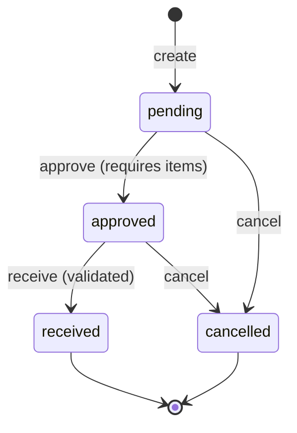
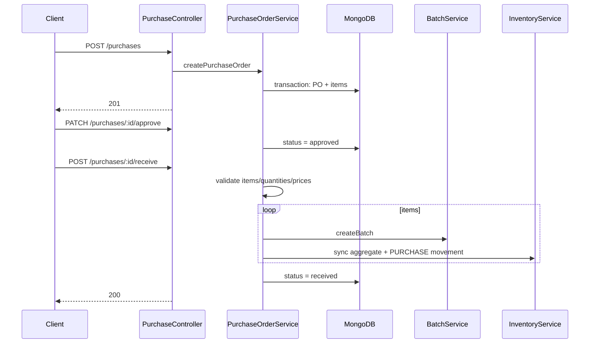

# Purchases

## 1. Purpose

Manage purchase orders from creation through approval and goods receipt, creating batches and increasing inventory on receipt.

## 2. Responsibilities

- Create purchase orders with line items.
- Maintain PO status (`pending`, `approved`, `received`, `cancelled`).
- Validate and receive goods.
- Create one batch per received line.
- Reconcile aggregate inventory.
- Link suppliers to purchase history.

## 3. Structure

```text
modules/purchase/
├── controller/purchase.controller.ts
├── model/
│   ├── purchaseOrder.model.ts
│   └── purchaseOrderItem.model.ts
├── repo/
│   ├── purchaseOrder.repo.ts
│   └── purchaseOrderItem.repo.ts
├── routes/purchase.route.ts
├── schema/
│   ├── purchaseOrder.schema.ts
│   ├── purchaseOrderItem.schema.ts
│   └── receivePurchaseOrder.type.ts
└── services/purchaseOrder.service.ts
```

## 4. Routes

Base: `/api/purchases`, roles: all three. The router re-applies `verifyToken`.

| Method | Path | Purpose |
|---|---|---|
| POST | `/` | Create PO + items |
| GET | `/` | List POs |
| GET | `/:id` | PO detail |
| DELETE | `/:id` | Hard delete |
| PATCH | `/:id/cancel` | Cancel |
| PATCH | `/:id/approve` | Approve |
| POST | `/:id/receive` | Receive goods |
| PATCH | `/:id/recalculate` | Compute total (no write) |
| GET | `/:id/items` | List items |
| POST | `/:id/items` | Add item |
| PATCH | `/:id/items/:itemId` | Update item |
| DELETE | `/:id/items/:itemId` | Remove item |
| GET | `/supplier/:supplierId` | POs by supplier |

Full contracts: [endpoints.md](../api/endpoints.md#purchases).

## 5. Controller

`PurchaseController` returns `{ message, data }` for most operations and `{ message }` for delete/cancel/approve/item removal.

- `receivePurchaseOrder` passes `req.user.userId` as `performedBy`.
- `createPurchaseOrder` logs the request body to the console.
- No controller-level validation; only three routes have Zod middleware.

## 6. Service

`PurchaseOrderService` (`modules/purchase/services/purchaseOrder.service.ts`):

| Method | Behavior |
|---|---|
| `createPurchaseOrder` | Validates supplier; computes `totalAmount`; creates PO and items in a transaction |
| `getPurchaseOrders` | List with supplier company name |
| `getPurchaseOrderById` | Loads supplier, items, computes per-item subtotal, shapes response |
| `deletePurchaseOrder` | Hard delete; no status check; items remain |
| `cancelPurchaseOrder` | Rejects if already received; sets `cancelled` |
| `approvePurchaseOrder` | Requires `pending` and at least one item; sets `approved` |
| `receivePurchaseOrder` | Full validation + batch creation + sync + `received` |
| `addPurchaseOrderItem` | Pending-only, duplicate medicine check, then recalculates |
| `updatePurchaseOrderItem` | Pending-only, ownership check; **does not recalculate** |
| `removePurchaseOrderItem` | Pending-only, ownership check, recalculates |
| `recalculateTotals` | Computes and **returns** the total without persisting |
| `getAllPurchaseOrderItems` | List for a PO |
| `getPurchaseOrdersBySupplierId` | Supplier existence then list |

## 7. Models

- `PurchaseOrder`: supplier, dates, invoice, total, status, VAT, discount.
- `PurchaseOrderItem`: PO id, medicine id, quantity, purchase price.

See [Schema and relationships](../database/schema-and-relationships.md#4-supply).

## 8. Validation

| Schema | Applied to | Notes |
|---|---|---|
| `createPurchaseOrderSchema` | `POST /purchases` | Requires `expectedDeliveryDate` and `receivedDate`; allows client `status` |
| `createPurchaseOrderItemSchema` | `POST /:id/items` | Requires `purchaseOrderId` in body |
| `updatePurchaseOrderItemSchema` | `PATCH /:id/items/:itemId` | Optional quantity/price |
| `ReceivePurchaseOrderDto` (TypeScript only) | `POST /:id/receive` | **No runtime validation** |

## 9. Middleware

`verifyToken` + `authorize` at the mount, plus a redundant `router.use(verifyToken)` inside the router.

## 10. Business rules

### Creation

1. Supplier must exist.
2. `totalAmount = sum(quantity * purchasePrice)`.
3. VAT and discount are stored but ignored in the total.
4. Items are created with the PO in one transaction.
5. The status supplied by the client is stored; the schema defaults to `pending`. A client can therefore create a PO directly as `received` or `cancelled`, bypassing the approve/receive workflow.

### Status transitions



- `received` cannot be cancelled.
- `pending` POs can be deleted outright.
- There is no reopen or edit-after-approval.

### Item rules

- Add/update/remove only while `pending`.
- Duplicate medicine in a PO is rejected on add.
- Item must belong to the PO.
- Add/remove recalculates the stored `totalAmount`; update does not, so editing quantity/price leaves the total stale.

### Receiving

1. User must exist.
2. PO must exist and be `approved`.
3. PO must have items.
4. Request `items` must be a unique set by medicine.
5. Request item count must equal PO item count.
6. Every PO item must have batch data.
7. `quantityReceived` must equal ordered quantity.
8. `sellingPrice >= purchasePrice`.
9. A batch is created with `quantityReceived = quantityRemaining`.

> **Note:** batch creation with positive quantity now passes the `isActive` validator, so purchase receiving can complete. Remaining receiving defects are the unvalidated request body and stale totals.
10. `syncInventoryFromBatch` runs per line with a `PURCHASE` movement context.
11. PO becomes `received` with `receivedDate`.

No partial receipt, tolerance, backorder, or multi-batch-per-line support.

## 11. Dependencies

- `SupplierRepo`, `PurchaseOrderRepo`, `PurchaseOrderItemRepo`
- `BatchService`
- `InventoryService`, `InventoryMovementService`
- `UserRepository`
- Used by dashboard and smart reorder

## 12. Workflow



## 13. Limitations and risks

| Issue | Status | Phase |
|---|---|---|
| Client-supplied status can bypass the workflow | Still open | Phase 4 |
| Batch creation was blocked by `isActive` validator | Already fixed (receiving can complete) | — |
| VAT/discount not applied | Still open | Phase 4 |
| `recalculate` does not persist | Still open | Phase 4 |
| Update item leaves total stale | Still open | Phase 4 |
| `receive` body unvalidated at runtime | Still open | Phase 3 |
| Hard delete orphans items and batches | Still open | Phase 4 |
| No partial receiving | Needs decision | Phase 6 |
| No PO numbering (counter unused) | Still open | Phase 6 |
| No invoice file upload | Needs decision | Phase 6 |
| No purchase returns | Needs decision | Phase 6 |
| No approval audit (who/when) | Needs decision | Phase 6 |
| `PurchaseOrderItemRepo.create` saves twice with a session | Still open | Phase 4 |
| No index on status/supplier/date | Still open | Phase 5 |

## Related documents

- [Suppliers](suppliers.md)
- [Batches](batches.md)
- [Business workflows](../business-logic/business-workflows.md)
- [API endpoints](../api/endpoints.md)
