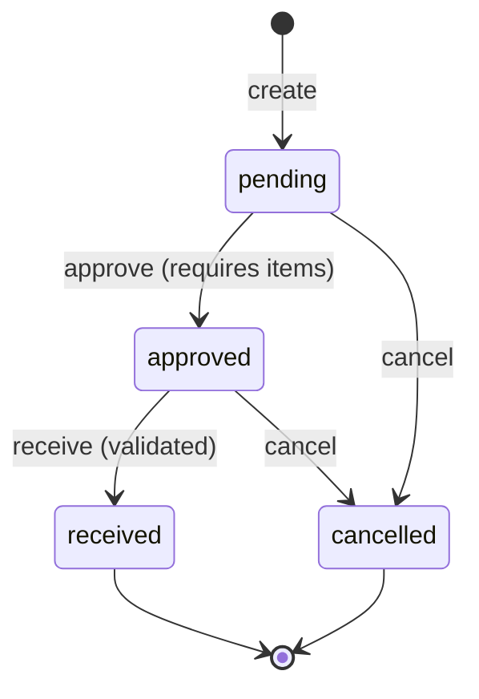
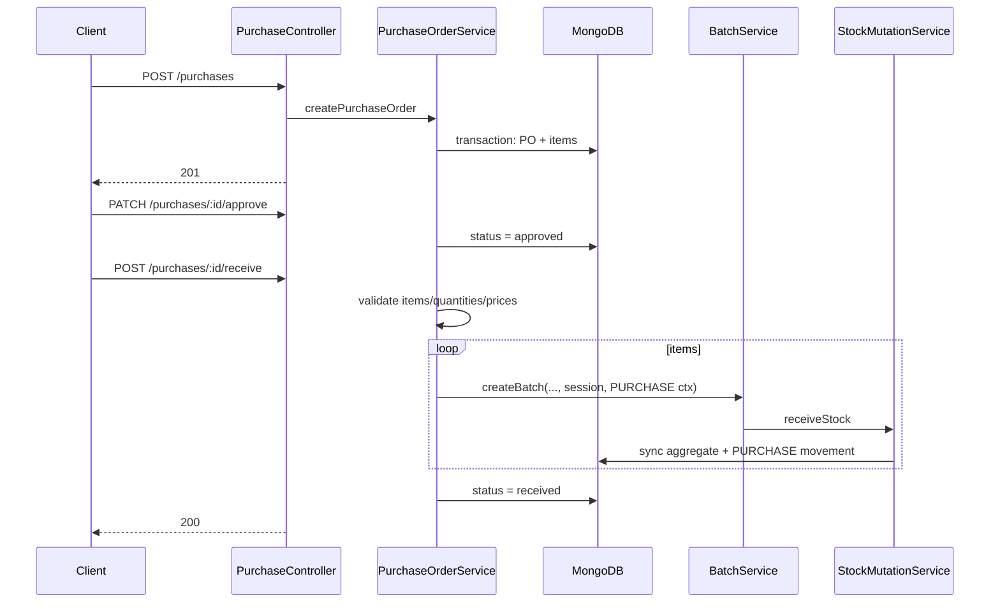

# Purchases

## 1. Purpose

Manage purchase orders from creation through approval and goods receipt, creating batches and increasing inventory on receipt.

## 2. Responsibilities

- Create purchase orders with line items.
- Maintain PO status (`pending`, `approved`, `received`, `cancelled`).
- Validate and receive goods.
- Create one batch per received line.
- Reconcile aggregate inventory.
- Link suppliers to purchase history.

## 3. Structure

```text
modules/purchase/
├── controller/purchase.controller.ts
├── model/
│   ├── purchaseOrder.model.ts
│   └── purchaseOrderItem.model.ts
├── repo/
│   ├── purchaseOrder.repo.ts
│   └── purchaseOrderItem.repo.ts
├── routes/purchase.route.ts
├── schema/
│   ├── purchaseOrder.schema.ts
│   ├── purchaseOrderItem.schema.ts
│   └── receivePurchaseOrder.schema.ts
└── services/purchaseOrder.service.ts
```

## 4. Routes

Base: `/api/purchases`, roles: all three. The router re-applies `verifyToken`.

| Method | Path | Purpose |
|---|---|---|
| POST | `/` | Create PO + items |
| GET | `/` | List POs |
| GET | `/:id` | PO detail |
| DELETE | `/:id` | Delete PO + items (guarded) |
| PATCH | `/:id/cancel` | Cancel |
| PATCH | `/:id/approve` | Approve |
| POST | `/:id/receive` | Receive goods |
| PATCH | `/:id/recalculate` | Recompute and persist total |
| GET | `/:id/items` | List items |
| POST | `/:id/items` | Add item |
| PATCH | `/:id/items/:itemId` | Update item |
| DELETE | `/:id/items/:itemId` | Remove item |
| GET | `/supplier/:supplierId` | POs by supplier |

Full contracts: [endpoints.md](../api/endpoints.md#purchases).

## 5. Controller

`PurchaseController` returns `{ message, data }` for most operations and `{ message }` for delete/cancel/approve/item removal.

- `receivePurchaseOrder` passes `req.user.userId` as `performedBy`.
- `createPurchaseOrder` logs the request body to the console.
- No controller-level validation; only three routes have Zod middleware.

## 6. Service

`PurchaseOrderService` (`modules/purchase/services/purchaseOrder.service.ts`):

| Method | Behavior |
|---|---|
| `createPurchaseOrder` | Validates supplier; forces `pending`; computes VAT/discount-aware `totalAmount`; creates PO and items in a transaction. A client `status` is stripped by the schema. |
| `getPurchaseOrders` | List with supplier company name |
| `getPurchaseOrderById` | Loads supplier, items, computes per-item subtotal, shapes response |
| `deletePurchaseOrder` | Transactional; blocks received orders and orders with batches; cascades items |
| `cancelPurchaseOrder` | Rejects if already received; sets `cancelled` |
| `approvePurchaseOrder` | Requires `pending` and at least one item; sets `approved` |
| `receivePurchaseOrder` | Full validation + batch creation + sync + `received` |
| `addPurchaseOrderItem` | Pending-only, duplicate medicine check, then recalculates and persists |
| `updatePurchaseOrderItem` | Pending-only, ownership check, then recalculates and persists |
| `removePurchaseOrderItem` | Pending-only, ownership check, then recalculates and persists |
| `recalculateTotals` | Computes and **persists** `totalAmount`; returns `{ subtotal, discount, taxable, vatAmount, totalAmount }` |
| `getAllPurchaseOrderItems` | List for a PO |
| `getPurchaseOrdersBySupplierId` | Supplier existence then list |

## 7. Models

- `PurchaseOrder`: supplier, dates, invoice, total, status, VAT, discount.
- `PurchaseOrderItem`: PO id, medicine id, quantity, purchase price.

See [Schema and relationships](../database/schema-and-relationships.md#4-supply).

## 8. Validation

| Schema | Applied to | Notes |
|---|---|---|
| `createPurchaseOrderSchema` | `POST /purchases` | Dates are optional; rejects/strips client `status`; VAT 0–100; requires at least one item |
| `createPurchaseOrderItemSchema` | `POST /:id/items` | No `purchaseOrderId` in body; the path supplies it |
| `updatePurchaseOrderItemSchema` | `PATCH /:id/items/:itemId` | Optional quantity/price; requires at least one field |
| `receivePurchaseOrderSchema` | `POST /:id/receive` | Validates items, dates, quantities, and duplicate medicines at runtime |
| `purchaseIdParamSchema` / `purchaseItemParamSchema` / `purchaseSupplierParamSchema` | id-bearing routes | Rejects malformed ObjectIds before controllers |

## 9. Middleware

`verifyToken` + `authorize` at the mount, plus a redundant `router.use(verifyToken)` inside the router.

## 10. Business rules

### Creation

1. Supplier must exist.
2. `subtotal = sum(quantity * purchasePrice)`.
3. `taxable = subtotal - discount`; `VAT` is a percentage applied to `taxable`.
4. `totalAmount = taxable + VAT amount`, rounded to two decimals.
5. A discount larger than the subtotal returns `400`.
6. Items are created with the PO in one transaction.
7. Every PO starts `pending`; a client-supplied `status` is ignored.

### Status transitions



- `received` cannot be cancelled or deleted.
- `pending`, `approved`, and `cancelled` POs can be deleted only when no batch
  references them; their items are deleted in the same transaction.
- There is no reopen or edit-after-approval.

### Item rules

- Add/update/remove only while `pending`.
- Duplicate medicine in a PO is rejected on add.
- Item must belong to the PO.
- Add/update/remove recalculate and persist `totalAmount` in the same
  transaction as the item change.

### Receiving

1. User must exist.
2. PO must exist and be `approved`.
3. PO must have items.
4. Request `items` must be a unique set by medicine.
5. Request item count must equal PO item count.
6. Every PO item must have batch data.
7. `quantityReceived` must equal ordered quantity.
8. `sellingPrice >= purchasePrice`.
9. A batch is created with `quantityReceived = quantityRemaining`.
10. `BatchService.createBatch` syncs the aggregate and writes one `PURCHASE` movement through `StockMutationService`; there is no separate sync call.
11. PO becomes `received` with `receivedDate`.

The whole receive operation runs in one transaction, including batch creation, aggregate sync, movements, and the PO status update. No partial receipt, tolerance, backorder, or multi-batch-per-line support.

## 11. Dependencies

- `SupplierRepo`, `PurchaseOrderRepo`, `PurchaseOrderItemRepo`
- `BatchService`
- `UserRepository`
- MongoDB connection for transactions
- Used by dashboard and smart reorder

## 12. Workflow



## 13. Limitations and risks

| Issue | Status | Phase |
|---|---|---|
| Client-supplied status can bypass the workflow | Fixed (always starts `pending`) | — |
| Batch creation was blocked by `isActive` validator | Already fixed (receiving can complete) | — |
| VAT/discount not applied | Fixed (VAT % + absolute discount) | — |
| `recalculate` does not persist | Fixed (persists `totalAmount`) | — |
| Update item leaves total stale | Fixed (recalculates on add/update/remove) | — |
| `receive` body unvalidated at runtime | Already fixed (runtime receive schema) | — |
| Hard delete orphans items and batches | Fixed (blocks received/batched orders, cascades items) | — |
| No partial receiving | Fixed: `receivedQuantity`, `partially_received`, multiple receipts/batches per line | — |
| No PO numbering (counter unused) | Fixed: `orderNumber` (`PO-000001`), unique sparse index | — |
| No invoice file upload | Fixed: multipart upload/download, type and size limits | — |
| No purchase returns | Fixed: `purchase-returns` module with lifecycle, batch deduction, supplier credit | — |
| No approval audit (who/when) | Fixed: `approvedBy/At`, `cancelledBy/At`, `receivedBy` | — |
| No supplier performance endpoint | Fixed: `/purchases/suppliers/:id/performance` | — |
| `PurchaseOrderItemRepo.create` saves twice with a session | Fixed (single save) | — |
| No index on status/supplier/date | Fixed: supplier/date, status/date, and order-date indexes | — |
| No list pagination/filtering | Fixed: cursor pagination, status, supplier, date range, search | — |

## Related documents

- [Suppliers](suppliers.md)
- [Batches](batches.md)
- [Business workflows](../business-logic/business-workflows.md)
- [API endpoints](../api/endpoints.md)
