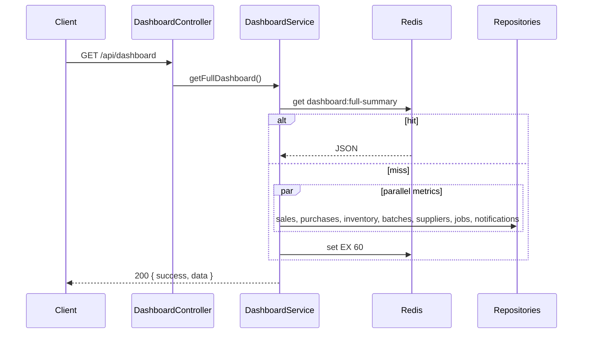

# Reporting (Dashboard and Analytics)

## 1. Purpose

Provide the dashboard landing payload and a set of read-only analytics endpoints covering sales, purchases, inventory, suppliers, profit, expiry, and reorder status.

## 2. Responsibilities

- Aggregate metrics across sales, purchases, inventory, batches, suppliers, notifications, and jobs.
- Cache the combined dashboard payload.
- Expose individual metric endpoints.
- Surface stale background jobs and delivery failures.

The module has no models, repositories, or write operations of its own.

## 3. Structure

```text
modules/dashboard/
├── controller/dashboard.controller.ts
├── routes/dashboard.routes.ts
└── service/dashboard.service.ts
```

## 4. Routes

Base: `/api/dashboard`, roles: all three.

| Path | Purpose |
|---|---|
| `/` | Combined cached payload |
| `/summary` | Headline metrics |
| `/reorder` | Reorder counts |
| `/expiry` | Disposal queue and expiring count |
| `/recent-activity?limit=` | Latest inventory movements |
| `/system-health` | Stale background jobs |
| `/notifications` | Failed/pending deliveries |
| `/profit` | Gross profit and margin |
| `/sales-comparison` | This month vs last month |
| `/suppliers` | Active/inactive counts |
| `/sales?year=` | Sales totals and monthly series |
| `/purchases` | Purchase totals and status counts |
| `/inventory` | Value, health, low/out/expiring counts |
| `/top-selling?limit=` | Top medicines by units |

All return `{ success: true, data }`. Full contracts: [endpoints.md](../api/endpoints.md#dashboard).

## 5. Controller

`DashboardController` uses `asyncHandler` and manual numeric checks:

- `limit` must be a positive number (default 10).
- `year` must be numeric (default current year).

## 6. Service

`DashboardService` composes 11 dependencies:

```text
SalesRepo, SaleItemRepo, PurchaseOrderRepo, InventoryRepo, MedicineBatchRepo,
SupplierRepo, SmartReorderService, BatchService, InventoryMovementService,
BackgroundJobService, NotificationRecipientRepo
```

| Method | Computation |
|---|---|
| `getSummary` | Parallel calls for sales, purchases, inventory value, batch count, active suppliers, low stock, out of stock, expiring soon (30 days), revenue trend |
| `getReorderSummary` | Pending recommendations, count with confidence ≥ 80, sum of suggested quantities |
| `getExpirySummary` | Batches awaiting disposal, units awaiting disposal, expiring within 30 days |
| `getRecentActivity` | Latest `InventoryMovement` documents |
| `getSystemHealth` | `IN_PROGRESS` jobs older than 60 minutes |
| `getNotificationSummary` | Counts of `Failed` and `Pending` recipients |
| `getProfitSummary` | `grossProfit = totalSales - totalPurchases`; margin percent |
| `getSalesComparison` | This month vs last month totals and percent change |
| `getSupplierAnalytics` | Active/inactive supplier counts |
| `getSalesAnalytics` | Total sales + monthly series |
| `getPurchaseAnalytics` | Total purchases + status counts |
| `getInventoryAnalytics` | Value, health object, low/out/expiring counts |
| `getTopSellingMedicines` | Aggregation over sale items |
| `getFullDashboard` | Cache-aside bundle of eight calls |

## 7. Metric definitions and caveats

### Total sales

`SalesRepo.getTotalSales` sums `totalAmount` for sales with `createdAt` in the **current calendar month** (server-local boundaries).

Caveats:

- It uses `createdAt`, not `saleDate`, even though clients supply `saleDate`.
- It ignores `status`; cancelled/pending sales would be included if they existed.
- `/dashboard/sales` uses the same current-month total, not the requested year.

### Monthly sales series

`SalesRepo.getSalesByMonth(monthBack, year)`:

- Ignores both parameters.
- Matches `saleDate` from January 1 of the current year to January 1 of next year.
- Groups by month and returns entries from January through the current month only.
- Uses `$month` for grouping, which is UTC by default, while other date filters are built with server-local `new Date(year, month, ...)` boundaries. Month edges can therefore differ from the server timezone.

Consequence: future months and previous years are not returned, and the `year` query parameter has no effect.

### Total purchases

`PurchaseOrderRepo.getTotalPurchases` sums `totalAmount` for non-cancelled POs with `createdAt` in the current month. It includes `pending` and `approved` orders, not just received ones.

### Gross profit

`totalSales - totalPurchases` for the current month. This is **not** COGS-based; it mixes sales revenue (VAT-inclusive) with purchase order commitments (VAT-exclusive, not yet received necessarily). Treat it as a rough indicator only.

### Inventory value

`InventoryRepo.getTotalInventoryValue` sums `batch.quantityRemaining * batch.sellingPrice` across all batches joined from all inventory rows. It uses **selling** price, not cost, and does **not** exclude expired or flagged batches. If duplicate inventory rows exist for a medicine, batches are counted multiple times.

### Low stock

`availableStock > 0 && availableStock <= medicine.reorderLevel`. Medicines with `reorderLevel` unset/zero are never low.

### Out of stock

`availableStock <= 0` on inventory rows. Medicines with no inventory row are not counted.

### Expiring soon

The summary and expiry endpoints use `MedicineBatchRepo.getExpiringSoonCount(30)`:

```text
expiryDate between now and now+30d AND quantityRemaining > 0
```

`InventoryRepo.getExpiringSoonCount` (a different method that queries a non-existent `batches` array path) always returns 0 and is only reached through `getInventoryHealth`.

### Batch count

`getTotalMedicineBatches` counts batches with stock, future expiry, and `isExpired: false`.

### Reorder summary

Only `PENDING` recommendations; high confidence is `confidenceScore >= 80` (note: scores are 0–100).

### Top selling

Aggregation over all `SalesItem` rows, all time:

```text
group by medicineId:
  totalQuantitySold = sum(quantity)
  totalRevenue      = sum(totalPrice)
sort by totalQuantitySold desc
limit N
```

Returned quantities include returned items; `returnedQuantity` is not subtracted. Revenue is VAT-exclusive line revenue.

### Recent activity

`InventoryMovementRepo.findRecent` sorts by `createdAt` desc, populates medicine, batch, and performer, and limits by the query value.

### System health

Jobs with status `IN_PROGRESS` whose `startedAt` is older than 60 minutes. It reports only those; it does not verify MongoDB or Redis.

### Notifications

Counts of all recipient rows by status, not per notification or per user.

## 8. Caching

Only `getFullDashboard` is cached:

| Key | TTL |
|---|---|
| `dashboard:full-summary` | 60 seconds |

The source comment says "2 min", but the constant is `60`. There is no invalidation on writes, so the dashboard can be up to a minute stale. Individual endpoints are uncached.

## 9. Validation

- `limit`: positive number, else 400.
- `year`: numeric, else 400; negative or fractional years are accepted.
- No date-range parameters exist.

## 10. Middleware

`verifyToken` + `authorize(["owner","inventory_manager","pharmacist"])` at `/api/dashboard`.

## 11. Data dependencies

| Source | Used for |
|---|---|
| `sales`, `salesitems` | revenue, trend, top selling |
| `purchaseorders` | purchases, profit, status counts |
| `inventories` | value, low/out of stock |
| `batches` | value, expiry, batch count, reorder |
| `suppliers` | counts |
| `smartreorders` | reorder summary |
| `inventorymovements` | recent activity |
| `backgroundjobs` | system health |
| `notificationrecipients` | delivery counts |

## 12. Workflow



## 13. Limitations and risks

| Issue | Status |
|---|---|
| `year`/`monthBack` parameters ignored | Defect |
| Revenue trend limited to current year | Limitation |
| Sales total uses `createdAt` | Inconsistency |
| Profit not COGS-based | Approximation |
| Returned units not excluded from top selling | Defect |
| `getInventoryHealth.expiringSoonCount` always 0 | Defect |
| No date-range analytics | Not Implemented |
| No export (CSV/PDF) | Not Implemented |
| Dashboard cache not invalidated | Limitation |
| No per-cashier or per-category breakdown | Not Implemented |
| No timezone strategy | Limitation |

## Related documents

- [Smart reorder](smart-reorder.md)
- [Inventory data model](../database/inventory-data-model.md)
- [Redis and caching](../infrastructure/redis-and-caching.md)
- [Background jobs](../infrastructure/background-jobs.md)
