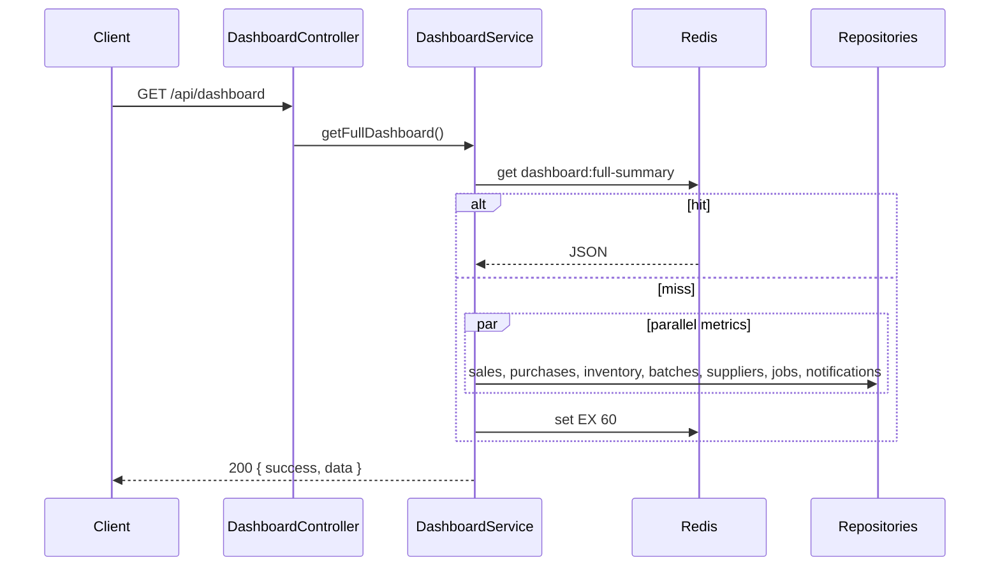

# Reporting (Dashboard and Analytics)

## 1. Purpose

Provide the dashboard landing payload and a set of read-only analytics endpoints covering sales, purchases, inventory, suppliers, profit, expiry, and reorder status.

## 2. Responsibilities

- Aggregate metrics across sales, purchases, inventory, batches, suppliers, notifications, and jobs.
- Cache the combined dashboard payload.
- Expose individual metric endpoints.
- Surface stale background jobs and delivery failures.

The module has no models, repositories, or write operations of its own.

## 3. Structure

```text
modules/dashboard/
├── controller/dashboard.controller.ts
├── routes/dashboard.routes.ts
└── service/dashboard.service.ts
```

## 4. Routes

Base: `/api/dashboard`, roles: all three.

| Path | Purpose |
|---|---|
| `/` | Combined cached payload |
| `/summary` | Headline metrics |
| `/reorder` | Reorder counts |
| `/expiry` | Disposal queue and expiring count |
| `/recent-activity?limit=` | Latest inventory movements |
| `/system-health` | Stale background jobs |
| `/notifications` | Failed/pending/skipped deliveries |
| `/profit` | Gross profit and margin |
| `/sales-comparison` | This month vs last month |
| `/suppliers` | Active/inactive counts |
| `/sales?year=` | Sales totals, VAT, and monthly series for the year |
| `/purchases` | Purchase totals and status counts |
| `/inventory` | Value, health, low/out/expiring counts |
| `/top-selling?limit=` | Top medicines by units |

All return `{ success: true, data }`. Full contracts: [endpoints.md](../api/endpoints.md#dashboard).

## 5. Controller

`DashboardController` uses `asyncHandler` and manual numeric checks:

- `limit` must be a positive number (default 10).
- `year` must be numeric (default current year).

## 6. Service

`DashboardService` composes 11 dependencies:

```text
SalesRepo, SaleItemRepo, PurchaseOrderRepo, InventoryRepo, MedicineBatchRepo,
SupplierRepo, SmartReorderService, BatchService, InventoryMovementService,
BackgroundJobService, NotificationRecipientRepo
```

| Method | Computation |
|---|---|
| `getSummary` | Parallel calls for sales, purchases, inventory value, batch count, active suppliers, low stock, out of stock, expiring soon (30 days), revenue trend |
| `getReorderSummary` | Pending recommendations, count with confidence ≥ 80, sum of suggested quantities |
| `getExpirySummary` | Batches awaiting disposal, units awaiting disposal, expiring within 30 days |
| `getRecentActivity` | Latest `InventoryMovement` documents |
| `getSystemHealth` | `IN_PROGRESS` jobs older than 60 minutes |
| `getNotificationSummary` | Counts of `Failed` and `Pending` recipients |
| `getProfitSummary` | COGS-based: net revenue − COGS; margin percent |
| `getSalesComparison` | This month vs last month totals and percent change |
| `getSupplierAnalytics` | Active/inactive supplier counts |
| `getSalesAnalytics` | Requested-year gross sales, VAT, and monthly series |
| `getPurchaseAnalytics` | Current-month purchases + status counts |
| `getInventoryAnalytics` | Value, health object, low/out/expiring counts (batches) |
| `getTopSellingMedicines` | Aggregation over sale items |
| `getFullDashboard` | Cache-aside bundle of eight calls |

## 7. Metric definitions and caveats

### Reporting timezone

All reporting periods and month grouping use `REPORTING_TIMEZONE`
(default `Asia/Kathmandu`). Dates are stored as UTC instants; boundaries are
calculated in the configured zone by `shared/utils/reportingPeriod.ts`.
`REPORTING_TIMEZONE` is validated at boot.

### Total sales

`SalesRepo.getSalesTotalsInRange(start, endExclusive)` sums `totalAmount` and
`VAT` for sales with `saleDate` in the half-open period. Cancelled sales are
excluded. `getTotalSalesInRange` returns the gross component.

### Monthly sales series

`SalesRepo.getSalesByMonth({ year, months, timeZone, now })`:

- Matches `saleDate` inside the requested calendar year in `timeZone`.
- Groups by `$month` using the same timezone.
- Always starts in January. Past years return 12 entries; the current year
  returns January..current month; future years return `[]`.
- `months` caps the number of entries.

### Total purchases

`PurchaseOrderRepo.getTotalPurchasesInRange(start, endExclusive)` sums
`totalAmount` for non-cancelled POs whose `orderDate` is in the period. It
includes `pending` and `approved` commitments, not only received orders.
Historical POs created before Phase 4 may have VAT-exclusive totals.

### Gross profit

`DashboardService.getProfitSummary` is COGS-based:

```text
netRefunds  = refunds − refund VAT
netRevenue  = (gross sales − sales VAT) − netRefunds
grossProfit = netRevenue − COGS
margin %    = grossProfit / netRevenue
```

- COGS = `Σ max(quantity − GOOD-returned quantity, 0) × cost` for sales in the
  period.
- Only `GOOD` returns reverse COGS because their stock re-enters sellable
  inventory. `DAMAGED`/`EXPIRED`/`OPENED` units are write-offs, so their cost
  stays in COGS.
- Cost uses the `SalesItem.purchasePrice` snapshot taken at sale time; legacy
  items without a snapshot fall back to `Batch.purchasePrice`.
- Refunds count only `COMPLETED` returns whose `returnDate` is in the period.
- Legacy completed returns without embedded VAT are treated as VAT-exclusive
  refunds.

### Inventory value

`InventoryRepo.getTotalInventoryValue` sums `batch.quantityRemaining * batch.sellingPrice` across all batches joined from all inventory rows. It uses **selling** price, not cost, and does **not** exclude expired or flagged batches. If duplicate inventory rows exist for a medicine, batches are counted multiple times.

### Low stock

`availableStock > 0 && availableStock <= medicine.reorderLevel`. Medicines with `reorderLevel` unset/zero are never low.

### Out of stock

`availableStock <= 0` on inventory rows. Medicines with no inventory row are not counted.

### Expiring soon

All expiry metrics use `MedicineBatchRepo.getExpiringSoonCount(30)`:

```text
expiryDate between now and now+30d AND quantityRemaining > 0
```

The broken `InventoryRepo.getExpiringSoonCount`/`getInventoryHealth` pair was
removed; `/dashboard/inventory` now sources the count from the batch repository.

### Batch count

`getTotalMedicineBatches` counts batches with stock, future expiry, and `isExpired: false`.

### Reorder summary

Only `PENDING` recommendations; high confidence is `confidenceScore >= 80` (note: scores are 0–100).

### Top selling

Aggregation over all `SalesItem` rows, all time, excluding cancelled sales:

```text
netQuantity       = quantity − returnedQuantity
totalQuantitySold = sum(netQuantity)            // fully returned rows dropped
totalRevenue      = sum(totalPrice × netQuantity / quantity)
sort by totalQuantitySold desc
limit N
```

Revenue is VAT-exclusive line revenue, prorated for returned units.

### Recent activity

`InventoryMovementRepo.findRecent` sorts by `createdAt` desc, populates medicine, batch, and performer, and limits by the query value.

### System health

Jobs with status `IN_PROGRESS` whose `startedAt` is older than 60 minutes. It reports only those; it does not verify MongoDB or Redis.

### Notifications

Counts of all recipient rows by status, not per notification or per user.
`failedDeliveries` excludes opted-out rows; `skippedDeliveries` counts them
separately.

## 8. Caching

Only `getFullDashboard` is cached:

| Key | TTL |
|---|---|
| `dashboard:full-summary` | 60 seconds |

The source comment says "2 min", but the constant is `60`. There is no invalidation on writes, so the dashboard can be up to a minute stale. Individual endpoints are uncached.

## 9. Validation

- `limit`: positive whole number, else 400.
- `year`: whole number 2000–2100, else 400.
- No arbitrary date-range parameters exist (only a calendar year).

## 10. Middleware

`verifyToken` + `authorize(["owner","inventory_manager","pharmacist"])` at `/api/dashboard`.

## 11. Data dependencies

| Source | Used for |
|---|---|
| `sales`, `salesitems` | revenue, trend, top selling |
| `purchaseorders` | purchases, profit, status counts |
| `inventories` | value, low/out of stock |
| `batches` | value, expiry, batch count, reorder |
| `suppliers` | counts |
| `smartreorders` | reorder summary |
| `inventorymovements` | recent activity |
| `backgroundjobs` | system health |
| `notificationrecipients` | delivery counts |

## 12. Workflow



## 13. Limitations and risks

| Issue | Status | Phase |
|---|---|---|
| `year` parameters ignored | Fixed (`year` selects the calendar year) | — |
| Revenue trend limited to the current year | Fixed (any year 2000–2100) | — |
| Sales total uses `createdAt` instead of `saleDate` | Fixed | — |
| Profit not COGS-based | Fixed (net revenue − COGS) | — |
| Returned units not excluded from top selling | Fixed | — |
| `getInventoryHealth.expiringSoonCount` always 0 | Fixed (batch repository) | — |
| No timezone strategy | Fixed (`REPORTING_TIMEZONE`, default `Asia/Kathmandu`) | — |
| Refunds recognised by `returnDate`, not completion date | Fixed: `completedAt` with legacy `returnDate` fallback | — |
| Legacy sale items (pre-snapshot) still use the current batch price for COGS | Partially fixed: migration backfills surviving batches; legacy rows with deleted batches remain | — |
| No arbitrary date-range analytics | Fixed: `/dashboard/range`, `/by-cashier`, `/by-category` | — |
| No CSV export | Fixed: `/dashboard/export` for sales/purchases/returns/inventory | — |
| Dashboard cache not invalidated | Fixed: writes invalidate the cache | — |
| No per-cashier or per-category breakdown | Fixed: `/dashboard/by-cashier` and `/by-category` | — |

## Related documents

- [Smart reorder](smart-reorder.md)
- [Inventory data model](../database/inventory-data-model.md)
- [Redis and caching](../infrastructure/redis-and-caching.md)
- [Background jobs](../infrastructure/background-jobs.md)
