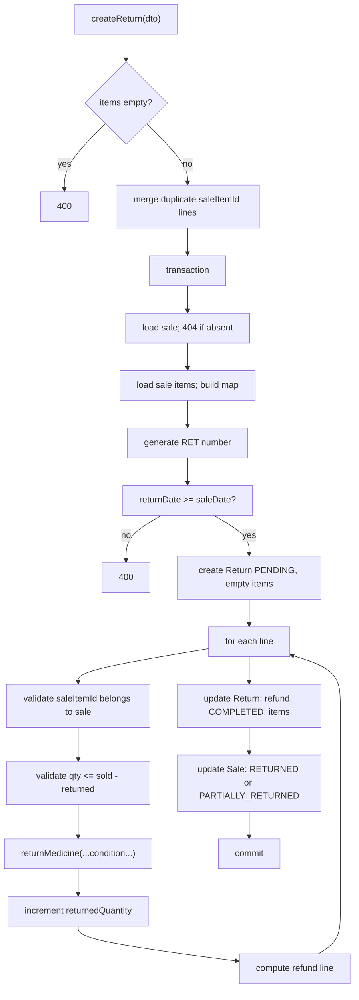

# Returns

## 1. Purpose

Record customer returns against completed sales, restore or write off stock depending on condition, and compute a refund.

Purchase returns and supplier returns are **not implemented**.

## 2. Responsibilities

- Validate the sale and returned quantities.
- Generate `RET-nnnnnn` numbers.
- Adjust stock and write movements.
- Increment `SalesItem.returnedQuantity`.
- Update sale status.
- Store embedded return line details and refund amount.

## 3. Structure

```text
modules/sales/
├── controller/return.controller.ts
├── model/return.model.ts
├── repo/return.repo.ts
├── routes/return.routes.ts
├── schema/return.schema.ts
├── services/return.service.ts
└── types/return.type.ts
```

## 4. Routes

Base: `/api/returns`, roles: all three.

| Method | Path | Purpose |
|---|---|---|
| POST | `/` | Create return |
| GET | `/` | List |
| GET | `/:id` | Detail |
| PATCH | `/:id` | Update reason only |

No DELETE. Full contracts: [endpoints.md](../api/endpoints.md#returns).

## 5. Controller

`ReturnController`:

- Requires an authenticated user (`performedBy`) from the JWT.
- Checks that `items` is a non-empty array.
- Forwards `salesId`, `returnReason`, `returnedBy`, `returnDate`, and `items`.
- Ignores a `performedBy` field in the body.
- PATCH requires `returnReason` and rejects an empty update with 400.

The controller does **not** invoke `CreateReturnSchema`; the schema file is unused.

## 6. Service

`ReturnService.createReturn` (`modules/sales/services/return.service.ts`):



Read methods are simple repository calls. `updateReturn` only updates `returnReason`.

## 7. Model

`Return` fields and embedded `returnItems`: [Schema and relationships](../database/schema-and-relationships.md#63-returns-return).

Key points:

- `returnNumber` is required but not unique in MongoDB.
- `returnItems.VAT` is required in the schema but never written.
- `returnItems.remarks` is accepted by the Zod schema but not persisted by the service.
- `returnItems.condition` default is `GOOD`.

## 8. Validation

`CreateReturnSchema` defines:

- `salesId` non-empty
- `returnReason` 3–500
- `returnedBy` non-empty
- `returnDate` coerced date
- `items` min 1, each with `saleItemId`, positive integer `quantity`, `condition` enum, optional `remarks` ≤ 500
- `performedBy` non-empty

**None of this is applied by the router.** Runtime checks are the controller's item-array check and the service rules.

## 9. Middleware

`verifyToken` + `authorize` at `/api/returns`.

## 10. Business rules

1. Return quantity cannot exceed `quantity - returnedQuantity` for that sale item.
2. Multiple return requests are allowed until fully returned.
3. A sale becomes `RETURNED` only when every sale item is fully returned in this transaction's view; otherwise it becomes `PARTIALLY_RETURNED`.
4. `returnDate` must not precede `saleDate`.
5. Refund per line:

```text
lineTotal          = unitPrice * quantity
discountPerUnit    = saleItem.discount / saleItem.quantity
refund             = lineTotal - discountPerUnit * quantity
```

6. VAT is **not** included in the refund, even though the original sale charged VAT.
7. Stock handling depends on condition (table below).
8. No return approval workflow is reachable: the record is created as `PENDING` but updated to `COMPLETED` in the same transaction.

### Condition behavior

| Condition | Batch `quantityRemaining` | Aggregate stock | Movement records |
|---|---|---|---|
| `GOOD` | Not restored | Increased by `increaseStock` | One `RETURN` with `referenceType: "SALES_RETURN"` |
| `DAMAGED` | Increased | Recomputed from batches | Two `RETURN` records |
| `EXPIRED` | Increased | Recomputed | Two `RETURN` records |
| `OPENED` | Increased | Recomputed | Two `RETURN` records |

This is the opposite of typical pharmacy rules: damaged/expired/opened items are returned to sellable batch stock, while good items are added only to the aggregate and will be lost on the next sync.

### Expected GOOD-path failure

Resolved: the `referenceType` enum now includes `SALES_RETURN`, so GOOD returns no longer abort on movement validation. The remaining condition semantics, VAT, and duplicate-movement defects are Phase 4 work.

## 11. Dependencies

- `ReturnRepo`, `SaleItemRepo`, `SalesRepo`
- `InventoryService.returnMedicine`
- `CounterRepository`
- MongoDB connection for sessions

## 12. Example

Request:

```json
{
  "salesId": "665f...",
  "returnReason": "Customer changed medication",
  "returnedBy": "665f...",
  "returnDate": "2026-02-11T09:00:00.000Z",
  "items": [
    { "saleItemId": "665f...", "quantity": 1, "condition": "GOOD" }
  ]
}
```

For a sale item with `quantity: 2`, `unitPrice: 100`, `discount: 10`:

```text
discountPerUnit = 5
refund          = 100 - 5 = 95
```

No VAT is added. The return is stored as `COMPLETED` with `refundAmount: 95`.

## 13. Limitations and risks

| Issue | Status | Phase |
|---|---|---|
| Purchase/supplier returns | Needs decision | Phase 6 |
| Return approval/rejection flow (statuses exist but are unreachable) | Needs decision (implement or remove) | Phase 4 |
| VAT refund | Still open | Phase 4 |
| DAMAGED/EXPIRED/OPENED still restock sellable stock | Still open | Phase 4 |
| GOOD return restores the aggregate but not the original batch | Still open | Phase 4 |
| Damaged/expired/opened returns write duplicate movement rows | Still open | Phase 4 |
| `returnItems.VAT` is required by the schema but never written | Still open | Phase 4 |
| `SALES_RETURN` enum mismatch | Already fixed (enum widened) | — |
| Return schema not wired | Still open | Phase 3 |
| `remarks` discarded | Still open | Phase 4 |
| No return deletion/reversal | Needs decision | Phase 6 |
| `returnNumber` not unique | Still open | Phase 4 |
| No refund payment record | Needs decision | Phase 6 |
| No restocking fee/partial refund policy | Needs decision | Phase 6 |

## Related documents

- [Sales](sales.md)
- [VAT and pricing](../business-logic/vat-and-pricing.md)
- [Stock movements](../business-logic/stock-movements.md)
- [Business workflows](../business-logic/business-workflows.md)
