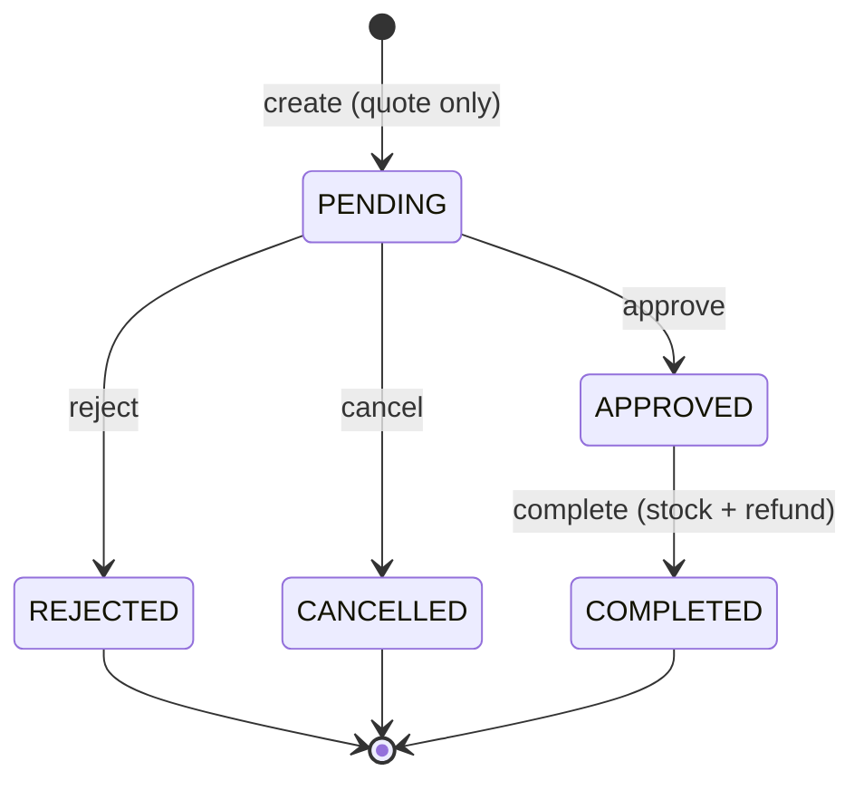

# Returns

## 1. Purpose

Record customer returns against completed sales, approve them, restore or write
off stock depending on condition, and compute a VAT-inclusive refund.

Purchase returns and supplier returns are **not implemented**.

## 2. Responsibilities

- Validate the sale and returned quantities, including other open requests.
- Generate `RET-nnnnnn` numbers.
- Hold a `PENDING` refund quote without moving stock.
- Approve, reject, cancel, or complete a return.
- On completion: adjust stock, write movements, increment
  `SalesItem.returnedQuantity`, and update sale status.
- Store embedded return line details, VAT, remarks, and refund amount.

## 3. Structure

```text
modules/sales/
├── controller/return.controller.ts
├── model/return.model.ts
├── repo/return.repo.ts
├── routes/return.routes.ts
├── schema/return.schema.ts
├── services/return.service.ts
└── types/return.type.ts
```

## 4. Routes

Base: `/api/returns`, mount roles: all three.

| Method | Path | Roles | Purpose |
|---|---|---|---|
| POST | `/` | all three | Create a `PENDING` return + quote |
| GET | `/?status=` | all three | List, optional status filter |
| GET | `/:id` | all three | Detail |
| PATCH | `/:id` | all three | Update reason while `PENDING` |
| PATCH | `/:id/approve` | owner, inventory_manager | `PENDING → APPROVED` |
| PATCH | `/:id/reject` | owner, inventory_manager | `PENDING → REJECTED` |
| PATCH | `/:id/cancel` | all three | `PENDING → CANCELLED` |
| PATCH | `/:id/complete` | all three | `APPROVED → COMPLETED`; applies stock + refund |

No DELETE. Full contracts: [endpoints.md](../api/endpoints.md#returns).

## 5. Controller

`ReturnController`:

- Requires an authenticated user for create and complete.
- Forwards `salesId`, `returnReason`, `returnedBy`, `returnDate`, and `items`.
- Ignores a `performedBy` field in the body.
- PATCH reason rejects an empty update with `400`.
- Status actions require only the validated return id.

## 6. Service

### Lifecycle



Invalid transitions return `409`. Missing returns return `404`.

### `createReturn`

1. Reject an empty item list.
2. Start a transaction.
3. Load the sale (`404` if absent) and its sale items.
4. Validate `returnDate >= saleDate`.
5. Sum `PENDING`/`APPROVED` quantities for the same sale items.
6. Merge duplicate request lines by `saleItemId + condition`.
7. For each line, validate
   `quantity <= sold - returnedQuantity - outstanding`.
8. Compute a refund quote, including VAT.
9. Insert the return as `PENDING` with embedded lines.
10. **No stock or `returnedQuantity` changes occur here.**

### `completeReturn`

1. Require `APPROVED`.
2. Re-load sale items inside the transaction.
3. Re-validate each line against current `returnedQuantity`.
4. Call `InventoryService.returnMedicine` once per line.
5. Increment `SalesItem.returnedQuantity`.
6. Recompute the final refund from current sale-item values.
7. Set the return to `COMPLETED` with final lines/VAT/refund.
8. Set the sale to `RETURNED` or `PARTIALLY_RETURNED`.

Read methods are simple repository calls. `updateReturn` only updates
`returnReason` and only while `PENDING`.

## 7. Model

`Return` fields and embedded `returnItems`: [Schema and relationships](../database/schema-and-relationships.md#63-returns-return).

Key points:

- `returnNumber` is **unique** (unique index).
- `returnItems.VAT` is required and contains the VAT **amount** for the line.
- `returnItems.remarks` is persisted.
- `returnItems.discount` is the total discount attributed to the returned
  quantity: the line-discount share plus the apportioned invoice-discount
  share.
- `returnItems.condition` default is `GOOD`.
- Legacy completed returns may lack `VAT`; they remain readable and are treated
  as having no refund VAT in reports.

## 8. Validation

`CreateReturnSchema`:

- `salesId` ObjectId
- `returnReason` 3–500
- `returnedBy` ObjectId
- `returnDate` coerced date
- `items` min 1, each with ObjectId `saleItemId`, positive integer `quantity`,
  `condition` enum, optional `remarks` ≤ 500
- `performedBy` is intentionally absent; the controller supplies the JWT user

`ReturnListQuerySchema` accepts an optional status enum.
`UpdateReturnSchema` requires a 3–500 character `returnReason`, and
`returnIdParamSchema` validates the route id. All are wired to the routes.

## 9. Middleware

`verifyToken` + `authorize(["owner","inventory_manager","pharmacist"])` at
`/api/returns`. Approve/reject additionally require `owner` or
`inventory_manager` at the route level.

## 10. Business rules

1. A request cannot exceed
   `quantity - returnedQuantity - outstanding PENDING/APPROVED quantity`.
2. Multiple completed returns are allowed until the line is fully returned.
3. A sale becomes `RETURNED` only when every sale item is fully returned;
   otherwise it becomes `PARTIALLY_RETURNED`.
4. `returnDate` must not precede `saleDate`.
5. Refund per line:

```text
gross               = unitPrice × quantity
lineDiscountShare   = saleItem.discount / saleItem.quantity × quantity
netBeforeInvoice    = gross − lineDiscountShare
invoiceDiscount     = sale.discount − Σ(all sale-item discounts)
invoiceShare        = invoiceDiscount × netBeforeInvoice / Σ(all line net values)
totalDiscountShare  = lineDiscountShare + invoiceShare
net                 = gross − totalDiscountShare
VAT                 = net × 13%
refundAmount        = net + VAT
```

6. The refund includes VAT; `returnItems.VAT` stores the amount.
7. A `PENDING` refund is a quote. Completion recomputes it from current
   sale-item values.
8. Invoice-level discounts are apportioned by returned net value, so total
   refunds cannot exceed the net amount the customer paid.
9. `DELETE /sales/:id` is blocked while a sale has `PENDING`, `APPROVED`, or
   `COMPLETED` returns.

### Condition behavior

| Condition | Batch `quantityRemaining` | Aggregate stock | Movement records |
|---|---|---|---|
| `GOOD` | Restored | Recomputed from batches | One `RETURN` with `referenceType: "SALES_RETURN"` |
| `DAMAGED` | Unchanged (write-off) | Unchanged | One `RETURN` |
| `EXPIRED` | Unchanged (write-off) | Unchanged | One `RETURN` |
| `OPENED` | Unchanged (write-off) | Unchanged | One `RETURN` |

Damaged, expired, and opened items are not returned to sellable stock. Each
return line produces exactly one movement at completion. Movement attribution
uses the authenticated performer, not the body-supplied `returnedBy`.

## 11. Dependencies

- `ReturnRepo`, `SaleItemRepo`, `SalesRepo`
- `InventoryService.returnMedicine`
- `CounterRepository`
- MongoDB connection for sessions

## 12. Example

Request:

```json
{
  "salesId": "665f...",
  "returnReason": "Customer changed medication",
  "returnedBy": "665f...",
  "returnDate": "2026-02-11T09:00:00.000Z",
  "items": [
    {
      "saleItemId": "665f...",
      "quantity": 3,
      "condition": "GOOD",
      "remarks": "Seal intact"
    }
  ]
}
```

For a sale item with `quantity: 10`, `unitPrice: 100`, `discount: 50`:

```text
gross         = 300
discountShare = (50 / 10) × 3 = 15
net           = 285
VAT           = 37.05
refund        = 322.05
```

The return is stored as `PENDING` with `refundAmount: 322.05`. After
`approve` and `complete`, the batch/aggregate are restored (GOOD), the sale
item's `returnedQuantity` increases by 3, and the return becomes `COMPLETED`.

If the original sale also had an invoice-level discount, the line's
proportional share of that discount is added to `discountShare`, reducing the
refund accordingly.

## 13. Limitations and risks

| Issue | Status | Phase |
|---|---|---|
| Purchase/supplier returns | Needs decision | Phase 6 |
| Return approval/rejection flow | Implemented (`PENDING → APPROVED/REJECTED → COMPLETED`, plus `CANCELLED`) | — |
| VAT refund | Implemented (line VAT persisted) | — |
| DAMAGED/EXPIRED/OPENED restock sellable stock | Fixed (write-off only) | — |
| GOOD return restores the original batch | Fixed | — |
| Duplicate movement rows | Fixed (one movement per line) | — |
| `returnItems.VAT` required but never written | Fixed | — |
| `remarks` discarded | Fixed | — |
| `returnNumber` not unique | Fixed (unique index) | — |
| Invoice-level discount not apportioned to refunds | Fixed (apportioned by returned net value) | — |
| Pending quotes can go stale if prices are corrected before completion | Final refund is recomputed at completion | — |
| No return deletion/reversal | Needs decision | Phase 6 |
| No refund payment record | Needs decision | Phase 6 |
| No restocking fee/partial refund policy | Needs decision | Phase 6 |
| No pagination on the list | Still open | Phase 5 |

## Related documents

- [Sales](sales.md)
- [VAT and pricing](../business-logic/vat-and-pricing.md)
- [Stock movements](../business-logic/stock-movements.md)
- [Business workflows](../business-logic/business-workflows.md)
