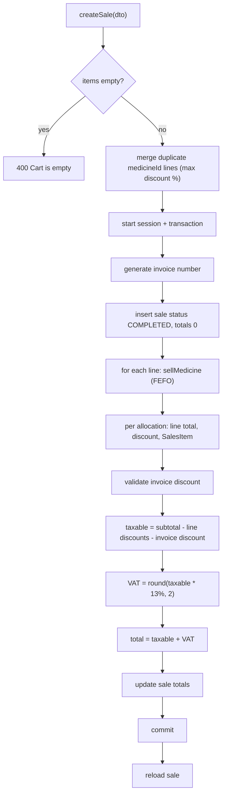

# Sales

## 1. Purpose

Create sales invoices, allocate stock FEFO, compute discounts and 13% VAT, record the cashier, and expose sales history.

## 2. Responsibilities

- Validate the cart and merge duplicate medicine lines.
- Generate sequential invoice numbers.
- Allocate and deduct batch stock.
- Create one sale item per batch allocation.
- Calculate subtotal, discounts, VAT, and total.
- Persist the sale transactionally.
- Support limited post-sale edits and sale deletion.

## 3. Structure

```text
modules/sales/
├── constants/counter.constants.ts
├── controller/
│   ├── sales.controller.ts
│   ├── salesItem.controller.ts
│   └── return.controller.ts
├── model/
│   ├── sales.model.ts
│   ├── salesItem.model.ts
│   ├── return.model.ts
│   └── counter.model.ts
├── repo/
│   ├── sales.repo.ts
│   ├── saleItem.repo.ts
│   ├── return.repo.ts
│   └── counter.repo.ts
├── routes/
│   ├── sales.routes.ts
│   ├── saleItem.routes.ts
│   └── return.routes.ts
├── schema/
│   ├── sales.schema.ts
│   └── return.schema.ts
├── services/
│   ├── sales.service.ts
│   ├── saleItem.service.ts
│   └── return.service.ts
└── types/return.type.ts
```

## 4. Routes

### Sales

| Method | Path | Purpose |
|---|---|---|
| POST | `/api/sales` | Create sale |
| GET | `/api/sales` | List |
| GET | `/api/sales/:id` | Detail + items |
| PATCH | `/api/sales/:id` | Edit customer/payment |
| DELETE | `/api/sales/:id` | Delete + restore batch and aggregate stock |

### Sale items

| Method | Path |
|---|---|
| GET | `/api/sale-items` |
| GET | `/api/sale-items/sales/:salesId` |
| GET | `/api/sale-items/:id` |
| PATCH | `/api/sale-items/:id` |

Full contracts: [endpoints.md](../api/endpoints.md#sales).

## 5. Controllers

### SalesController

- Requires `req.user.userId` as `cashierId`.
- Re-checks that `items` is a non-empty array.
- Returns `201` `{ success: true, data: sale }`.
- `updateSale` forwards only `customerName` and `paymentMethod`.
- `deleteSale` requires the JWT user for movement attribution.

### SaleItemController

- Read-only plus a price/discount correction.
- Rejects a PATCH where both fields are absent.
- Never creates or deletes items.

## 6. Service

### SalesService

`createSale` (`modules/sales/services/sales.service.ts`):



`updateSale` only permits `customerName` and `paymentMethod`.

`deleteSale`:

1. Starts a transaction.
2. Loads the sale and its items.
3. Rejects with `409` if the sale has `PENDING`, `APPROVED`, or `COMPLETED`
   returns (prevents orphaned return records).
4. For each item, computes `restorable = quantity - returnedQuantity`.
5. If `restorable > 0`, calls `increaseStock` with the original `batchId`; this restores the batch, syncs the aggregate, and writes one `RETURN` movement.
6. Deletes each sale item and the sale.

Fully returned items are deleted without a stock change. If a batch was deleted after it sold out, restoration fails with 404.

### SaleItemService

`getById`, `getBySalesId`, `getAll`, and `update({unitPrice, discount})`.

The update is an admin correction and runs in a transaction:

1. Rejects a line with `returnedQuantity > 0` (`409`).
2. Recomputes `totalPrice = unitPrice × quantity − discount`.
3. Derives the invoice-level discount as
   `sale.discount − sum(existing line discounts)` so it is preserved.
4. Recomputes the parent `subTotal`, `discount`, `VAT`, and `totalAmount`.
5. Rejects a discount larger than the line total or a negative taxable amount
   (`400`).

## 7. Models

- `Sales`: invoice, customer, totals, payment method, cashier, sale date, status.
- `SalesItem`: one row per batch allocation, with `returnedQuantity` and a
  `purchasePrice` cost snapshot for stable historical COGS.
- `Counter`: sequence storage.
- `Return`: see [Returns](returns.md).

See [Schema and relationships](../database/schema-and-relationships.md#6-sales-and-returns).

## 8. Validation

`createSaleSchema`:

- `customerName`: 1–100.
- `paymentMethod`: enum.
- `saleDate`: coerced date.
- `discount`: number ≥ 0.
- `items`: min 1.
- Per item: `medicineId` ObjectId, optional `batchId` ObjectId, `quantity`
  positive integer, `discountPercentage` 0–100.

`updateSaleSchema` is wired to `PATCH /sales/:id` and accepts only `customerName` / `paymentMethod`, with at least one field required. `updateSaleItemSchema` accepts `unitPrice` / `discount`, also with at least one field required. ObjectId params are validated for sale, sale-item, and return routes.

## 9. Middleware

`verifyToken` + `authorize(["owner","inventory_manager","pharmacist"])` at `/api/sales` and `/api/sale-items`.

## 10. Business rules

### Pricing

For each allocation (`qty` units from one batch at `unitPrice`):

```text
lineTotal    = unitPrice * qty
lineDiscount = lineTotal * discountPercentage / 100
SalesItem.discount   = lineDiscount
SalesItem.totalPrice = lineTotal - lineDiscount
```

Invoice level:

```text
subtotal       = sum(lineTotal)
lineDiscounts  = sum(lineDiscount)
taxable        = subtotal - lineDiscounts - invoiceDiscount
VAT            = round(taxable * 0.13, 2)
totalAmount    = taxable + VAT
Sales.discount = invoiceDiscount + lineDiscounts
```

- Client-supplied prices are ignored; batch `sellingPrice` is used.
- VAT is applied after all discounts.
- `SalesItem` totals are VAT-exclusive.
- Line totals, line discounts, and sale totals are rounded to two decimals.
- `invoiceDiscount` cannot exceed `subtotal - lineDiscounts`; a larger value
  returns `400` so taxable can never go negative.
- `batchId` is accepted for older clients but is not used; FEFO chooses batches.

### Stock

- FEFO allocation across batches.
- One `SalesItem` per batch.
- Aggregate inventory is recalculated after all allocations.
- Expired or flagged batches are excluded.

### Status

- Creation always sets `COMPLETED`.
- Returns change it to `PARTIALLY_RETURNED` or `RETURNED`.
- `PENDING` and `CANCELLED` are never set by any flow.

### Payment

`paymentMethod` is stored as a string. There is no payment record, gateway call, or paid/unpaid state.

## 11. Dependencies

- `InventoryService` (allocation/deduction)
- `MedicineBatchRepo` (injected but not used directly in `SalesService`)
- `CounterRepository`
- `SalesRepo`, `SaleItemRepo`
- `AppError`
- MongoDB connection for sessions
- Used by `ReturnService`, dashboard, smart reorder (`SaleItemRepo`)

## 12. Example

Request:

```json
{
  "customerName": "Walk-in Customer",
  "paymentMethod": "CASH",
  "saleDate": "2026-02-10T10:30:00.000Z",
  "discount": 25,
  "items": [
    { "medicineId": "665f...", "quantity": 3, "discountPercentage": 5 }
  ]
}
```

Assume three units at 100 each:

```text
lineTotal     = 300
lineDiscount  = 15
subtotal      = 300
taxable       = 300 - 15 - 25 = 260
VAT           = 33.8
totalAmount   = 293.8
Sales.discount= 40
```

## 13. Limitations and risks

| Issue | Status | Phase |
|---|---|---|
| Sale creation session leak | Already fixed (`createSale` ends the session in `finally`) | — |
| No payment ledger/gateway | Needs decision | Phase 6 |
| Historical COGS depends on the batch still existing | Fixed (cost snapshot on `SalesItem`; batch deletion blocked when referenced) | — |
| No customer entity | Needs decision | Phase 6 |
| No invoice PDF/print endpoint | Needs decision | Phase 6 |
| Delete restores aggregate but not batches | Fixed (restores `quantity - returnedQuantity` to the original batch) | — |
| Sale item correction does not recompute line or sale totals | Fixed (line + parent totals, transaction) | — |
| Invoice discount can exceed the post-line-discount subtotal; `discountPercentage` unbounded | Fixed (`400` beyond the discounted subtotal; 0–100 cap) | — |
| `batchId` required in request but ignored | Fixed (optional; FEFO chooses) | — |
| Sale deletion orphans return records | Fixed (`409` while active/completed returns exist) | — |
| No validation on update/delete | Already fixed (body and ObjectId param schemas) | — |
| No idempotency key | Needs decision | Phase 5 |
| No pagination/date filters | Still open | Phase 5 |
| No prescription linkage | Needs decision | Phase 6 |
| VAT rate is a code constant (`VAT_RATE = 0.13`) rather than configuration | Needs decision | Phase 6 |

## Related documents

- [VAT and pricing](../business-logic/vat-and-pricing.md)
- [FEFO/FIFO](../business-logic/fefo-fifo.md)
- [Returns](returns.md)
- [Stock movements](../business-logic/stock-movements.md)
