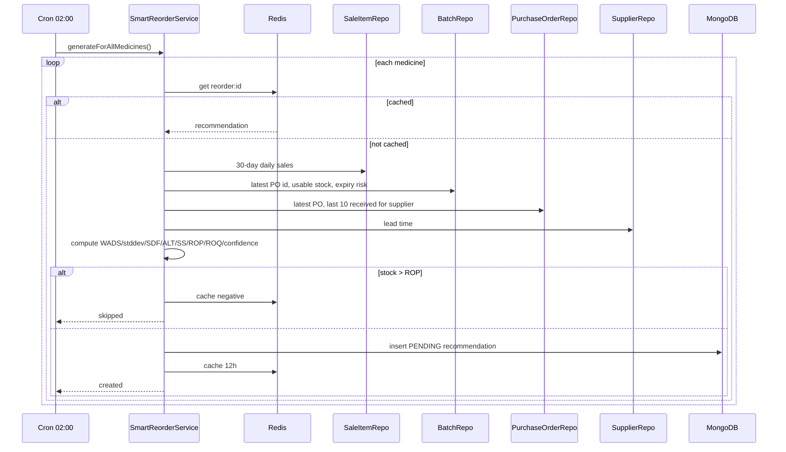

# Smart Reorder

## 1. Purpose

Generate purchase recommendations from recent demand, supplier lead time, safety stock, and expiry risk, instead of relying on a fixed reorder level.

## 2. Responsibilities

- Compute demand statistics from the last 30 days of sales.
- Derive supplier lead time from the most recent purchase history.
- Estimate safety stock, reorder point, and recommended order quantity.
- Compute a confidence score.
- Persist recommendations with `PENDING` status.
- Cache results in Redis.
- Allow approve/reject/delete and manual generation.

It does **not** create purchase orders automatically.

## 3. Structure

```text
modules/smartReorder/
├── controllers/smartReorder.controller.ts
├── model/smartReorder.model.ts
├── repo/smartReorder.repo.ts
├── routes/smartReorder.routes.ts
├── services/smartReorder.service.ts
└── utils/smartReorder.Calculatro.ts   # spelling is intentional (actual filename)
```

## 4. Routes

Base: `/api/smart-reorders`, roles: all three unless noted.

| Method | Path | Extra role check | Purpose |
|---|---|---|---|
| GET | `/` | — | List (only `PENDING` in practice) |
| GET | `/pending` | — | Pending list |
| GET | `/medicine/:medicineId` | — | Recommendations for a medicine |
| GET | `/:id` | — | Detail |
| PATCH | `/:id/approve` | — | Set `APPROVED` if pending |
| PATCH | `/:id/reject` | — | Set `REJECTED` if pending |
| POST | `/generate` | `owner`, `inventory_manager` | Generate for all medicines |
| POST | `/generate/:medicineId` | `owner`, `inventory_manager` | Generate for one medicine |
| DELETE | `/:id` | `owner` | Delete |

Full contracts: [endpoints.md](../api/endpoints.md#smart-reorders).

## 5. Controller

`SmartReorderController` returns `{ success, data }`. `generateAll` and the single-medicine generator read but ignore `threshold` and `targetStock` from the body.

`generateAll` responds `200` with a result list:

```json
[
  { "medicineId": "...", "status": "created" },
  { "medicineId": "...", "status": "skipped", "reason": "Medicine is not currently below reorder point ..." }
]
```

## 6. Service

`SmartReorderService.generateRecommendationForMedicine`:

1. Check Redis `reorder:{medicineId}` (12h TTL).
2. Load medicine.
3. Load 30-day daily sales.
4. Compute WADS and standard deviation.
5. Find the most recent batch's purchase order and its supplier.
6. Load the last 10 received orders for that supplier and compute average delay.
7. Compute supplier delay factor, adjusted lead time, safety stock, reorder point.
8. Compute usable stock and expiry-risk units with a cutoff of `now + adjustedLeadTime + 30 days`.
9. If `currentStock > reorderPoint`, cache a negative result and throw 400.
10. Compute ROQ and confidence score.
11. Persist a `PENDING` recommendation.
12. Cache it for 12 hours.

`generateForAllMedicines` iterates every medicine and records `created` or `skipped` with a `reason`. The result type also allows `error`, but the implementation converts every caught exception into `skipped`; `error` is never produced. Most skips are expected business outcomes (stock above ROP, no purchase history), not failures.

`approve`/`reject` only change status; they do not create a PO or reserve stock. `delete` removes the record.

## 7. Model

`SmartReorder`:

| Field | Meaning |
|---|---|
| `medicineId`, `supplierId` | References |
| `suggestedQuantity` | ROQ |
| `confidenceScore` | 0–100, one decimal |
| `recommendationReason` | Human-readable reason |
| `generatedAt` | Timestamp |
| `status` | `PENDING`, `APPROVED`, `REJECTED` |
| `WADS` | Weighted average daily sales |
| `demandStdDev` | Sample standard deviation of daily sales |
| `adjustedLeadTime` | Base lead time × delay factor |
| `safetyStock` | Computed safety stock |
| `reorderPoint` | Computed ROP |
| `currentStock` | Usable stock at generation time |
| `expiryRiskUnits` | Units expiring within the cutoff |

No timestamps and no indexes on `medicineId`/`status`.

## 8. Formulas

Source: `server/src/modules/smartReorder/utils/smartReorder.Calculatro.ts`

```text
n = 30 (days, index 0 = oldest, index 29 = today)
weightSum = n(n+1)/2
weight(i) = (i+1) / weightSum
WADS = Σ weight(i) * dailySales[i]

stdDev = sqrt( Σ (dailySales[i] - WADS)^2 / (n - 1) )      // sample stddev

SDF  = 1 + avgDelayDays / baseLeadTime
ALT  = baseLeadTime * SDF

Z95  = 1.645
SafetyStock = Z95 * stdDev * sqrt(ALT)
ROP         = WADS * ALT + SafetyStock

ROQ = max(0, ceil(
        WADS * (ALT + reviewPeriod)
        + SafetyStock
        - currentStock
        + expiryRiskUnits
      ))
reviewPeriod = 7 days

dataScore       = min(daysWithSales / 30, 1)
CV              = WADS > 0 ? stdDev / WADS : 1
demandScore     = 1 - min(CV, 1)
supplierScore   = supplierReliability / 100
confidence      = round(100 * (0.35*dataScore + 0.35*demandScore + 0.30*supplierScore), 1)

avgDelayDays = mean(receivedDate - expectedDeliveryDate) over last 10 received POs
supplierReliability = max(0, round(100 - (max(0, avgDelay) / baseLeadTime) * 100))
```

Notes:

- The newest day gets the largest weight (30/465).
- `expiryRiskUnits` is added to the order quantity, which increases ordering when stock is about to expire.
- `reviewPeriod`, Z-value, and confidence weights are hardcoded constants.
- `moq` is supported by `calculateROQ` but never supplied; there is no MOQ field on suppliers or medicines.

## 9. Cache behavior

| Key | TTL | Value |
|---|---|---|
| `reorder:{medicineId}` | 12 hours | Recommendation object or negative result |

- Cache is read before any database work.
- A negative result (`reorderNeeded: false`) is cached, but the first request then throws 400. Subsequent requests within the TTL return the cached negative object with a success status; the reorder-point check is not re-run.
- There is no invalidation when stock, sales, or suppliers change.
- `deleteCache` exists but is unused.

## 10. Validation

- `suggestedQuantity > 0` and `confidenceScore` 0–1 in the unused `createRecommendation` method.
- HTTP routes validate ObjectId params; generate actions accept no body.
- `threshold`/`targetStock` are ignored.
- Medicine existence is checked; supplier existence is checked.

## 11. Middleware

`verifyToken` + `authorize` at the mount, plus the extra role checks listed above.

## 12. Workflow



## 13. Example

Assume:

```text
WADS = 5 units/day
stdDev = 2
baseLeadTime = 3 days
avgDelay = 1 day
SDF = 1 + 1/3 = 1.333
ALT = 4
SafetyStock = 1.645 * 2 * sqrt(4) = 6.58
ROP = 5*4 + 6.58 = 26.58
currentStock = 20
expiryRiskUnits = 3
ROQ = ceil(5*(4+7) + 6.58 - 20 + 3) = ceil(44.58) = 45
```

A recommendation for 45 units is stored, with confidence derived from data coverage, demand variability, and supplier reliability.

## 14. Limitations and risks

| Issue | Status | Phase |
|---|---|---|
| Auto-create purchase orders | Needs decision | Phase 6 |
| MOQ / pack size | Needs decision | Phase 6 |
| Seasonality/trend modeling | Needs decision | Phase 6 |
| Cache invalidation | Still open | Phase 5 |
| Negative results returned as success on cache hits | Still open | Phase 5 |
| Missing `expectedDeliveryDate` handling (`NaN`) | Still open | Phase 5 |
| Duplicate recommendations per run | Still open | Phase 5 |
| Recommendation deduplication | Still open | Phase 5 |
| Approval audit (who/when) | Needs decision | Phase 6 |
| `expiryRiskUnits` includes already-expired stock | Still open | Phase 5 |
| Indexes on medicine/status | Still open | Phase 5 |
| `createRecommendation` manual path | Needs decision | Phase 6 |
| Manual confidence scale (0–1) differs from generated scale (0–100) | Still open | Phase 5 |
| `supplier.reliabilityScore` unused | Still open | Phase 5 |

## Related documents

- [Reporting](reporting.md)
- [Background jobs](../infrastructure/background-jobs.md)
- [Redis and caching](../infrastructure/redis-and-caching.md)
- [Purchases](purchases.md)
