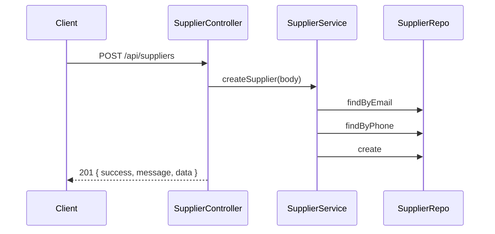

# Suppliers

## 1. Purpose

Maintain the supplier directory used when creating purchase orders and when calculating supplier lead time for reorder recommendations.

## 2. Responsibilities

- Supplier CRUD.
- Enforce email uniqueness and application-level phone uniqueness.
- Provide lead time and status to purchasing and smart reorder.

## 3. Structure

```text
modules/supplier/
├── controller/supplier.controller.ts
├── model/supplier.model.ts
├── repo/supplier.repo.ts
├── routes/supplier.route.ts
├── schema/supplier.schema.ts
└── service/supplier.service.ts
```

## 4. Routes

Base: `/api/suppliers`. Roles: all three. Full contracts: [endpoints.md](../api/endpoints.md#suppliers).

| Method | Path |
|---|---|
| GET | `/` |
| GET | `/:id` |
| POST | `/` |
| PUT | `/:id` |
| DELETE | `/:id` |

## 5. Controller

`SupplierController` returns `{ success: true, message, data }` for every operation. It forwards errors with `next(error)`.

## 6. Service

`SupplierService`:

- `createSupplier`: pre-checks email and phone, then creates.
- `getSupplierById`: validates ObjectId format (`400`), then `404` if absent.
- `updateSupplier`: validates ObjectId, existence, and changed email/phone uniqueness.
- `deleteSupplier`: validates ObjectId and existence, blocks deletion while `pending`/`approved` purchase orders exist, then hard deletes.

## 7. Model

`Supplier`:

| Field | Type | Rules |
|---|---|---|
| `companyName` | String | required |
| `contactPerson` | String | required |
| `email` | String | required, unique, lowercase |
| `phone` | String | required; uniqueness checked only in service |
| `address` | String | required |
| `leadTime` | Number | required; interpreted as days |
| `status` | String | `active` / `inActive`, default `active` |
| `reliabilityScore` | Number | default 0, 0–100; never written |
| timestamps | Date | yes |

## 8. Validation

| Schema | Fields |
|---|---|
| `createSupplierSchema` | companyName (2–100), contactPerson (2–100), email (normalized), phone (7–20 with pattern), address (5–250), leadTime (positive integer), status default `active` |
| `updateSupplierSchema` | same fields, all optional |
| `supplierIdParamSchema` | ObjectId route param |

`reliabilityScore` is not part of either schema, so it is dropped from requests even if supplied.

## 9. Middleware

`verifyToken` + `authorize` at the `/api/suppliers` mount, plus body and ObjectId-param validation.

## 10. Business rules

1. Supplier email is globally unique.
2. Supplier phone is treated as unique by the service, but concurrent requests can still create duplicates because there is no unique index.
3. `leadTime` is the base lead time used by the smart reorder formula.
4. `status` does not prevent selection in purchase order creation; the service only checks existence.
5. Deleting a supplier leaves purchase orders and smart reorder documents referencing a missing supplier.
6. `reliabilityScore` is unused; smart reorder computes a score from delivery delays.

## 11. Dependencies

- Used by `PurchaseOrderService` (validate supplier, list POs by supplier).
- Used by `SmartReorderService` (lead time and reliability input).
- Used by `DashboardService` (supplier counts).

## 12. Workflow



## 13. Limitations

| Issue | Status | Phase |
|---|---|---|
| Phone unique index | Still open | Phase 5 |
| Prevent delete with open POs | Already fixed (409 for pending/approved POs) | — |
| Supplier performance history endpoint | Needs decision | Phase 6 |
| `reliabilityScore` maintenance | Still open | Phase 5 |
| Pagination/filtering by status | Still open | Phase 5 |
| Contact/address validation beyond non-empty | Already fixed (trim, length, email, phone) | — |

## Related documents

- [Purchases](purchases.md)
- [Smart reorder](smart-reorder.md)
- [Schema and relationships](../database/schema-and-relationships.md)
